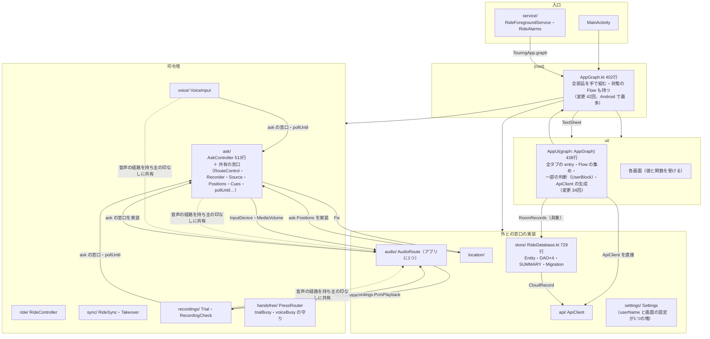
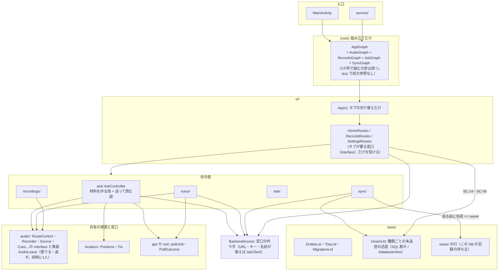
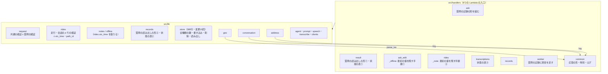
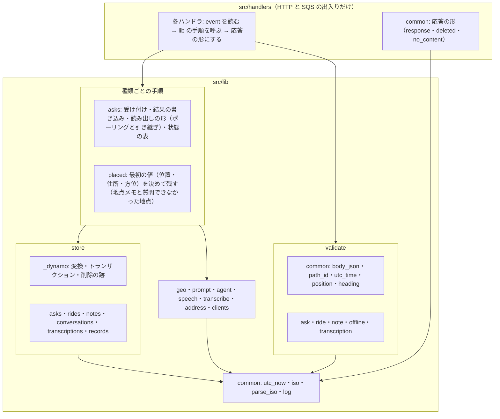
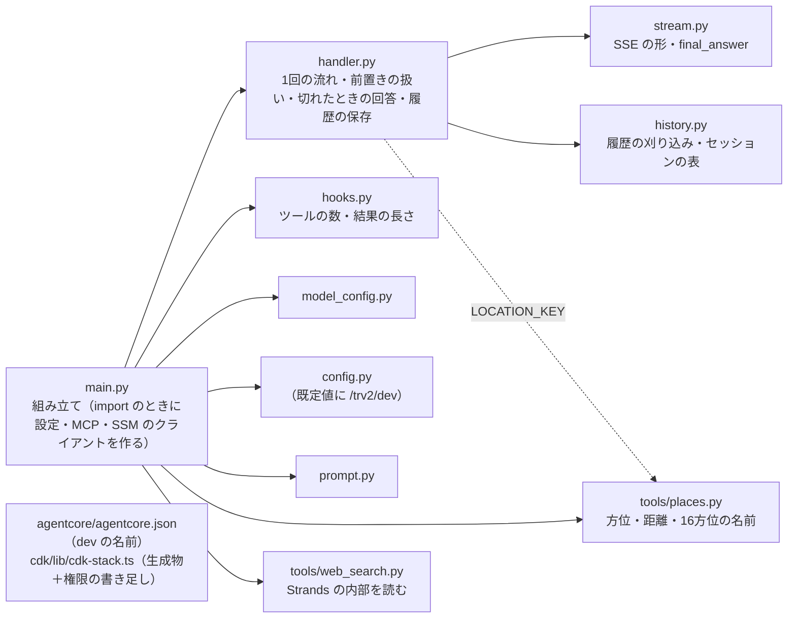
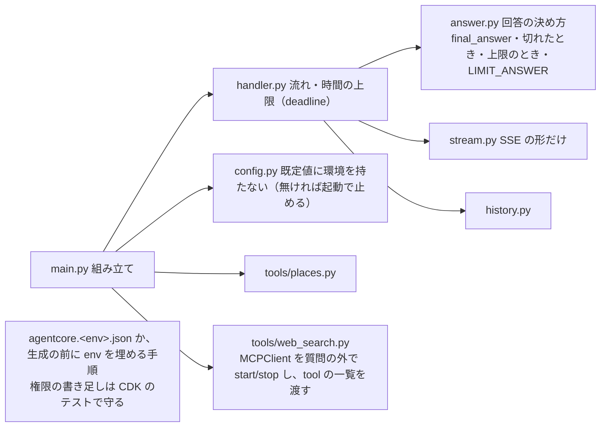
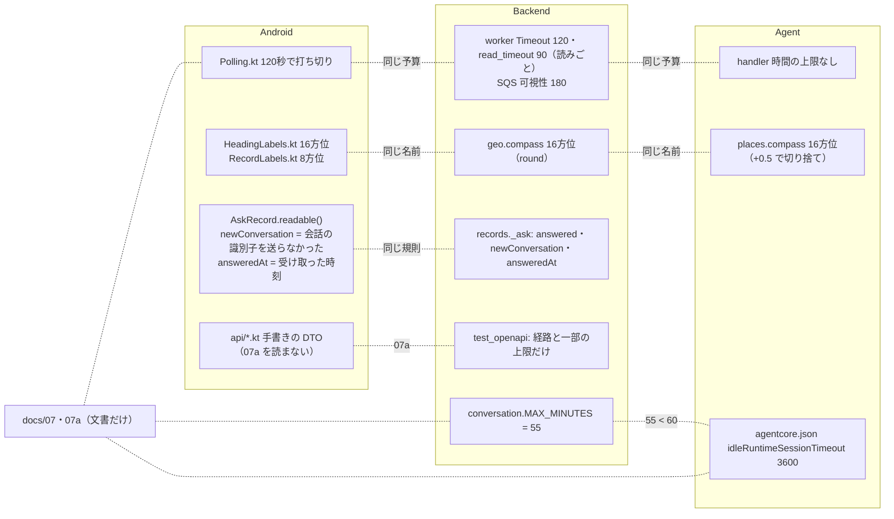
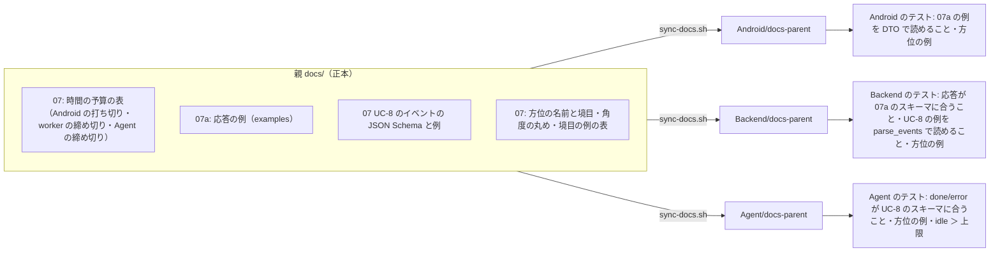

# 構成の指摘

全体の作りについての指摘（観点 S）と、構成に関わる文書の整合（D）・費用（E）の指摘です。件数は 32 件（Medium 12・Low 18・Info 2）。Critical・High はありません。
先頭に、ユニットごと（Android・Backend・Agent・ユニット間）の「いまの構成の図・良いところ・問題の根・あるべき構成の案」と、直す順と単位の提案を置き、そのあとに指摘を重大度の順に並べます。
Android の構成の指摘（R10-xx）は4つの問題の根に、Backend・Agent・ユニット間の指摘（R11-xx）は各ユニットの問題の根に結びつけてあります。ほかのレビューの観点 S の指摘は、ここの指摘に取り込みました（Android の `RideDatabase.kt`・未送信の述語・記録の持ち主・`store` の `api` への依存は R10-08・R10-02・R10-03・R10-09）。
個々の不具合（A）・脆弱性（B）は、ほかのファイルが扱います。

---

## 1. ユニットごとの構成

### 1.1 Android

#### いまの構成

#### 良いところ

- **判断の芯が純粋な関数に切れている**: `Flow.kt`（状態機械）・`Ride.kt`・`SyncPlan.kt`・`Merge.kt`・`Heading.kt`・`Records.kt`・`RecordLabels.kt` など、Android に依存しない関数に判断が集まり、JVM のテスト 713件で守られている。08a §1 の方針どおり。
- **窓口（interface）越しの依存の逆転**: `store` は `sync`・`ride`・`ask` の窓口（`SyncStore`・`RideStore`・`AskLog` など）を実装し、司令塔は Room を知らない（`ask`・`ride`・`sync` は `store` を import しない）。`AskDeps`・`RideDeps`・`TrialDeps`・`VoiceDeps` で外の部品を差し替えられ、司令塔ごとにテストできる。
- **状態を変える入口が1つ**: 走行の状態は `RideController` だけが変え、受け付けるかは `refusal(RideNow)` だけが決める（README「大事な決まり」）。送信は `RideSync` だけ、読み込みは `Takeover` だけ。
- **画面は値と関数を受ける**: `HomeScreen`・`DataScreen`・`UserScreen` などは `AppGraph` を知らず、画面ごとのテストができる。
- **組み立ての場所が1つ**: DI ライブラリなしで、`AppGraph` 1か所を読めば部品のつながりが全部わかる（小さなアプリには妥当）。

#### 問題の根（4つ）

1. **アプリに1つの音声の経路に、借り手を区別する仕組みが無い。** 質問・試し録り・声の入力が同じ `AudioRoute` を共有し、「片付くまで次を始めない」守りを利用者ごとに別々に足している（R10-01）。位置の監視（`PositionTracker`）を持つのは質問の司令塔だけで、共有ではない。この作りに関わる不具合として R1-01（Medium。根は `AskController.cancel()` が片付けを待たないことで、`AskController` の中で直せる）・R1-03（Low。利用者をまたぐ共有に根があるが、起きる条件が狭い）がある。
2. **同じ決まりの「正」が1か所に無い。** 「未送信」の述語（R10-02）、Backend の窓口の作り方（R10-07）、名前の変更を止める条件（R10-10）が、それぞれ複数の場所に別の形で書かれている。
3. **記録の持ち主（ユーザー名）が、画面の好みと同じ設定の塊にあり、丸ごと書き戻される**（R10-03）。記録（Room）と持ち主の食い違いを検知する手段が無い。
4. **組み立てと画面のつなぎが2つの大きな部品に集中する。** `AppGraph`（402行・変更42回）と `AppUi`（438行・変更34回）を、ほぼどの機能でも触る（R10-04）。加えて、共有の窓口が `ask` パッケージに置かれていることがパッケージの循環の主な原因（R10-05）。

新しい画面・記録の種類を足すときの手戻り（いまの形）:

- **画面を1つ足す**: `ui/` の画面のファイル、`AppUi` の `entryProvider` に entry（Flow の集めと `graph.*` のたどり）、`Tabs.kt` の Key、多くは `AppGraph` に部品か Flow。`AppUi` は `AppGraph` 全体を要するので、つなぎは `AppUiTest`（本物の `TouringApp`）でしか試せない。
- **記録の種類を1つ足す**（例: 写真のメモ）: Entity・DAO・Migration（`RideDatabase.kt`）、送信の問い合わせ、`SUMMARY` の副問い合わせ、`RideDao.rows` の `*Left`、`SaveSummary` の項目と `unsent`、`toRecord()` の `sent`、`SyncStore` の窓口と `RoomSyncStore`、`RideSync.send` の順と `sendX`、削除の種類の文字列（`RideDatabase.kt` 253・314・554行、`RideSync.kt` 229〜231行、`Merge.kt` 97〜99行、`api/Records.kt` 83〜86行）、`Merge.kt` の突き合わせ、`TakeoverDao`、`api/` の型と呼び出し、`RecordLabels`・`RecordsScreens`。15か所前後で、そのうち「未送信」と「削除の種類」は同じ決まりの写しなので、1か所を忘れても型やテストで気づけない（R10-02）。

#### あるべき構成の案

要点: (1) 音声の経路は「札」で借りる。(2) 同じ決まりは1か所（未送信の述語・窓口の作り手・名前の変更を止める条件）。(3) 持ち主は記録と同じ DB に置く。(4) `AppGraph` は1か所で組む方針を保ったまま、機能ごとの小さな組み立てに分け、`AppUi` はタブごとのつなぎに分ける。どれも採用した ADR（0005・0006・0013）の決定は変えない。08a §1 の「部品の組み立ては1か所」の書き方だけ、分けた形に合わせて直す。

### 1.2 Backend

#### いまの構成

経路のまとまりごとに Lambda を分け（`template.yaml` の8関数）、入力の検証と DynamoDB の読み書きを `lib` に置く。重い処理は SQS の先の worker だけが行う。

#### 良いところ

- 層は2つで浅く、ハンドラは短い（最長の worker でも153行）。`worker.Steps` で外の呼び出しを差し替えられ、テストが書きやすい。
- DynamoDB の書き込みの決まり（削除の跡とトランザクション・新旧の比べ方・衝突の再試行）が `store` の中に閉じていて、ハンドラから見えない。
- 07a の写しをテストが読み、経路・状態・上限の一部が実装と合うことを機械で確かめている（`tests/test_openapi.py`）。
- 環境の名前を `samconfig.toml` から渡し、既定値を持たせない（`tests/test_template.py`）。CICD で環境を足すときの土台がある。

#### 問題の根

1. **「記録の種類ごとの業務の手順」の置き場所が無い。** `lib` は「入力の検証」と「表への読み書き」だけで、質問の記録の形を組む・最初の値を残す・読み出す形を作る、という手順はハンドラに直接書かれている。そのため同じ手順が2〜3か所に散り、すでにずれた（R11-06・R11-07）。
2. **`lib` の中に共通の部品の置き場所が無い。** 時刻・ログ・パスの ID の検証が、最初に要ったところ（`handlers/common`・`lib/request`・`lib/rides`）に置かれ、`lib` から `handlers` への逆向きの依存が生まれた（R11-12）。
3. **`store` が全種類を1ファイルで持つ。** 種類を足す plan のたびに同じファイルを触る（変更15回で Backend の最多）（R11-13）。
4. **失敗と時間の予算を、仕組みとして持っていない。** worker の時間切れ・DLQ・5xx に気づく経路が無い（R11-01・R11-05）。

#### あるべき構成の案

依存は `handlers → lib の手順 → store・外の部品 → lib/common` の一方向にする。一度に作り替える必要は無い（直す順は 2 章）。

### 1.3 Agent

#### いまの構成

#### 良いところ

- `main`（組み立て）と `handler`（流れ）が分かれ、`Deps` で作り物のエージェントを渡してテストできる。
- 費用の上限（ツールの数・結果の長さ・周回・履歴）が hooks と config に分かれて読みやすく、値は Runtime の環境変数で変えられる。
- 位置はプロンプトでなく `invocation_state` で数値のままツールに渡り、AI に座標を写させない。

#### 問題の根

1. **環境（dev）が名前に焼き込まれている。** ディレクトリ名・Runtime 名・Gateway 名・SSM の名前・既定値・CDK のスタック名のどれもが1つの環境を前提にしている（R11-02）。
2. **時間の上限が無い。** 回数の上限はあるが時間の上限が無く、Backend・Android の時間の予算と噛み合わない（R11-01。症状は R5-02）。
3. **「何を回答にするか」の決まりが2つの部品に分かれている**（R11-14）。
4. **Web 検索の接続の使い回しが Strands の内部に頼る**（R11-15）。

#### あるべき構成の案

### 1.4 ユニット間

#### いまの構成（同じ規則・数値がどこにあるか）

#### 良いところ

- 06 の分担は素直で、「端末でしかできないこと」と「事実の確定」と「回答」がユニットに一対一で載っている。Agent を呼ぶのは Backend だけ、Android は Agent を知らない。
- 方位は Android、住所は Backend、周辺の方角・左右は Agent と、それぞれ1か所で決め、他のユニットは受けた値を「確定した事実」として使う（adr/0013・07 UC-8）。計算が二重に走って結果が食い違う作りにはなっていない。
- 文字起こし・住所の確定は Backend だけにあり、二重化していない。
- 07 の冒頭に「片方だけを変えるともう片方が壊れるものを置く」と役割が書かれ、契約の置き場が決まっている。

#### 問題の根

1. **ユニットをまたぐ数値と規則を、文書（07）では揃えているが、機械では揃えていない。** 07a は Backend が一部を確かめるだけで Android は読まない（R11-08）。UC-8（Backend ↔ Agent）と、55分＜60分のような数値の組は、どちらのテストも確かめない（R11-10）。方位の名前は3ユニットに別々の式で書かれている（R11-09）。
2. **時間の予算を、ユニットをまたぐ1つの設計として持っていない**（R11-01）。
3. **環境とユニット間の受け渡し（SSM・ARN）が手作業**で、CICD を足すときにまとめて表に出る（R11-02〜R11-05）。

#### あるべき構成の案

「写しを各ユニットのテストが読む」という、Backend の 07a ですでに効いているやり方を、Android と Agent と UC-8 に広げるのが最も安い。新しい仕組み（コード生成など）は要らない。

#### 費用（E）の見取り図

1問あたりの費用の内訳の目安。**単価は公開の料金表の記憶による目安で、確かめていません。** 数量は PROJECT.md のスライス1の判定の値と `Backend/template.yaml` によります。

| 項目 | 数量 | 目安 |
|---|---|---|
| LLM（Sonnet 4.6。入力の中央値3909トークン・出力150トークンほど） | 1問 | 約 1.5 円（0.015 米ドル）前後 |
| Transcribe のストリーミング（1回15秒が最小の課金） | 15秒以上 | LLM の4割ほど |
| Polly（neural。回答80字ほど） | 1回 | LLM の1割ほど |
| worker の Lambda（512MB × 10〜20秒） | 1回 | LLM の1%未満 |
| ポーリング（最初の10秒は1秒ごと・以後2秒ごと。中央値で12回ほど、打ち切りなら65回） | API Gateway・Lambda（256MB）・DynamoDB の結果整合の読み | 合わせて LLM の1%未満 |

ユニットをまたいで見える AWS の無駄（ポーリング・Lambda のメモリ・DynamoDB の読み方）は、LLM に比べて2桁小さく、詰めても効かない（R11-20）。効くのは LLM（Agent #8・R5-03・R5-05・R5-15）と、時間の予算が無いために「聞かれない回答」に LLM を使うこと（R11-01）と、CICD で smoke を回すたびの LLM（R11-17）。

---

## 2. 直す順と単位の提案

R10 と R11 の提案を1つの順にまとめます。R10-01 と R11-01 はどちらも Medium です（「すでに不具合が出ている」とはいえず、「あとで守りや上限を足すときの手戻り」が重い、という重さ）。そのため、どちらも「いちばん先」の理由にはせず、先頭には「振る舞いを変えず、あとの差分を小さくする」移すだけの作り替えを置きました。

| 順 | 単位（plan の大きさ） | 中身 | 振る舞い | 理由 |
|---|---|---|---|---|
| 1 | 移すだけ（Android の plan 1つ・Backend の plan 1つ。互いに独立）（小） | Android: R10-05（窓口を `audio`・`location` へ移して循環を消す）・R10-08（`RideDatabase.kt` を分ける）・R10-07（窓口の作り手）・R10-09（`store` から `api` を外す）・R10-11（残りの循環・前方参照）。Backend: R11-12 → R11-06 → R11-07 → R11-13 の順（R4-13 の C も一緒に） | 変えない（既存のテストがそのまま通ることが完了の判定） | あとの plan の差分が小さくなる。R10-05 は札の置き場所（`audio`）を決める。Backend は #28（`headingSample` を外す）の前にやると、#28 が1か所の直しで済む |
| 2a | Backend と Agent の plan 1つ（中） | R11-01（時間の予算。R5-02 と、R4-02 のうち時間切れの部分と、R12-01 のうち120秒の時間切れのあとの言い直しの経路を閉じる） | 変える（07 の約束が変わるので spec を通す。Agent の名前の付け方は変えない） | Agent と worker に上限を足す手戻りを避ける。メモリ切れ・実行環境の落ちは `claimedAt`（R4-02）、取り消しの経路はセッションごとの錠（R12-01）で別に閉じる |
| 2b | Android の plan 1つ（中） | R10-01 → R10-06（音声の経路を札で借りる。`AskController.cancel()` が片付けを待つ形にして R1-01 を閉じ、`AudioRoute` の待ちを本当に取り消せるようにして R1-03 を閉じる。そのあと `AskController` を2段に分ける） | 直す（R1-01・R1-03 の再現テストを先に書く） | 2a と独立で、どちらからでもよい。走行中の不具合（R1-01）に効くので 2b を先にしてもよい |
| 3 | Android の plan 1つ（中） | R10-03（持ち主の行・`update { }` の形。R2-01・R2-02 を一緒に直す）・R10-02（未送信の述語を1か所に）・R10-10（名前の変更を止める条件を1つの関数に） | 直す（スキーマの版を1つ上げる） | 2a・2b と独立 |
| 4 | CICD のスライスの最初の plan（中） | R11-02・R11-03・R11-04・R11-05・R11-17・R11-18・R11-19 | 変える（07 の約束を変える。Agent の名前の付け方を変えるなら ADR を伴う） | どれも「環境をもう1つ作る」「人の手を抜く」ための前提。CICD を作り始めてから見つけると、Agent の名前の付け替え（Runtime の作り直し）で手戻りが大きい。CICD は Android の作りに触れないので、Android の 1〜3 との前後の制約は無い |
| 5 | 親と各ユニットの plan 1つ（中） | R11-08・R11-09・R11-10・R11-11 | 契約を機械で確かめる形に揃える | 急がない。次に API か UC-8 を変える plan の前に入れると、その plan から効く。R11-10 の `deadlineSeconds` の検査は 2a のあとが自然 |
| 6 | Android の plan 1つ（中。新しい画面を足す前） | R10-04（`AppUi` をタブごとの Routes に、`AppGraph` を機能ごとの組み立てに） | 変えない | 新しい画面を足すスライスの直前でよい |
| 7 | ついで | R11-14・R11-15・R11-16・R10-12 | 変えない | 触るときに一緒に直せばよい |

1 と 5 のうち「ふるまいを変えない作り替え」は、spec を立てずに後回しの指摘（issue）として扱い、関わる plan の頭で片付ける形で足りる。2a と 4 は 07 の約束を変えるので、spec か ADR を伴う。

---

## 3. 指摘

## Medium

### R10-01 [S] [Medium] [確か] アプリに1つの音声の経路を、質問・試し録り・声の入力が持ち主の印なしに共有し、守りが利用者ごとにばらばらで、利用者を足すたびに守りを足し忘れやすい

- 場所: `Android/app/src/main/java/com/touringproject/v2/AppGraph.kt` の `controller`（242〜274行。`route = AudioRouteControl(audioRoute)`）・`trial`（280〜294行。`AudioRouteControl(audioRoute)`）・`voice`（305〜325行。同じ）・`router`（328〜342行）。`…/v2/handsfree/PressRouter.kt` の `press()`・`tap()`（24〜43行。`trialBusy`・`voiceBusy` の分岐）、`…/v2/recordings/Trial.kt` 63行（`busy`）、`…/v2/voice/VoiceInput.kt` 97行（`busy`）、`…/v2/ask/AskController.kt` の `record()`（309〜372行。`route.stop()` を5か所・`location.end()` を6か所で手で返す）。
- 内容: `AudioRoute` はアプリに1つ（`AppGraph.kt` 111行）だが、3つの利用者がそれぞれ `AudioRouteControl` を包んで直接張り・外す。「前の利用者が片付くまで次を始めない」決まりは、試し録り（`Trial.busy`）と声の入力（`VoiceInput.busy`）のぶんを `PressRouter` が個別に見て守り、質問どうし（取り消した質問の後始末と次の質問）には守りが無い。位置の監視（`PositionTracker`）を持つのは質問の司令塔（`AppGraph.kt` 260行）だけで、試し録りと声の入力は位置を持たない。したがって共有されるのは音声の経路で、位置の監視ではない。新しい利用者（例: 別の画面の声の入力）を足すたびに `PressRouter` に引数と分岐が増える。
  - すでに出ている不具合との関係: R1-01（取り消した質問の後始末が、すぐ始めた次の質問の経路と位置を壊す）の根は、利用者をまたぐ共有ではなく、`AskController.cancel()` が片付けを待たないこと。質問の司令塔の `AudioRouteControl` は1つ（`AppGraph.kt` 253行）で `source` をフィールドに持ち、古い run の `stop()` が `source = null` にするので、新しいインカムの run の最後の `stop()` が `releaseSco()` に流れる。これは `AskController` の中だけで直せる。利用者をまたぐ作りに根があるのは R1-03（声の入力の取り消しと `busy` の守りが合わない。Low）で、起きる条件が狭い。このため重大度は、「その作りのせいで不具合がすでに出ている」ではなく、「利用者を足すたびに守りを足し忘れやすい」の Medium とする。
- 起きる条件: 利用者の片付け（`route.stop()`）が非同期に遅れて走っているあいだに、別の利用者（または同じ質問の次の一巡）が経路を張るとき。詳しい再現は R1-01・R1-03。
- 影響: 走行中にインカムの経路が切れる・位置が付かない質問になる（R1-01）。押下の行き先の決まりを足すたびに同じ種類の不具合が入りやすい。
- 対応案: (1) 先に `AskController.cancel()` が片付けの完了を待ってから次を始められる形にする（R1-01 はこれで閉じる。位置の `end()` の遅れもここで同時に直る）。(2) `AudioRoute` に「借りる・返す」の札を持たせる（`suspend fun acquire(owner): Lease`。同時に1人、前の札が返るまで待つか断る。`Lease.release()` は自分の札のときだけ効く）。`AskController.record()` の経路の後始末は `lease.use { }` 1つにする。`PressRouter` の `trialBusy`・`voiceBusy` は「経路が借りられているか」1つにまとまる。(3) ただし、札を返すだけでは R1-03 は閉じない（取り消された準備は札を返したあとも `AudioRoute` の中で動き続ける）ので、`AudioRoute` 側の待ちを本当に取り消せるようにする。テスト: (a) 取り消した質問の `release` が遅れて走っても、次の質問の札が無効にならないこと（R1-01 の再現）、(b) 声の入力の取り消しの後、札が返るまで質問が始まらないこと（R1-03 の再現。取り消せる作り物で）、(c) 札を2重に取れないこと。効く範囲: 3つの利用者が同じ決まりで守られる。押下の行き先を足すときに守りを足し忘れない。直す費用: 中。
- 同じ根: R1-01・R1-03・R10-05・R10-06

### R11-01 [S] [Medium] [ありうる] 質問の時間の予算がユニットをまたいで設計されていない（Android 120秒・worker 120秒・Agent の読み 90秒ごと・Agent の呼び出しは上限なし）

- 場所:
  - Android: `Android/app/src/main/java/com/touringproject/v2/ask/Polling.kt` 14行（`POLL_TIMEOUT_MS = 120_000L`。POST が返ってから数える）
  - Backend: `Backend/template.yaml` 260行（worker の `Timeout: 120`）・302行（`VisibilityTimeout: 180`）・306行（`maxReceiveCount: 2`）、`Backend/src/lib/clients.py` 55行（`read_timeout=90` は1回の読みごとの上限で、全体の上限ではない）、`Backend/src/lib/transcribe.py` の `transcribe_pcm()`（53行。時間の上限なし）と、その呼び出し側の `Backend/src/handlers/worker.py` 85〜86行、同 53〜62行（受け持ちを取ってから処理。例外は `failed` にするが、Lambda の時間切れ・メモリ切れは捕まらず `processing` が残る）
  - Agent: `Agent/app/agentcore_trv2_dev_ask/handler.py` 80〜101行（`stream_async` に時間の上限なし）
  - 文書: `docs/07_units_contracts.md` UC-5（「打ち切りや取り消しの後も、Backend の処理は続いてよい」）・UC-8（時間の約束なし）
- 内容: 1つの質問にかけてよい時間が、Android（120秒）・worker（120秒。ただし SQS で待った時間と文字起こしの時間を含み、Android の120秒とは起点が違う）・Agent への読み（90秒ごと。全体の上限ではない）・Agent（上限なし）で別々に決まっていて、どれも他を知らない。07 は「続いてよい」とだけ書き、どこで誰が打ち切るかを約束していない。このせいで、次の3つがすでに別々の指摘として出ている。個々に直すと、それぞれが別の秒数を選び、また噛み合わなくなる。
  - R4-02: worker の Lambda が時間切れ・メモリ切れで落ちると記録が `processing` のまま残り、DLQ にも移らない。`processing` が残るのは worker が落ちたときで、Android があきらめたこととは独立に起きる。
  - R5-02: Agent が打ち切られずに動き続け、聞かれなかった回答で LLM を使い、履歴に残す。Android があきらめたあとも Agent が動き続けるかは、切断が Runtime に伝わるかをコードで追えないので、ありうる、にとどまる。
  - R12-01: Agent #6 を閉じた前提が崩れ、同じ会話への呼び出しが重なる。
- 起きる条件: Web 検索や Bedrock が遅いとき、Transcribe が遅いとき、SQS で待つ時間が延びたとき。
- 影響: 利用者は「時間切れ」を聞くのに、LLM の費用は1問ぶんかかりうる。言い直すと、聞いていない回答を前提に「さっきの」が解釈されうる。不具合がすでに起きた記録は無く、Android は `processing` を時間切れの失敗として取り込むので、利用者に見える害は小さい。重さは、Agent・worker に上限を足すときの手戻り（Medium）。利用者が1人のうちは頻度は低いが、遅延は外のサービスしだいで普通に起きる。
- 対応案: 07 に「時間の予算」の表を1つ置き、締め切りを上流から下流へ渡す。
  1. Backend が受け付けで `deadline = receivedAt + 110秒`（Android の120秒より少し前）を決め、質問の記録に残す。
  2. worker は `deadline` と `context.get_remaining_time_in_millis()` の早いほうを予算とし、文字起こしと Agent の呼び出しを残りの時間で包む。`transcribe_pcm` は同期の入口（`asyncio.run(_transcribe(audio))`）なので、`asyncio.wait_for` を掛ける場所は中の非同期の処理（`_transcribe` の `asyncio.gather` の外側）とする。予算が尽きたら `failed`（`agent_failed` か新しい `timeout`）で終える。受け持ちには時刻（`claimedAt`）を残し、送り直しで古い `processing` を `failed` にする（R4-02 の対応案の (2)）。
  3. Backend は Agent への本文に `deadlineSeconds`（残りの秒数）を足す。Agent は `asyncio.timeout(deadlineSeconds - 余裕)` で `stream_async` を包み、時間切れでは履歴を残さずに `error`（`agent_failed`・`timeout`）を返す（R5-02 の対応案と同じ形。秒数を Agent の設定でなく呼び出しから受けるところだけが違う）。
  4. 07 UC-5 の「続いてよい」を「Backend と Agent は、受け付けから決めた締め切りで打ち切る」に変え、UC-8 に `deadlineSeconds` を足す。UC-5 の「Android があきらめても処理は続いてよい」は文書で決めた振る舞いなので、変えるなら spec か ADR を通す。
  - 確かめるテスト: Backend は、`Steps` の Agent の呼び出しが締め切りを過ぎる作り物で `failed` になり、Agent に渡る `deadlineSeconds` が残りの時間から計算されること。Agent は、`stream_async` が眠る作り物で、`deadlineSeconds` を小さくすると `error` が返り `sessions.get` が変わらないこと。
  - 効く範囲: 時間の予算の設計で閉じるのは、R5-02 と、R4-02 のうち時間切れの部分と、R12-01 のうち120秒の時間切れのあとの言い直しの経路だけ。R4-02 のメモリ切れ・実行環境の落ちは `claimedAt` の仕組みで、R12-01 の取り消しの経路はセッションごとの錠で閉じる（「3つが1つの決まりで閉じる」わけではない）。Android の打ち切りの秒数を変えるときに、変える場所が 07 の表から辿れる。直す費用: 中（07 の表・Backend の worker と agent・Agent の handler。テストは両方に数本）。
- 関わる文書: `docs/07_units_contracts.md` UC-5・UC-8
- 同じ根: R4-02（時間切れの部分）・R5-02・R12-01（120秒の時間切れのあとの言い直しの経路）

### R10-02 [S] [Medium] [確か] 「未送信」の述語が、SQL と Kotlin の9か所に別々に書かれ、定義も2通りある

- 場所: `Android/app/src/main/java/com/touringproject/v2/store/RideDatabase.kt` の `AskDao.unsentMemos`（213〜218行）・`AskDao.unsentUnreached`（229〜233行）・`NoteDao.unsent`（319〜323行）・`SUMMARY`（363〜372行。副問い合わせ4つ）・`RideDao.rows` の `pointsLeft`・`memosLeft`・`notesLeft`・`unreachedLeft`（387〜398行）・`RideDao.unsentRides`（446〜451行）。`…/v2/sync/SyncPlan.kt` の `metaToSend`（45〜46行）。`…/v2/store/RoomRecords.kt` の `AskEntity.toRecord()` の `sent`（33行）・`NoteEntity.toRecord()` の `sent`（36行）。`…/v2/records/Records.kt` の `saveState()`（21〜25行）。
- 内容: 「送るもの」（送信の回の問い合わせ・`metaToSend`）、「数えるもの」（SC-14・SC-18 の `SUMMARY`。名前の変更を止める判定 `RoomTakeover.kt` 31行もこれを使う）、「一覧の印」（SC-05 の `rows` の `*Left` と `saveState`。断られた版も未送信に含める）、「行の印」（`toRecord()` の `sent`。版を見ない）が、同じ列の比較（`sentUpdatedAt < updatedAt`・`rejectedUpdatedAt != updatedAt`）を別々に書いている。一覧の印が断られた版を含むのはコメント（`Records.kt` 16〜19行）で意図と分かるが、どこまでが意図した違いかを1か所で読めない。08a §6 は「未送信は…データの保存（SC-14）の内訳と同じ数を使う」と約束しているが、それを保つ仕組み（同じ定義を使う・同じ集合を返すテスト）が無い。
- 起きる条件: 送る条件（例: 新しい列・新しい状態）を変えるとき、記録の種類を足すときに、どれか1か所を直し忘れる。
- 影響: 送らないのに未送信と数える → SC-18 で名前を変えられなくなる（行き止まり）。数えないのに送る → SC-14 が「保存済み」と出しているのに送り残しがある。いまは食い違いは見つからなかったが、CICD 以降に記録の種類や送信の決まりを足すと踏みやすい。
- 対応案: `store/Unsent.kt` に種類ごとの述語を SQL の定数（`const val NOTE_UNSENT = "(sentUpdatedAt IS NULL OR …) AND (rejectedUpdatedAt IS NULL OR …)"`）で置き、送信の問い合わせと `SUMMARY` が文字列連結で同じ定数を使う（種類ごとの述語を Room の `@DatabaseView` に置く案でもよい）。一覧の印（断られた版を含む）は別の名前の定数（`NOTE_NOT_TAKEN` など）にして、違いを名前で表す。`metaToSend` と `toRecord().sent` は、同じ意味の Kotlin の関数を1つにする。テスト: Room（Robolectric）で、断られた版・送り済み・未送信・記録中の走行を混ぜた DB に対して、`unsentX()` の件数の和と `summaryNow().unsent` が等しいこと。効く範囲: 記録の種類を足すとき・送る条件を変えるときに1か所で済み、「送る＝数える」をテストで固定できる。直す費用: 小〜中。
- 関わる文書: `docs/08a_android-design.md` §6

### R10-03 [S] [Medium] [確か] 記録の持ち主（ユーザー名）が、記録と別の保存先の「画面の設定の塊」にあり、画面が古い写しを丸ごと書き戻す

- 場所: `Android/app/src/main/java/com/touringproject/v2/settings/Settings.kt` の `Settings`（50〜67行。`userName` と画面の設定が1つ）、`…/v2/settings/SettingsRepository.kt` の `update(next)`（57〜60行）・`save(next)`（66〜69行）、`…/v2/ui/AppUi.kt` 206・267・269・278・280・313・316・373行（`graph.settings.update(current.copy(…))` の形）、`…/v2/AppGraph.kt` の `saveUserName()`（379〜381行）・`sync` の `api`（146〜150行。送るたびに `settings.settings.value?.userName` を読む）、`…/v2/sync/Takeover.kt` 110・125行。
- 内容: Room の記録がどのユーザー名のものかを Room は知らず、送信は送る瞬間の設定の名前を使う。名前は、画面の写し（`current`）から作った `Settings` 全体の置き換えで書かれる値の1つなので、(1) 設定を読めなかった起動の既定値（R2-01）、(2) 戻す保存の失敗（R2-02）、(3) 名前の保存・戻しと、ほかの設定の画面からの古い写しの書き戻しが前後したとき、のどれでも「記録と名前の食い違い」が起き、それを検知する比較がどこにも無い。(3) は SC-11 の「＋」の連打のような同じフレームの2回の書き込みでも起きる（2回目が1回目を消す）。
- 起きる条件: 上の (1)〜(3)。(1)(2) は R2-01・R2-02 として別に挙がっている。(3) は条件が揃えば起きるが、実機での発生頻度は確かめていない。
- 影響: 端末の記録が別のユーザー名で Backend に送られる（他人の名前に自分の記録が入る・自分の記録が失われたように見える）。設定の変更が黙って消える。
- 対応案: Room に「この DB の記録の持ち主」を1行持つ表を足し（スキーマの版を1つ上げる）、名前の変更（`RoomTakeover`）はその行の書き換えと記録の入れ替えを同じトランザクションにする。送信の回は「設定の名前 == DB の持ち主」のときだけ走る（違えば SC-14・SC-18 に出す）。`SettingsRepository.update(transform: (Settings) -> Settings)` にして最新の値から作り直し、`userName` は `update` では変えられない（`save` だけ）形にする。テスト: (a) 持ち主と設定の名前が違うと送信の回が API を呼ばないこと、(b) `update { it.copy(answerVolumeDb = …) }` を名前の保存の後に古い写しなしで呼んでも名前が戻らないこと、(c) 同じ値から2回 `update` しても両方が残ること。効く範囲: 名前と記録の食い違いが、どの経路で起きても1つの比較で止まる。設定の取り違えが消える。直す費用: 中（Migration・`RoomTakeover` の書き換え・設定の更新の呼び方の変更）。
- 同じ根: R2-01・R2-02

### R10-04 [S] [Medium] [確か] すべての画面のつなぎが `AppUi(graph: AppGraph)` の1つの関数にあり、組み立ての `AppGraph` と合わせて、どの機能でも2つの大きな部品を触る

- 場所: `Android/app/src/main/java/com/touringproject/v2/ui/AppUi.kt` の `AppUi()`（97〜438行。`graph.` のたどりが約80か所）、`…/v2/AppGraph.kt`（402行。部品の組み立てに加えて `textSheet`・`flowState`・`trialFlow`・`voiceFlow`・`recordsList`・`saveSummary`・`activeAskCount` など画面のための状態も持つ）。前方参照: `AppGraph.kt` 125〜126行（`askLog` が後で作る `sync` を読む）・165〜166行（`RoomTakeover` が後で作る `rides` を読む）。テストのための `var headingCheck`（207行）。変更回数は `AppGraph.kt` 42回・`AppUi.kt` 34回で Android の1位・2位。
- 内容: 画面の部品は値と関数を受ける形で切れているが、「どの entry が何を集め、どの部品を呼ぶか」は `AppGraph` 全体を受ける1つの関数にある。つなぎを試すには本物の `TouringApp` を起動するしかなく（`Android/app/src/test/java/com/touringproject/v2/ui/AppUiTest.kt` 43・73・120行。`AppGraph` を作り物で作るテストは無い）、そのために本番の `headingCheck` が `var` になっている。画面をまたぐ決まり（「質問が始まったら、どの画面のシート・ダイアログも閉じる」R3-02）の置き場所も無い。組み立ての前方参照はコメントで「後で読む」と断っているだけで、呼ばれる時期がずれると初期化前の参照になる（いまは `unreachedKept` は質問の一巡が終わったとき、`waitingToSave` は読み込みのときに読まれ、どちらも `AppGraph` の初期化の後なので、起きないと読める）。
- 起きる条件: 画面・状態を足す改修のたび。
- 影響: 改修のたびに2つの大きなファイルの差分が混ざり、レビューと競合の手間が増える。画面をまたぐ決まりが画面ごとに漏れる（R3-01・R3-02 の種類）。
- 対応案: (1) `AppUi` はタブの切り替えと帯だけにし、`HomeRoutes`・`RecordsRoutes`（既にある）・`SettingsRoutes` に entry を移す。各 Routes は `AppGraph` ではなく、そのタブが要る窓口だけをまとめた interface（例: `HomeDeps`）を受ける。`AppGraph` がそれを実装する。(2) `AppGraph` は1か所で組む方針（08a §1）を保ったまま、`AudioGraph`・`RecordsGraph`（DB・送信・読み込み）・`AskGraph` などの小さな組み立てに分け、依存の順に並べるか `by lazy` にして前方参照のラムダとコメントを消す。(3) 画面のための状態（`textSheet` など）は、それを使う Routes の側のホルダーに移す。テスト: タブごとの Routes を作り物の `HomeDeps` で Robolectric で描き、つなぎ（押したら窓口が呼ばれる・質問が始まったらシートが閉じる）を確かめる。08a §1 の組み立ての一文を、分けた形に合わせて直す。効く範囲: 画面を足すときに `AppUi` と `AppGraph` の全体を開かずに済み、つなぎを作り物の窓口で試せる。`headingCheck` の `var` が要らなくなる。直す費用: 中。
- 関わる文書: `docs/08a_android-design.md` §1
- 同じ根: R3-01・R3-02

### R11-02 [S] [Medium] [確か] Agent の環境（dev）が、コードのディレクトリ名・`agentcore.json`・既定値・CDK のスタック名に焼き込まれ、2つ目の環境を足せない

- 場所:
  - `Agent/app/agentcore_trv2_dev_ask/`（ディレクトリ名）と `pyproject.toml` の `name = "agentcore_trv2_dev_ask"`
  - `Agent/agentcore/agentcore.json` 12行（Runtime 名 `agentcore_trv2_dev_ask`）・22行（`MODEL_ID_PARAMETER` = `/trv2/dev/agent-model-id`）・61行（Gateway 名 `gwTrv2DevMain`）
  - `Agent/app/agentcore_trv2_dev_ask/config.py` 26行（既定値 `/trv2/dev/agent-model-id`）
  - `Agent/agentcore/aws-targets-sample.json`（目標の名前 `default`）→ スタック名は `AgentCore-trv2Agent-default`（`agentcore/cdk/bin/cdk.ts` 20行の `toStackName`）
  - `Agent/agentcore/cdk/lib/cdk-stack.ts` 128〜145行（CLI の生成物に、プロジェクトの権限を手で書き足している。生成し直すと消える）
- 内容: AgentCore の CLI は、目標（`aws-targets.json`）ごとにスタックを分けるが、Runtime・Gateway の名前と環境変数は `agentcore.json` に1組しか持てない。いまの名前は dev を含むので、prod の目標を足すと、同じアカウント（PROJECT.md「前提」: ほかのプロジェクトと同じアカウント）に同じ名前の Runtime を作ろうとしてぶつかるか、prod が dev の SSM を読む（同じ名前の Runtime がぶつかるかは AWS で確かめていない）。Backend は #7 で「環境ごとの名前を既定値に持たせない」と決めて `samconfig.toml` で渡す形にしたが（`Backend/tests/test_template.py`）、Agent には同じ決まりが無い。`config.py` の既定値は、環境変数を付け忘れた環境が黙って dev のモデルを読む作り（Backend #7 で避けたもの）。加えて、権限の書き足しが生成物の中にあり、CLI の版を上げて生成し直すと消える（R5-07 のテストの抜けと同じ根）。
- 起きる条件: prod（や検証用の環境）を足すとき。CICD で Agent のデプロイを自動にするとき。CLI の版を上げて `cdk/` を生成し直すとき。
- 影響: 環境を足す作業で、ディレクトリ名の変更（Runtime の作り直しと ARN の変更・Backend のデプロイし直し）が要る。気づかずに進めると、prod が dev のモデル ID を読む、dev の Runtime を上書きする、のどちらかが起きる。
- 対応案:
  1. ディレクトリ名と Python のパッケージ名から環境を外す（例: `app/ask/`）。Runtime 名は UC-1 の規約どおり環境を含めてよいが、`agentcore.json` を環境ごとに持つ（`agentcore/envs/<env>.json` を CICD がデプロイの前に `agentcore.json` に写す）か、CLI が環境ごとの上書きを持つならそれを使う。
  2. `config.py` の `MODEL_ID_PARAMETER` の既定値を消し、無ければ起動で止める（Backend #7 と同じ決まり）。テストは「環境変数が無ければ `load_settings` が例外」。
  3. 権限の書き足しは `cdk-stack.ts` に残したまま、CDK のテストで「Runtime の役割に `geo-places:SearchNearby`・`SearchText` と、その環境の SSM の名前だけの `ssm:GetParameter` がある」を確かめる（R5-07 の対応案と同じ。R5-10 の絞り込みもここで `/trv2/<env>/agent-model-id` に）。
  4. 名前の付け方を変えるので、07 UC-1 の Agent の例を直し、決定として ADR を1つ書く（Runtime の作り直しを伴うため）。
  - 効く範囲: CICD のスライスで、環境を足す作業が「設定のファイルを1つ足す」で済む。直す費用: 中（名前の付け替えは Runtime の作り直しになる。dev の会話の文脈が1回消えるだけで、記録には触れない）。
- 関わる文書: `docs/07_units_contracts.md` UC-1
- 同じ根: R5-07・R5-10

### R11-03 [S] [Medium] [確か] ユニットをまたぐ設定値（SSM 3つ）と Agent の ARN の受け渡しを手で作っていて、IaC にも「新しい環境を作る手順」にも無い

- 場所:
  - `Agent/README.md` 40行（ARN を東京の `/trv2/dev/agent-runtime-arn` に手で書く）・50行（モデル ID は上書きの手順だけ）
  - `Backend/README.md` 45行（前提として ARN がある）・66行（会話を区切る分数は上書きの手順だけ）
  - `Backend/template.yaml` 13〜14行（ARN を `AWS::SSM::Parameter::Value<String>` でデプロイのときに読む）
  - `docs/07_units_contracts.md` UC-3（書く側を「Agent のデプロイ」とするが、Agent のデプロイの仕組み（CDK）は書かない）
- 内容: `/trv2/<env>/agent-model-id`（us-east-1）・`/trv2/<env>/conversation-reset-minutes`（東京）・`/trv2/<env>/agent-runtime-arn`（東京）の3つは、どれも IaC が作らず、最初に作る手順もどこにも無い（README にあるのは `--overwrite` の上書きだけ）。新しい環境では、モデル ID が無いとすべての質問が `agent_failed` になり（`model_config.py` 31〜36行）、区切る分数が無いと黙って既定の15分になり、1分ごとにログが出る（`conversation.py` 33〜35行）。ARN はデプロイのときに読むので、Agent を作り直すたびに人が SSM に書き、Backend をデプロイし直す必要がある（UC-3）。
- 起きる条件: 環境を足すとき。CICD で Agent → Backend の順のデプロイを自動にするとき。
- 影響: 自動のデプロイが「人がこの順で SSM を書いた」ことに頼る。抜けると、デプロイは通るのに質問がすべて失敗する（smoke まで気づかない）。
- 対応案:
  1. 管理者が変える値（モデル ID・区切る分数）は、作るのを環境の準備の手順（CICD の `bootstrap` の手順か、各 README の「新しい環境」節）に書き、IaC では作らない（IaC が作ると、管理者が変えた値をデプロイが戻すおそれがあるため）。どちらにするかを 07 UC-2・UC-5 に1行書く。
  2. ARN は Agent のデプロイの産物なので、Agent の CDK に東京の SSM へ書く部品を足す（`cdk-stack.ts` で、地域をまたぐ `AwsCustomResource` の `ssm:PutParameter`）か、CICD がデプロイの出力から書く。どちらでも UC-3 の「書く側」が仕組みになる。
  3. smoke の最初に「3つの SSM があること」を確かめる行を足す。
  - 効く範囲: 環境を足すときの手順が、README の1節とデプロイの仕組みで閉じる。直す費用: 小（手順の追記と、CDK に部品1つか CICD の1手順）。
- 関わる文書: `docs/07_units_contracts.md` UC-2・UC-3・UC-5

### R11-04 [S] [Medium] [確か] smoke がそのまま CICD で回せない（環境の固定・デプロイ直後の403・残る跡）

- 場所: `Backend/scripts/smoke.py` 22〜24行（`REGION`・`STACK = "stack-trv2-dev-backend"`・`USER = "smoketest"` が固定）・`wait()`（55〜64行）、`Backend/README.md` 56行（直後は 403 になることがあり「1分ほど待って回し直す」）、`Agent/scripts/smoke.py` 46行（ARN を引数で受ける）
- 内容: Backend の smoke はスタック名に dev を持ち、環境を引数で選べない。デプロイの直後に新しい経路が 403 になることを、人が見て待つ前提にしている。回すたびに `smoketest` のパーティションに削除の跡が溜まる（R4-15 は費用の面）。prod でも同じ smoke を回すと、prod の表に `smoketest` の跡が残り続ける。Agent の smoke は引数で ARN を受けるので回せるが、ARN の引き方（`list-agent-runtimes` の名前）は README の手順にだけある。
- 起きる条件: CICD のパイプラインに smoke を入れるとき。
- 影響: パイプラインがデプロイ直後の 403 で偶に落ちる。prod の表に試験の記録が溜まる。
- 対応案: `--env`（と `--stack`）を引数にし、既定値を持たせない。新しい経路の 403 は、`/health` が通るまでと、最初の認証つきの呼び出しが 403 でなくなるまでを、上限つきで待つ。smoke のユーザー名を環境ごとに決め（例: `smoke<env>`）、最後に跡を消す手段が要るなら Backend に試験用の掃除の経路を作らず、smoke の後に `aws dynamodb` で `USER#smoke...` を消す手順を CICD に置く。テストは不要（smoke 自身が確かめる）。効く範囲: CICD の「デプロイ → smoke」の段がそのまま作れる。直す費用: 小。
- 同じ根: R4-15・R11-17

### R11-05 [S] [Medium] [確か] 失敗に気づく仕組み（DLQ・worker の失敗・5xx の通知）が無い

- 場所: `Backend/template.yaml` 297〜312行（`AskQueue`・`AskDeadLetterQueue`。アラームも読む仕組みも無い）、Agent の CDK（`Agent/agentcore/cdk/lib/cdk-stack.ts`。アラーム無し）
- 内容: DLQ に移ったメッセージ・worker の `ask_crashed`・API の 5xx・Agent の `invoke_failed` に、誰も気づけない。R4-02 のとおり、受け持ちの後の失敗は DLQ にも残らない。いまは利用者が実機で気づくが、CICD で自動のデプロイにすると、壊れたデプロイに気づく手段が smoke の一度だけになる。
- 起きる条件: デプロイの後や外のサービスの障害で、質問が失敗し続けるとき。
- 影響: 走行中に AI が答えなくなっても、管理者は走り終えるまで気づかない（走行中の利用者は「AI が答えられませんでした」を聞くだけ）。
- 対応案: Backend の `template.yaml` に、DLQ の `ApproximateNumberOfMessagesVisible > 0`・worker の `Errors > 0`・API の `5XXError > 0`・worker のログの `"status": "failed"` の数（メトリクスフィルター）のアラームを足し、SNS でメールに送る（費用はアラーム1つ月 0.1 米ドルほど）。Agent はログの `invoke_failed` のメトリクスフィルターに1つ。テストは `tests/test_template.py` に「アラームが DLQ と worker を見ている」を足す。効く範囲: CICD の自動デプロイの安全網。R11-01 の `timeout` の失敗も数えられる。直す費用: 小。
- 同じ根: R4-02

### R11-06 [S] [Medium] [確か] 「最初に受けた値（位置・住所・方位）を残す」手順が地点メモと質問できなかった地点で別々に書かれ、すでにずれている

- 場所: `Backend/src/handlers/rides.py` の `_note()`（55〜85行）、`Backend/src/handlers/ask_edit.py` の `_offline()`（42〜82行）
- 内容: どちらも「跡の先回りの確かめ → 保存済みを読む → 新しければ住所と方位を保存済みから残し、無ければ求める → 条件付きで書く → 書かなかったら読み直す」という同じ手順で、07 UC-7 も「地点メモと同じく」と1つの決まりとして書いている。しかしコードは2つあり、すでに (1) 保存済みの読み方（`_offline` は一貫した読み出し、`_note` は結果整合。`rides.py` 61行・`ask_edit.py` 47行。症状は R4-05）、(2) 位置を最初の値に固定するか（`_offline` だけ。`ask_edit.py` 60行、Backend #21 の直し（`b9aa3a3`）が片方にだけ入った）でずれた。次に Backend #28（`headingSample` を外す。#28 に関わる）で方位の決め方を変えるときも、2か所を直す。
- 起きる条件: 地点メモか質問できなかった地点の決まりを変えるとき。
- 影響: 片方だけ直る不具合が、また入る。
- 対応案: `lib/placed.py`（名前は任意）に `settle_first(stored, incoming, at) -> dict`（位置・住所・方位を保存済みと新しい版から決める）と、「読む → 決める → 条件付きで書く → 書かなければ一貫して読み直す」の手順を置き、`_note` と `_offline` はそれを呼ぶだけにする。違い（質問できなかった地点の 409）は呼ぶ側に残す。テストは今の `test_notes.py`・`test_offline.py` がそのまま使え、加えて `settle_first` の単体のテストで「位置・住所・方位がどれも最初の値を残す」を1か所で確かめる。R4-05 の直し（地点メモも一貫した読み出し）はこの作り替えで自然に入る。効く範囲: Backend #28 が1か所の直しで済む。地点メモと質問できなかった地点の決まりが揃う。直す費用: 小〜中。
- 関わる文書: `docs/07_units_contracts.md` UC-7
- 同じ根: R4-05・R11-07

### R11-07 [S] [Medium] [確か] 質問の記録の形と読み出しの形が、5つのハンドラと lib に散っている

- 場所:
  - 作る: `Backend/src/handlers/ask.py` 35〜52行（項目の組み立て）
  - 足す: `Backend/src/handlers/worker.py` 104〜128行（`transcript`・`address`・`headingDegrees`・`answer`・`usage` などを書き足す）
  - 質問できなかった地点: `Backend/src/handlers/ask_edit.py` 61〜73行（`receivedAt` を質問と同じ名前にそろえる、という決まりがコメントで守られている）
  - 読み出し①: `Backend/src/handlers/result.py` 12〜13行（状態の表）・34〜46行（ポーリングの形）
  - 読み出し②: `Backend/src/lib/records.py` 15〜16行（同じ状態の表）・69〜97行（引き継ぎの形）
  - 方位を決める: `ask.py` 48行と `worker.py` 99行の2回（Backend #29 の直しで受け付けにも入った）
- 内容: 質問の記録には「その項目をどこで決めるか」の置き場所が無く、項目を1つ足すと、作る・足す・読み出し2つ・07a の2つのスキーマを、それぞれ手で揃える。状態の対応表の重複（R4-13 の C）はこの症状の1つ。方位が受け付けと worker の2か所で決まるのも同じ根（どちらも `settled_heading` を呼ぶので値は同じになるが、#28 で決め方を変えるときは2か所）。
- 起きる条件: 質問の記録に項目を足す・変える plan（スライス5の `inputType`・`headingDegrees`・`volumeDb` のような変更）。
- 影響: ポーリングで返る値と引き継ぎで返る値がずれる不具合が入りやすい。
- 対応案: `lib/asks.py` に、質問の記録の項目の名前と、`new_ask()`（受け付け）・`answered_fields()`（worker の結果）・`offline_ask()`・`poll_view()`・`record_view()`・`STATUS` を置く。ハンドラはそれを呼ぶだけにする。テストは、今のハンドラのテストに加え、`poll_view` と `record_view` が同じ記録から同じ `status`・`address`・`headingDegrees`・`askedAt` を返すことを1本。効く範囲: 質問の項目の変更が1ファイルと 07a で閉じる。R4-13 の状態の表の重複が消える。直す費用: 小〜中（移すだけ）。
- 同じ根: R4-13・R11-06・R11-11

### R11-08 [S] [Medium] [確か] API の正本（07a）を Android のテストは読まず、Backend のテストも応答の形までは確かめていない

- 場所: `Backend/tests/test_openapi.py`（経路・いくつかの上限と状態の列挙・`GET /records` の項目の名前だけ。`AskResult`・`AskAccepted`・`NoteResult` などの応答の形は確かめない）、`Android/app/src/main/java/com/touringproject/v2/api/ApiClient.kt` 21行・195行（07a を指すコメントだけで、DTO は手書き。`ignoreUnknownKeys = true`・`explicitNulls = false`）、`Android/app/src/test/java/com/touringproject/v2/api/ApiClientTest.kt`（手書きの JSON を読む）
- 内容: 07a は「項目の名前・型の正本」（docs/README）だが、機械で確かめているのは Backend の一部だけで、Android の DTO と 07a は人の目でしか揃っていない。Android は知らない項目を黙って捨て、無い項目を null にするので、名前の変更や必須の項目の抜けは、テストでも実行でも黙って通る。入力の上限（文字の質問の500字・音声の0.25〜60秒・ユーザー名の形）も、Android と Backend の両方に別々に書かれ、07a と照らすテストは Backend のメモ・地点メモ・走行の名前・点の数だけ。
- 起きる条件: 07a を変える plan（次は Backend #28 で `headingSample` を外すとき）。
- 影響: Android と Backend の片方だけを直した食い違いが、実機の確認まで残る。
- 対応案: 07a の主な応答（`AskAccepted`・`AskResult`・`NoteResult`・`OfflineAskResult`・`RecordsPage`・`TranscriptionResult`）に `examples` を置く。Backend のテストは、ハンドラの応答が 07a のスキーマに合うこと（`openapi-core` か `jsonschema` で応答を検証）と、例がスキーマに合うことを確かめる。Android のテストは `docs-parent/07a_openapi.yaml` の例を読んで DTO に読み込めること（必須の項目が null にならないこと）を確かめる（Gradle のテストのリソースに `docs-parent` を足す）。入力の上限は、Android の定数と 07a の `maxLength` などを照らすテストを1本。効く範囲: 07a を変える plan で、片方の直し忘れがテストで落ちる。Backend #28 から効く。直す費用: 中（例を書く手間が主）。
- 関わる文書: `docs/07a_openapi.yaml`

## Low

### R11-17 [E] [Low] [確か] CICD で smoke を回すたびに LLM を約8回呼び、うち1回は Web 検索で数万トークンになる

- 場所: `Agent/scripts/smoke.py` 49〜55行（5回。うち「今日の東京の天気は？」は Web 検索）、`Backend/scripts/smoke.py` の `main()`（文字・音声・会話の続きの3回の質問。235行〜）
- 内容: 手で回すいまは回数が少ないが、CICD でデプロイのたびに両方の smoke を回すと、1回で LLM を約8回呼ぶ。adr/0003 の測定では検索した質問は1件で2万〜7万トークンなので、Web 検索の1回だけで Sonnet 4.6 の入力の単価（README の 3.3 米ドル／100万トークン）で 0.07〜0.23 米ドルほどになる。Backend の smoke は Agent まで通るので、Backend だけの変更（記録の同期など）でも LLM を呼ぶ。回数はコードで確かめた。トークン数は adr/0003 の測定値。
- 起きる条件: CICD を入れ、push やマージのたびにデプロイと smoke を回すとき。
- 影響: 費用。回数しだいで、利用者の走行1回ぶんの LLM の費用を超えうる。
- 対応案: smoke を2段に分ける。(1) LLM を呼ばない段（Backend の記録の同期・削除・410・`/health`・認証。Agent は呼ばない作り物の質問の経路が無いので、質問は1回だけ・ツールなしの質問にする）を毎回、(2) Agent の全項目（Web 検索を含む）は Agent のコードか `agentcore.json` が変わったときと手での実行だけ。CICD の設計の段で、どの変更でどの段を回すかを決める。
- 同じ根: R11-04

### R11-18 [E] [Low] [ありうる] Agent の Runtime・Gateway のログの保持期間を IaC で決めておらず、無期限に溜まりうる

- 場所: `Agent/agentcore/cdk/cdk.out/AgentCore-trv2Agent-default.template.json`（作られる資源は Runtime・Gateway・GatewayTarget・IAM だけで、`AWS::Logs::LogGroup` が無い）、`Agent/app/agentcore_trv2_dev_ask/pyproject.toml`（`aws-opentelemetry-distro` でトレースを送る）
- 内容: Backend のログの保持期間が決まっていない件は R4-07 にあるが、Agent も同じで、Runtime のログ（`invoke_done` の行を毎回出す）と OpenTelemetry のトレース（R5-01 のとおり質問と回答の全文を含む）の置き場を、サービスが既定（無期限）で作っているとみられる。IaC に無いことは確かで、実際のロググループの名前と保持期間は AWS で確かめていない。
- 起きる条件: 使い続けるほど。
- 影響: CloudWatch Logs の保管の費用が少しずつ増える（量は小さい）。R5-01 の個人情報が無期限に残る。
- 対応案: CDK に、Runtime のロググループ（`/aws/bedrock-agentcore/runtimes/<id>-DEFAULT` など、名前は実際のものを確かめる）を保持期間つきで作る部品を足すか、CICD の環境の準備で `aws logs put-retention-policy` をかける。Backend の R4-07 と同じ日数にそろえ、07 か 05 に「ログの保持は N 日」を1行書く。
- 同じ根: R4-07・R5-01

### R11-16 [D] [Low] [確か] 06 §3 が「回答から前置きを除く」を Backend の担当にしているが、除いているのは Agent

- 場所: `docs/06_units_definition.md` §3 の「担当する範囲」の表（「回答から前置きを除く（読み上げに向けて整える） | A-07」）。実装は `Agent/app/agentcore_trv2_dev_ask/stream.py` 7〜9行（`final_answer`）と `handler.py` 45〜55行で、Backend の `handlers/worker.py` 117行は `reply.answer` をそのまま使う。07 UC-8 も「前置きは Agent が除く」。
- 内容: 06 の分担の表を信じると、前置きの扱いを変えるときに Backend を探す。
- 起きる条件: 回答の整え方を変えるとき。
- 影響: 文書を読んだ人が、直す場所を誤る。
- 対応案: 06 §3 の行を消し（§4 の Agent に「読み上げに向く回答（前置きを除く）| A-07」がすでにある）、`scripts/sync-docs.sh` で写す。
- 関わる文書: `docs/06_units_definition.md` §3・§4、`docs/07_units_contracts.md` UC-8

### R10-05 [S] [Low] [確か] 共有の窓口（経路・録音・合図・位置・ポーリング）が `ask` パッケージに置かれ、パッケージの循環3つの原因になっている

- 場所: `Android/app/src/main/java/com/touringproject/v2/ask/AskPorts.kt`（`RouteControl` 14行・`Recorder` 24行・`RecordingSink` 42行・`Positions` 56行・`Cues` 74行・`AnswerPlayer` 82行・`Speech` 88行）、`…/v2/ask/Polling.kt`（`pollUntil`・`PollOutcome`）、`…/v2/ask/AskController.kt` 25行（`pcmDurationMs`）。使う側: `audio/AudioRouteControl.kt` 4〜5行・`audio/PcmRecorder.kt` 7〜8行・`audio/ToneCues.kt` 8行・`audio/TtsSpeech.kt` 6行・`audio/ExoAnswerPlayer.kt` 12行・`location/PositionTracker.kt` 3行・`recordings/Trial.kt` 3〜6行・`recordings/RecordingStore.kt` 3〜4行・`voice/VoiceInput.kt` 8〜14行。逆向き: `ask/AskPorts.kt` 6〜8行（`audio.InputDevice`・`audio.MediaVolume`・`location.Fix`）、`audio/PcmPlayer.kt` 6行（`recordings.PcmPlayback`）と `recordings/Trial.kt` 7行（`audio.InputDevice`）。
- 内容: 窓口を使う側に置く（依存の逆転）作りは正しいが、`RouteControl`・`Recorder`・`Source`・`TICK_MS`・`pollUntil` は質問だけのものではなく、試し録り・声の入力も使う共有の窓口になっている。その結果、`voice`・`recordings` が `ask` に依存し、`ask↔audio`・`ask↔location`・`audio↔recordings` の循環が生まれている（パッケージ間の import を数える機械の検査が挙げた2つ組の循環6つのうち3つ）。R10-01 の札を足すとき、置き場所（`ask` か `audio` か）で迷う。
- 起きる条件: 共有の窓口を変える・新しい利用者を足すとき。
- 影響: 振る舞いの不具合は無い。`ask` を変えると `voice`・`recordings`・`audio` の再コンパイルとレビューが要り、「質問の部品」と「共有の部品」の境目が読めない。
- 対応案: 音声の窓口（`RouteControl`・`Recorder`・`Recorded`・`Source`・`Cues`・`AnswerPlayer`・`Speech`・`PcmPlayback`・`pcmDurationMs`・`TICK_MS`）を `audio/AudioPorts.kt` に、`Positions` を `location/` に、`pollUntil`・`PollOutcome` を `api/`（Backend のポーリングの形）に移す。`RecordingSink`・`RecordingMeta` は `recordings/` に。移した後は `ask`・`voice`・`recordings` → `audio`・`location`・`api` の一方向になる。テスト: 既存のテストが変更なく通ること（import の書き換えのみ）。パッケージの循環を数える機械の検査で、循環が `(root)↔service` だけになること。効く範囲: 依存が一方向になり、R10-01 の札の置き場所が `audio` に決まる。直す費用: 小（移すだけ）。
- 同じ根: R10-01

### R10-06 [S] [Low] [確か] `AskController`（513行）が声の質問と文字の質問の2つの一巡を1クラスに持ち、入口と送信が二重になっている

- 場所: `Android/app/src/main/java/com/touringproject/v2/ask/AskController.kt` の `run()`（110〜173行）と `runText()`（175〜233行）・`send()`（374〜415行）と `sendText()`（235〜276行）・`record()`（309〜372行）。
- 内容: 文字の質問は「録音が無い」以外は声の質問と同じ流れだが、入口の確かめ（記録中か・接続キー・通信）と送信の組み立てが別々に書かれている（R1-12）。録音の後始末も `record()` の中に手で書かれている（R1-13）。片方だけ直す改修（例: 入口の確かめを1つ足す）で食い違いが入る。
- 起きる条件: 質問の入口・送信の決まりを変えるとき。
- 影響: 振る舞いの不具合はいまは無い。質問の種類（例: 写真つきの質問）を足すと3つ目の写しになる。
- 対応案: 「送る前の材料（音声か文か・位置・方位・会話）を作る段」（声: `record()`、文字: すぐ作る）と、「入口の確かめ → 送る → 待つ → 読み上げる段」（1つ）に分ける。材料は `sealed interface AskInput { Voice(recording); Text(text) }`。R10-01 の札を入れた後なら、`record()` の経路の後始末は札の返却1つになる。テスト: 既存の `AskControllerTest` の声と文字の両方のケースが通ること、入口の確かめを1か所に足すと両方に効くこと。効く範囲: 質問の入口・送信の決まりが1か所になる。直す費用: 小〜中（R10-01 の後なら小）。
- 同じ根: R1-12・R1-13・R10-01

### R10-07 [S] [Low] [確か] 「API の URL・接続キー・ユーザー名が揃えば `ApiClient`」が5か所に書かれ、そのうち1か所は画面が `ApiClient` を作る

- 場所: `Android/app/src/main/java/com/touringproject/v2/AppGraph.kt` 146〜150行（`sync`）・161〜164行（`takeover`）・251行（`controller`。条件は `apiKey` 247行と `AskController` の中）・311〜315行（`voice`）、`…/v2/ui/AppUi.kt` 339行（SC-13 の接続キーの確認で `ApiClient(graph.apiBaseUrl, key, current.userName, graph.http).checkKey()`）。
- 内容: どれも同じ「揃っていなければ null」だが、条件の書き方が3通り（`user == null` を見る・見ない・呼び出し側で見る）ある。画面は `api` パッケージと `graph.http`・`graph.apiBaseUrl` を知っている（08a §1 の図は画面から API への線を持たない。R3-11）。
- 起きる条件: Backend の呼び出しに共通の決まり（例: ヘッダーを1つ足す・URL の検証）を入れるとき。
- 影響: 1か所の直し忘れで、一部の経路だけ違う形で Backend を呼ぶ。
- 対応案: `BackendAccess`（`fun client(user: String? = current): ApiClient?`・`suspend fun checkKey(key): KeyCheck`）を1つ作り、`AppGraph` の4か所と画面が使う。画面は `checkKey` の関数だけを受ける。テスト: URL が空・キーが無い・名前が無いのそれぞれで null になることを1つのテストで確かめる。効く範囲: Backend の呼び出しの共通の決まりが1か所。画面が `api` を知らない。直す費用: 小。
- 関わる文書: `docs/08a_android-design.md` §1
- 同じ根: R3-11・R3-16

### R10-08 [S] [Low] [確か] `RideDatabase.kt`（729行）に Entity 6つ・DAO 4つ・集計の SQL・Migration 5つが同居している

- 場所: `Android/app/src/main/java/com/touringproject/v2/store/RideDatabase.kt`（Entity 29〜165行、`AskDao` 167行〜、`NoteDao` 260行〜、`SUMMARY` 363行、`RideDao` 374行〜、`TakeoverDao` 566行〜、`@Database` 619行、`MIGRATION_1_2`〜`MIGRATION_5_6` 641〜729行）。変更回数 22回（Android で3位）。
- 内容: スキーマを変える plan のたびに同じファイルの離れた箇所（Entity・DAO・Migration・`SUMMARY`）を触り、差分が読みにくい。Migration だけを見直すときも Entity・DAO の中を探す。
- 起きる条件: スキーマ・問い合わせを変えるとき。
- 影響: 読みにくさ。変更そのものには効かない。
- 対応案: パッケージはそのままで `Entities.kt`・`AskDao.kt`・`NoteDao.kt`・`RideDao.kt`・`TakeoverDao.kt`・`Migrations.kt`・`RideDatabase.kt`（`@Database` と `open()` だけ）に分ける。R10-02 の `Unsent.kt` もここに。Room の生成物とスキーマの JSON は変わらない。テスト: 既存の Migration のテストと DAO のテストがそのまま通ること。効く範囲: スキーマの版を足す作業で、Migration と Entity のファイルだけを見ればよい。直す費用: 小。
- 同じ根: R10-02

### R10-09 [S] [Low] [確か] 端末の DB の層（`store`）が Backend の受け渡しの型（`api.CloudRecord`）に依存している

- 場所: `Android/app/src/main/java/com/touringproject/v2/store/RoomTakeover.kt`（`import com.touringproject.v2.api.CloudRecord`）、`…/v2/sync/Takeover.kt` の `TakeoverStore.take(cloud: List<CloudRecord>, …)`。
- 内容: ほかの `store` の依存は `sync`・`ride`・`records`・`ask` の内側の型だけだが、`RoomTakeover` は `api` の型を受けてトランザクションの中で `merge()` を呼ぶ（読み出し・突き合わせ・書き込みを1つのトランザクションにする決まり、08a §6 のため）。
- 起きる条件: `api` の型（07a の形）を変えるとき、`store` も変わる。
- 影響: 読みやすさ。小さい。
- 対応案: `TakeoverStore.take(merge: (DeviceRecords) -> MergeResult, …)` のように突き合わせの関数を渡し、`sync/Takeover.kt` が `cloud` を閉じ込めた関数を作る。トランザクションの範囲は変わらない。テスト: 既存の `RoomTakeoverTest`・`TakeoverTest` が通ること。効く範囲: `store` が `api` を知らない。直す費用: 小。
- 関わる文書: `docs/08a_android-design.md` §6

### R10-10 [S] [Low] [確か] 名前の変更を止める条件が、画面（`UserBlock`、3通り）とトランザクション（`BlockReason`、2通り）に別の形で書かれている

- 場所: `Android/app/src/main/java/com/touringproject/v2/ui/AppUi.kt` 353〜358行（`ride != null → RIDE`・`summary.unsent > 0 → UNSENT`・`waitingToSave → WAITING`）、`…/v2/ui/SettingsScreens.kt` 362行（`enum class UserBlock`）、`…/v2/store/RoomTakeover.kt` 29〜31行（`activeRides() > 0 → RIDE`・`unsent > 0 || waitingToSave() → UNSENT`）、`…/v2/sync/Takeover.kt` 30行（`enum class BlockReason`）。
- 内容: トランザクションの中で確かめ直すのは決まり（README）どおりだが、条件そのもの（何があれば止めるか）が画面の composable と DB の層に別々に書かれ、理由の分け方も違う（画面は書き直し待ちを別に出し、DB は未送信にまとめる）。08a §6 の止める条件を変えると2か所を直す。
- 起きる条件: 止める条件を足すとき（例: R10-03 の持ち主の食い違い）。
- 影響: 画面は押せるのにトランザクションで止まる、またはその逆の表示のずれ。いまは食い違いは無い。
- 対応案: `sync/` に純粋な関数 `nameChangeBlock(rideActive: Boolean, unsent: Int, waitingToSave: Boolean): BlockReason?` を置き、`BlockReason` に `WAITING` を足す。画面とトランザクションの両方がこれを呼ぶ。テスト: 関数の表のテスト1つ。効く範囲: 止める条件が1か所。直す費用: 小。
- 関わる文書: `docs/08a_android-design.md` §6
- 同じ根: R10-02・R10-03

### R10-11 [S] [Low] [確か] 残りの循環のうち2つは置き場所の小さなずれで、消せる

- 場所: (1) `(root)↔ui`: `Android/app/src/main/java/com/touringproject/v2/AppGraph.kt` 80行（`import com.touringproject.v2.ui.TextSheet`。235行で `MutableStateFlow(TextSheet())` を持つ）と `ui/AppUi.kt` 39行（`AppGraph`）。(2) `records↔ride`: `…/v2/ride/RideController.kt` 6行（`records.memoFits`。定義は `records/Memos.kt` 55行）と `records/Records.kt` 3〜5行・`records/Notes.kt` 4行（`ride` の型）。(3) `(root)↔service`: `service/RideForegroundService.kt` 16〜17行・`service/RideAlarms.kt` 12〜13行（`TouringApp`・`MainActivity`）。
- 内容: (1) 組み立ての部品が画面の型を持っている（文字の質問のシートの状態）。(2) 走行の司令塔が記録の画面の決まり（メモの長さ）を読む。(3) は Android のサービスがアプリの部品を取る普通の形（サービスは DI で作れない）で、問題にしない。
- 起きる条件: なし（読みにくさ）。
- 影響: 小さい。
- 対応案: (1) `TextSheet` と `after()` を `ask/TextAsk.kt` か、R10-04 で作る Home の状態ホルダーへ移す。(2) `memoFits`・`MEMO_MAX` を `ride/`（走行のメモの決まり）か、`records` と `ride` の両方が使う小さな場所へ移す。テスト: 既存のテストが通ること。効く範囲: 循環が `(root)↔service` だけになる。直す費用: 小。
- 同じ根: R10-04・R10-05

### R11-09 [S] [Low] [確か] 方位の名前（16方位）と角度の計算が3つのユニットに別々の式で書かれ、境目の丸め方が違う

- 場所: `Backend/src/lib/geo.py` 14〜15行・34〜35行（`round(bearing / 22.5)`。Python の `round` は偶数への丸め）、`Agent/app/agentcore_trv2_dev_ask/tools/places.py` 54〜57行・88〜90行（`int(bearing / 22.5 + 0.5)`）、`Android/app/src/main/java/com/touringproject/v2/ui/HeadingLabels.kt` 11〜15行（`((d + 11.25) / 22.5).toInt()`。コメントに「名前は Backend のもの」）、同 `ui/RecordLabels.kt` 292〜298行（8方位。SC-07 の8方位は R6-04 の D）。方位と距離の式も `geo.py` 18〜31行・`places.py` 79〜110行・`location/Heading.kt` 53〜80行の3つ。
- 内容: AI に渡す名前（Backend）、ツールが返す名前（Agent）、SC-22 で利用者に見せる名前（Android）が、同じ16の名前を別々の式で決めている。境目ちょうど（11.25°＋22.5°の倍数）では Backend の偶数への丸めと他の2つが違う名前を返す。Backend は方位を0.1度に丸めてから名前にするので、境目ちょうどになることは実際にはほぼ無く、いま害は無い。ただ、つながりがコメント1行でしか守られておらず、どれか1つの名前（例: 「北北東」を「北北東寄り」）や丸めを変えると、SC-22 で見た名前と AI が言う名前が黙ってずれる。
- 起きる条件: 方位の名前・丸め・8方位と16方位の使い分けを変えるとき。
- 影響: 走行中に「右手の〜」の名前と画面の名前が食い違う（小さい）。
- 対応案: 07 に「方位の名前と境目」（16の名前・境目は `11.25 + 22.5k` 度・境目ちょうどは時計回り側）と、角度→名前の例の表（例: 0・11.24・11.25・348.75・359.9）を置き、3つのユニットのテストが `docs-parent/07_units_contracts.md` の表を読む（か、同じ値をテストに写して出どころとして 07 の節を書く）。Backend の `compass` は `int(x + 0.5)` に揃える。効く範囲: 方位の名前を変えるとき、3ユニットのテストが一緒に落ちる。直す費用: 小。
- 関わる文書: `docs/07_units_contracts.md`
- 同じ根: R6-04

### R11-10 [S] [Low] [確か] Backend ↔ Agent の約束（UC-8）と、2つのユニットにまたがる数値の組（55分＜60分）を、どちらのテストも確かめていない

- 場所: `Backend/src/lib/agent.py` 41〜75行（`parse_events`。`done` の `answer`・`usage`・`modelId` と、Runtime 自身の失敗の形を読む）、`Agent/app/agentcore_trv2_dev_ask/stream.py` 12〜29行（`error_event`・`done_event`）、`Backend/src/lib/conversation.py` 17行（`MAX_MINUTES = 55`）、`Agent/agentcore/agentcore.json` 50行（`idleRuntimeSessionTimeout: 3600`）、`docs/07_units_contracts.md` UC-8
- 内容: UC-8 の SSE のイベント（`text`・`tool`・`done`・`error` と各項目）は 07 の文章にだけあり、Backend の `test_agent.py` と Agent の `test_stream.py`・`test_handler.py` はそれぞれ手書きの形で確かめている。Agent が項目の名前を変えても Backend のテストは通る（R5-14 の「Runtime 自身の失敗の形」が 07 に無いのも、形の正本が無いことの症状）。会話を区切る分数の上限（Backend の55）と Runtime のアイドルの時間切れ（Agent の3600秒）は「必ず前者が短い」が約束（07 UC-8・adr/0003）だが、片方を変えても何も落ちない。
- 起きる条件: Agent の応答に項目を足す・変えるとき。アイドルの時間切れか上限の分数を変えるとき。
- 影響: デプロイの後の smoke まで気づかない（smoke では気づける）。アイドルを縮めると、会話の途中で文脈が黙って消える。
- 対応案: 07 UC-8 の下に、イベントの JSON Schema と例（`done` と `error` と Runtime の失敗の形）を置く（07a と同じく親の `docs/` に置き、写しを読む）。Backend のテストは例を `parse_events` で読み、Agent のテストは `done_event`・`error_event` の出力がスキーマに合うことを確かめる。55＜60 は、Agent のテストで `agentcore.json` の `idleRuntimeSessionTimeout` が `docs-parent/07` に書いた上限（55分）より長いことを確かめる1本。効く範囲: Agent と Backend を別々にデプロイしても、約束のずれがテストで落ちる。R11-01 で `deadlineSeconds` を足すときから効く。直す費用: 小。
- 関わる文書: `docs/07_units_contracts.md` UC-8
- 同じ根: R5-14

### R11-11 [S] [Low] [確か] 質問の記録の派生する値（聞けた回答か・会話の最初か・回答の時刻）を、Android と Backend が別々の規則で決めている

- 場所:
  - 聞けた回答か: `Android/app/src/main/java/com/touringproject/v2/ask/AskRecord.kt` 85行（`readable()`）と `Backend/src/lib/records.py` 73行（`answered`）。同じ式。
  - 会話の最初か: Android は「会話の識別子を送らなかった」（`ask/AskController.kt` 275行・409行の `body.conversationId == null`）、Backend は「会話の記録の開始時刻と受け付けの時刻が同じ」（`records.py` 91行）。
  - 回答の時刻: Android は受け取った端末の時刻（`AskRecord.kt` 93行の `now`）、Backend は `synthesizedAt` か `agentDoneAt`（`records.py` 84行）。
- 内容: 同じ質問について、端末が作った値と、引き継ぎ・読み直しでクラウドから入れる値（07 UC-7「中身はクラウドの値で入れ」）が、別の規則で決まる。会話の最初かは、Android が会話の識別子を送ったのに Backend の会話の記録が TTL（1日）で消えていた場合などに食い違い、読み直すと SC-07 の「ここから新しい会話」の区切りの線が増える・消える。回答の時刻は読み直すたびに数秒ずれる。いずれも小さいが、規則が2つある限り、片方を変えるともう片方とずれる。表示が変わる場面は、会話の記録が消えた後に同じ会話を続けたときで、頻度は確かめていない。
- 起きる条件: 読み直し（SC-18）・引き継ぎのあと。会話の区切りの規則を変えるとき。
- 影響: 振り返りの画面の表示が読み直しの前後で少し変わる（小さい）。
- 対応案: これらは Backend が決めて `GET /asks/{askId}` の応答に入れ（`newConversation`・`answeredAt`・`answered`）、Android はそれを記録に写すだけにする（07 UC-5 の「結果には…も入る」に足す）。Android の `readable()` は応答の `answered` を読む形にする。テストは Backend の `poll_view` と `record_view` が同じ値を返すこと（R11-07 のテストと同じ1本）と、Android の `askRecord` が応答の値を写すこと。効く範囲: 質問の記録の「正」が、Backend の作る1つの規則になる。直す費用: 小〜中（07a・Backend・Android の3つに小さな直し）。
- 関わる文書: `docs/07_units_contracts.md` UC-5・UC-7
- 同じ根: R11-07

### R11-12 [S] [Low] [確か] `lib` に共通の部品の置き場所が無く、`lib` から `handlers.common` への逆向きの依存がある

- 場所: `Backend/src/lib/geo.py` 8行（`from handlers.common import parse_iso`）・`lib/conversation.py` 13行・`lib/address.py` 6行（`log`）。時刻の書式は `handlers/common.py` 16〜18行・`lib/rides.py` 30〜41行（`utc_time`）・`lib/request.py` 82〜95行の3か所（R4-13 の C）。`lib/notes.py` 8行・`lib/offline.py` 9行は `lib.rides.utc_time` を借り、`handlers/ask_edit.py` 14行は質問の `askId` の検証に `lib.rides.path_id` を使う。
- 内容: `handlers` が `lib` を使う向きのはずが、`lib` の3つが `handlers.common` を読む。時刻・ログ・パスの ID の検証が、最初に要ったファイルに置かれ、`lib/rides.py` は「走行の検証」と「何にでも使う検証」を兼ね、`handlers/rides.py` と名前もぶつかる。
- 起きる条件: 新しいハンドラや検証を足すとき（どこから何を読むかを毎回探す）。
- 影響: 読みにくさ。変更には効きにくい。
- 対応案: `lib/common.py`（`utc_now`・`iso`・`parse_iso`・`log`）を作り、`handlers/common.py` は応答の形だけにして時刻・ログは `lib.common` から読み直す（今の import はそのまま動く）。`body_json`・`path_id`・`utc_time`・`position`・`heading_value`・`heading_sample` を `lib/validate.py`（または `lib/request.py` に寄せる）に移し、`lib/rides.py` は走行の検証だけにする。テストは今のもので足りる（import の向きは `tests/` に「`lib` の中に `handlers` の import が無い」を1本足してもよい）。効く範囲: R4-13 の時刻の重複が消え、R11-06・R11-07 の作り替えの置き場所が決まる。直す費用: 小。
- 関わる文書: `docs/08b`（§1 の「入力の検証と記録の読み書きは共通の部品（`src/lib/`）に置く」は、R11-06・R11-07 を直したあとは「種類ごとの手順も `lib` に置き、ハンドラは出入りだけ」と書き直すとよい）
- 同じ根: R4-13

### R11-13 [S] [Low] [確か] `lib/store.py`（380行・変更15回で Backend の最多）が、すべての記録の種類の鍵と読み書きと削除を1ファイルに持つ

- 場所: `Backend/src/lib/store.py`（変換 36〜56行・削除の跡とトランザクション 59〜129行・質問 132〜239行・走行とルートと地点メモ 242〜284行・削除 287〜337行・引き継ぎ 340〜351行・文字起こし 354〜380行）。
- 内容: 記録の種類を足す・変える plan のたびに同じファイルの別の場所を触る。更新の式の組み立てが3回書かれている（`update_ask`・`put_offline_ask`・`finish_transcription`。R4-13 の C）のも、同じファイルの中で離れているため。
- 起きる条件: 記録の種類・項目を変えるとき。
- 影響: 差分が読みにくい。変更の取り違えは起きていない。
- 対応案: `lib/store/` に分ける: `_dynamo.py`（`_to_item`・`_from_item`・`_set_expression`・`_write_unless_deleted`・`_retrying_conflicts`・削除の跡）、`asks.py`・`rides.py`（ルート・地点メモ・走行の削除）・`conversations.py`・`transcriptions.py`・`records.py`。`store/__init__.py` で今の名前を読み直せば、ハンドラとテストは変えずに済む。効く範囲: 種類ごとの変更が1ファイルに閉じる。直す費用: 小（移すだけ）。
- 同じ根: R4-13

### R11-14 [S] [Low] [確か] Agent の「何を回答にするか」の決まりが `handler.py` と `stream.py` に分かれている

- 場所: `Agent/app/agentcore_trv2_dev_ask/handler.py` 23〜29行（`LIMIT_ANSWER`・`_CUT_OFF_TOOL`）・45〜55行（`_settle_cut_off`）・103〜114行（上限のときの回答と履歴への足し方）、`stream.py` 7〜9行（`final_answer`）・16〜29行（`done_event` の `answer` の上書き）
- 内容: 07 UC-8 の「`answer` は最後のツールの呼び出しより後ろだけ・周回の上限なら決まった文・出力の上限なら途中までの文」という1つの決まりが、流れ（`handler`）と形（`stream`）に分かれて書かれている。`handler.py` は変更6回で Agent の最多で、その多くがこの決まりの直し（Agent #3・#9 など）。
- 起きる条件: 回答の決め方を変えるとき（次は R5-17 の取り消されたツールの扱い、R11-01 の時間切れのとき）。
- 影響: 読みにくさ。決まりを1か所で読めない。
- 対応案: `answer.py` に `settle_answer(result | cut_off, messages) -> (answer, history_tail)` を置き、`LIMIT_ANSWER`・`_CUT_OFF_TOOL`・`final_answer` を移す。`handler` は流れだけ、`stream` は SSE の形だけにする。テストは `test_handler.py` の回答の決め方のテストを `test_answer.py` に移す。効く範囲: 回答の決め方の変更が1ファイルに閉じる。直す費用: 小。
- 関わる文書: `docs/07_units_contracts.md` UC-8
- 同じ根: R5-17

### R11-15 [S] [Low] [ありうる] Web 検索の接続の使い回しが、Strands の内部の名前と「ほかの consumer が残っていない」ことに頼る

- 場所: `Agent/app/agentcore_trv2_dev_ask/tools/web_search.py` 72〜90行（`_connection_failed`・`_tool_provider_started`・`_is_session_active` を読み、`remove_consumer(KEEPER)` でつなぎ直す）、Strands の `mcp_client.py` 612〜636行（`remove_consumer` が止めるのは consumer が空のときだけ。627行）
- 内容: README は「Strands の版を上げたら本物の `MCPClient` のテストで確かめる」を決まりにしていて、内部の名前を読むこと自体は受け入れられている。ただ、つなぎ直しは「前の質問のエージェントが consumer として残っていない」ことを前提にしており、前のエージェントが解放されずに残ると、`remove_consumer(KEEPER)` は止めずに戻り、`_broken` だけが下りて、壊れた接続を使い続ける。実際にエージェントが残るかは確かめていない。
- 起きる条件: 前の質問のエージェントが参照されたまま残るとき（例外の経路・R11-01 の時間切れで打ち切ったエージェントなど）。
- 影響: Web 検索が失敗し続け、AI が「調べきれませんでした」と答える（頻度は確かめられない）。
- 対応案: エージェントに `MCPClient` を渡さず、`WebSearchConnection` が質問の外で `start()`／`stop()` を持ち、`list_tools_sync()` の結果（`MCPAgentTool` の一覧）をエージェントの `tools` に渡す。consumer の数え方に頼らず、つなぎ直しは `stop()` → `start()` の明示の呼び出しになる。テストは、作り物の `MCPClient` で「壊れたら次の質問の前に stop と start が1回ずつ呼ばれる」こと。効く範囲: Strands の内部の名前への依存が `start`／`stop`／`list_tools_sync` の公開の API だけになる。直す費用: 中。
- 同じ根: R11-01

### R11-19 [S] [Low] [確か] Backend の実行時の依存（boto3）を固定しておらず、テストの版と Lambda の版が違う

- 場所: `Backend/src/requirements.txt`（`amazon-transcribe==0.6.4` だけ。boto3 は Lambda の実行環境の組み込みを使う）、`Backend/requirements-dev.txt`（`boto3>=1.43` など下限だけ）。Agent は `uv.lock` で固定している。
- 内容: テストは手元の新しい boto3 で通り、Lambda では実行環境に入っている boto3（AWS が更新する）で動く。新しい API の引数（例: `bedrock-agentcore` の新しい項目）を使うと、テストは通るのに Lambda では失敗しうる。CICD でテストの環境を作り直すたびに、依存の版が変わる。固定していないことは確かだが、実際に版の違いで壊れた例は見ていない。
- 起きる条件: AWS の新しい機能の引数を使うとき。CI でテストの環境を毎回作るとき。
- 影響: デプロイの後の smoke まで気づかない。CI の結果が日によって変わる。
- 対応案: `src/requirements.txt` に boto3・botocore を固定して Lambda に同梱する（パッケージが10MB ほど増える）か、`requirements-dev.txt` の boto3 を Lambda の実行環境の版に合わせて固定する（AWS が公開している版を README に書く）。テストの依存は `pip-compile` などでロックファイルにする。効く範囲: CICD のテストが再現する。直す費用: 小。

## Info

### R11-20 [E] [Info] [確か] ユニットをまたいで見える AWS の費用（ポーリング・Lambda のメモリ・DynamoDB の読み方）は、LLM に比べて2桁小さく、詰める価値は小さい

- 場所: `Android/app/src/main/java/com/touringproject/v2/ask/Polling.kt` 11〜17行（1秒ごと10秒・以後2秒ごと・120秒で打ち切り）、`Backend/template.yaml` 36〜38行（既定 256MB・10秒）・209行・226行・259行（records・transcriptions・worker が 512MB）、`Backend/src/handlers/result.py` 22行（結果整合の読み）
- 内容: 1問あたり、ポーリングは中央値の12.6秒（PROJECT.md のスライス1の判定）で約12回、打ち切りでも約65回。1回は API Gateway の1要求・256MB の Lambda の数十ミリ秒・DynamoDB の結果整合の読み1回で、合わせても LLM の1%に届かない。worker の 512MB×10〜20秒も同じ桁。`GET /transcriptions` が 512MB の関数で動く（POST と同じ関数）のも同じく小さい。比べて効くのは LLM（Agent #8・R5-03 など）と、Transcribe のストリーミング（1回15秒が最小の課金。LLM の4割ほどの目安）と Polly（1割ほど）。数量は確かだが、単価は公開の料金表の記憶による目安で、確かめていない。
- 対応案: 何もしない。費用を見直すときは LLM・Transcribe・Polly の順に見る。Transcribe の最小の課金（15秒）は、短い質問ほど割高になる点として、Agent #8 の検討の材料に足してよい。

### R10-12 [S] [Info] [確か] 走行のルートから方位を求める `RouteHeading` は `ride` にあり、08a §1 の表は方位の計算を `location` に書いている

- 場所: `Android/app/src/main/java/com/touringproject/v2/ride/RouteHeading.kt`、`docs/08a_android-design.md` §1 のパッケージの表（`location` の行）。
- 内容: 判断の芯（`findHeading`）は `location/Heading.kt` にあり、`RouteHeading` は走行の DB を読んでそれに渡すつなぎなので、置き場所としては妥当。表に「走行のルートを読む部分は `ride`」と一言あれば迷わない。
- 対応案: 08a の表の `ride` の行に「走行のルートからの方位（`RouteHeading`）」を足す（R2-08・R7-06 の `api` の行を足す直しと一緒に）。直す費用: 小。
- 関わる文書: `docs/08a_android-design.md` §1
- 同じ根: R2-08・R7-06

---

## 確かめられなかった点

- R10-03 の (3)（名前の保存・戻しと、ほかの設定の画面の古い写しの書き戻しの前後）が実機で起きる頻度。`Takeover` はアプリの範囲で走り、SC-18 を離れて別の設定の画面で値を変えることはできるが、試していない（実機・エミュレーターは触らない決まりで調べた）。
- R11-01 で、Android があきらめて取りに行くのをやめたあとも、Agent の呼び出しが動き続けるか。切断が AgentCore の Runtime に伝わるかをコードでは追えていない。
- R11-02 で、同じアカウント・同じリージョンの別のスタックから同じ名前の AgentCore Runtime を作るとぶつかるか（Runtime の名前がアカウントの中で一意かどうか）。AWS には触れていない。
- R11-18 で、AgentCore の Runtime・Gateway と OpenTelemetry のトレースのロググループが実際にどの名前で、保持期間がどうなっているか。
- Agent の `agentcore/.cli/deployed-state.json` は `Agent/.gitignore` の `agentcore/.cli/` で追跡から外れ、開発者の Mac にだけある。CI の実行環境でこのファイルが無いときに CLI のデプロイが同じ結果になるか（`cdk/bin/cdk.ts` は無くても進むが、CLI の側の扱い）は確かめていない。CICD の最初の plan で確かめる項目。
- 費用の見取り図と R11-20 の単価（Transcribe・Polly・Lambda・API Gateway の東京の料金）は記憶による目安で、確かめていない。
