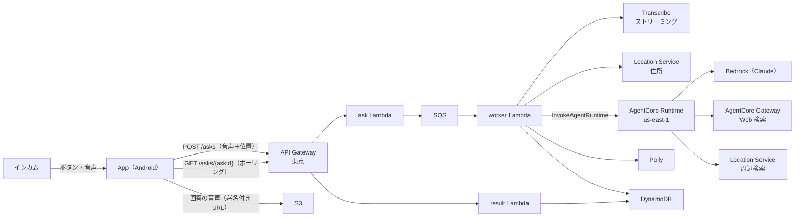
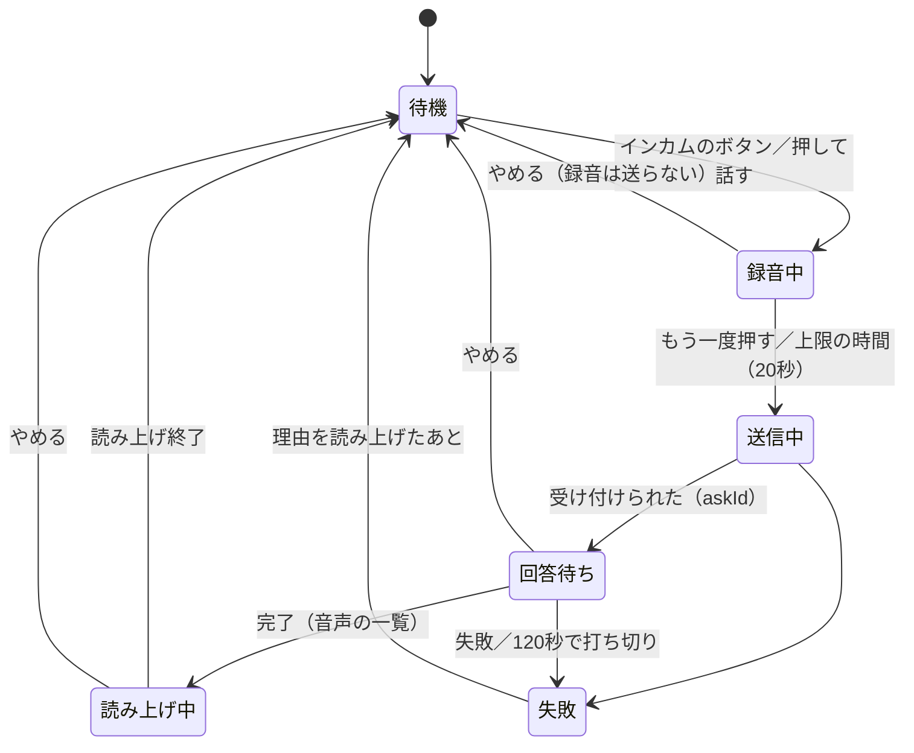
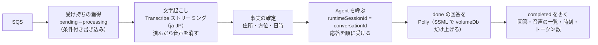

# スライス1 設計: 土台と、質問の一巡を縦に通す

- 日付: 2026-10-16
- 状態: 承認済み（実装計画の作成待ち）
- 前提の文書: [docs/init/](../init/README.md)（初期検討。凍結）。本書は初期検討から変える点を含む。変える点は §9 にまとめ、[docs/](../) の現行版と [adr/](../../adr/) に反映する

## 1. 目的と成功の判定

プロジェクトは4つのユニット（App・Backend・Agent・CICD）からなり、一度には作れない。小さな単位（スライス）に分け、スライスごとに「設計 → 実装計画 → 実装」を回す。

スライス1は、リポジトリなどの土台を作り、**インカムのボタンで質問してから、回答の読み上げを聞き、ナビへ戻るまで**を全ユニットに通す。最も大きなリスク（ハンズフリーの起動・インカムのマイクの経路・背面での動作・応答の待ち時間・費用）を、早く実機で確かめるため。

成功の判定（[01_requirements.md](../init/01_requirements.md) §9 の「走行中」の4項目）:

- [ ] インカムのボタンだけで、質問 → 回答の読み上げ → ナビへの復帰が、走りながら通しでできる
- [ ] 現在地と進行方向を踏まえた回答が返る（「右手の〜」が正しく右手を指す）
- [ ] 周辺の施設を、向きと距離を添えて答える
- [ ] 失敗したときに、画面を見なくても音で分かる

加えて、スライス1で次を確かめる。

- [ ] 質問から読み上げ開始までの段ごとの所要時間とトークン数が、記録とログから集計できる
- [ ] 15分以内の続けての質問で、前の話を踏まえて答える。15分を過ぎるか「新しい会話」を押すと区切られる

## 2. 範囲

### 含める

| 分類 | 内容 | 主な US |
|---|---|---|
| 土台 | 親と4ユニットのリポジトリ、`docs/` の現行版、`adr/`、親の文書をユニットへ写す仕組み | — |
| 質問の一巡 | インカムのボタンで起動 → 録音 → もう一度押すか上限の時間で送る → 回答待ち → 読み上げ → ナビへ戻る。画面の「押して話す」 | B-01〜B-07 |
| 状況の確定 | 現在地・住所・進行方位・日時を確定して AI に渡す | A-01, A-02 |
| 回答の生成 | Web 検索・周辺検索（距離・方角・左右）。読み上げに向く文体。前置きを読み上げない | A-05〜A-07 |
| 会話の文脈 | 15分以内の続けての質問で文脈を保つ。「新しい会話」で区切る | A-03, A-04 |
| 音量 | 回答の音声の音量を上げる（上げる量は利用者が設定で選ぶ）。メディアの音量が低いとホームで警告する | B-08 |
| 録音の確認 | 試し録り、送った録音（直近10件）の聞き直し | C-06, E-03 |
| 画面 | ホーム（SC-02 の最小限）、対話（SC-03）、設定（SC-09）、接続の設定（SC-13）、ユーザー名（SC-18）、応答後に戻るアプリ（SC-10）、録音の確認（SC-12）、回答の音量（SC-20）、新しい会話の確認（DL-02）、削除の確認（DL-01。録音のみ） | — |
| 走行用のビルド | JS を組み込んだビルド（USB を外して走れる） | — |
| 記録 | 質問と回答をクラウドに保存する（App の一覧はまだ作らない） | C-03（一部） |
| 計測 | 段ごとの時刻とトークン数を記録とログに残す | — |

### 後のスライスに回す

走行の記録（開始・一時停止・終了・ルート）、記録一覧と地図での振り返り、地点メモ・メモ、端末とクラウドの同期、通信できないときの後送と「質問できなかった地点」の記録、初回セットアップの案内（SC-01）、録音の設定（SC-11。スライス1では既定値で固定）、文字での質問、文ごとの読み上げ、やめた質問の記録（US-B-07.005）、CICD による自動デプロイ（スライス1は手動でデプロイする）。

## 3. 全体構成



## 4. リポジトリ・環境・命名

### 4.1 リポジトリ

| ローカル | GitHub | 公開 |
|---|---|---|
| `TouringProjectV2/` | `h-akira/TouringProjectV2` | 公開 |
| `TouringProjectV2/App/` | `h-akira/TouringProjectV2_App` | 公開 |
| `TouringProjectV2/Backend/` | `h-akira/TouringProjectV2_Backend` | 公開 |
| `TouringProjectV2/Agent/` | `h-akira/TouringProjectV2_Agent` | 公開 |
| `TouringProjectV2/CICD/` | `h-akira/TouringProjectV2_CICD` | 非公開（スライス1では骨組みだけ） |

- GitHub のリポジトリは `gh repo create` で作る。push は利用者の許可を得てから行う。
- 各ユニットは submodule として親に登録する。リモートに中身が無いあいだは登録できないので、初回の push の許可を得た時点で登録する。それまでは親の `.gitignore` で各ユニットのディレクトリを除く。
- 親は `docs/`（現行版）・`docs/init/`（凍結）・`docs/specs/`（スライスごとの設計）・`docs/plans/`（実装計画）・`adr/`（決定の記録）を持つ。`tmp/` は追跡しない。
- 親の `docs/` は各ユニットの `docs-parent/` に写す（写しは編集しない）。写すスクリプトを親に置く。

### 4.2 AWS

- アカウントは既存のリソースと共有する。プロファイルは `touring`。環境はスライス1では `dev` だけ。
- リソース名は `<type>-trv2-<env>-<id>`（[07_units_contracts.md](../init/07_units_contracts.md) UC-1）。CloudFormation のスタック名（例 `stack-trv2-dev-backend`）と IAM ロール名も同じ規約に揃え、既存のリソースと衝突させない。
- S3 のバケット名の末尾にアカウント ID を付ける。AgentCore の名前はアンダースコアにする。
- デプロイは手動（`sam deploy` と AgentCore の CLI）。順は Agent → Backend（UC-3）。

### 4.3 設定値（SSM）

| 名前 | リージョン | 既定 | 読む側 | 用途 |
|---|---|---|---|---|
| `/trv2/dev/agent-runtime-arn` | `ap-northeast-1` | — | Backend のデプロイ | Agent の呼び先（UC-3） |
| `/trv2/dev/agent-model-id` | `us-east-1` | Sonnet 系の最新の推論プロファイル（`us.`） | Agent（呼ばれるたびに読み、60秒キャッシュ） | 使う AI モデル |
| `/trv2/dev/conversation-reset-minutes` | `ap-northeast-1` | `15` | Backend（質問の受け付けのたび） | 会話を区切るまでの時間。55以下 |

管理者は SSM の値を変えるだけで、モデルと会話を区切る時間を変えられる。デプロイもアプリの更新も要らない。

### 4.4 Android

- パッケージ名 `com.touringproject.v2`、アプリ名「Touring V2」（同じ端末の別のアプリと並べて入れられるように）。

## 5. App

### 5.1 構成

Expo の Development Build、expo-router、TypeScript。

```
App/src/
  app/              画面（home・ask・settings/ 配下）。表示だけを持つ
  flow/askFlow.ts   一巡の状態機械（副作用なし）
  services/         recorder・player・cues・location・api・conversation・settings・returnApp
App/modules/        自前のネイティブモジュール（Kotlin）
  handsfree         インカムのボタンが出す音声コマンドの合図を受ける（config plugin で Manifest に足す）
  audio-route       インカムのマイクへの経路を張る・実際の入力デバイスを返す
  ride-service      フォアグラウンドサービス（microphone・mediaPlayback）・前面に出る・戻り先のアプリを前面に出す
```

### 5.2 一巡の状態機械



- 画面（SC-03 の全面の色）・合図の音・戻り先のアプリへ戻るタイミングは、この状態から決める。
- 戻るタイミングは SC-10 で選ぶ（送ったらすぐ〔既定〕／回答が届いたら／読み上げが終わったら）。画面から始めた質問では戻らない。
- 回答待ちのあいだにボタンが押されたら、応答中であることを読み上げ、新しい録音は始めない（US-B-06.002）。

### 5.3 背面での動作

既定では送った時点でナビへ戻り、回答待ちと読み上げは背面で続ける。一巡の処理は JS に置き、フォアグラウンドサービス（microphone・mediaPlayback）でプロセスを生かし続ける（スパイク B で、画面を消しても成り立つことを確かめた。[adr/0004](../../adr/0004-background-processing.md)）。

- 背面で待つ処理（ポーリングの間隔など）に `setTimeout` を使わない。React Native は背面でタイマーを止めるので、`ride-service` に「ネイティブ側で時間差で解決する待ち」を持たせて使う。
- 音声の設定は、背面で再生する・マナーモードでも鳴らす（`playsInSilentMode`）・他のアプリの音と重ねる、を指定する。指定しないと、マナーモードで再生の指示が黙って無視される。
- 回答の音声は、回答が届いた時点で、その URL から再生を始める。

### 5.4 録音

- 形式は PCM（16kHz・モノラル・16bit）。expo-audio の AudioStream で録る（スパイク A。[adr/0002](../../adr/0002-streaming-transcription.md)）。Android の MediaRecorder の Ogg/Opus は、ストリーミングの文字起こしに拒否されたのでやめた。
- インカムが繋がらなければ本体のマイクで録り、そのことを画面に出す（US-B-01.004）。
- 無音検知で終わりを判定しない。上限は20秒で固定（設定はスライス1では出さない）。
- 直近10件の録音を端末に残し、録った時刻・長さ・マイクのモード・実際の入力デバイス・聞き取られた文を添える。11件目で最も古い音声を消す。試し録りは残さない。
  - 録音ごとに、PCM と並べて付随情報の JSON（`rec-<時刻>.json`）を置く。聞き取られた文は、回答の結果が届いたときに書き足す。消すときは PCM と JSON を一緒に消す。
  - 再生するときは、PCM に WAV のヘッダーを付けた一時ファイルを作って鳴らす。

### 5.5 録音の確認（SC-12）

- 試し録り: 質問と同じ経路（インカムのマイク。繋がらなければ本体のマイク）で録る。画面のボタンかインカムのボタンをもう一度押すか、20秒で止まり、すぐメディアの音で再生する。実際の入力デバイス（または本体のマイクで録ったこと）を出す。サーバーには送らず、端末にも残さない。試し録りのあいだのインカムのボタンは、質問を始めずに試し録りを止める。
- 送った録音: 新しい順に、録った時刻・長さ・マイク（インカム／本体と実際の入力デバイス）・聞き取られた文（空なら「聞き取れませんでした」）を並べ、各行から再生する。
- 「録音をすべて消す」は DL-01 で確かめてから消す。文字の記録（クラウドの質問と回答）は消えない。
- マイクのモードの設定（SC-11）は後のスライスなので、スライス1では「インカム／本体」と入力デバイスの名前を出す。

### 5.6 音量

- 回答の音量（SC-20）: `+0 / +3 / +6（既定）/ +9 / +12 dB` から選ぶ。端末に保存し、質問を送るたびに `volumeDb` として付ける（§6.3）。端末の音声合成で読む代わりの経路には当たらない。
- メディアの音量の警告: 回答と合図はメディアの音（A2DP）で鳴り、インカムとスマホの音量は連動する。メディアの音量が最大の1/3未満なら、ホームに「メディアの音量が低く、回答が聞こえないかもしれません」の帯を出す。音量は `audio-route` で読み、ホームが見えているあいだ2秒ごとに見直す。アプリが音量を変えることはしない。

### 5.7 走行用のビルド

開発用のビルドは JS を USB 越しに Mac の Metro から読むので、走行では使えない。走行用には、Mac で release を作って入れる（`npx expo run:android --variant release --device`）。署名は開発用と同じなので、上書きしてもデータ（接続キー・設定・録音）は残る。開発用にだけ入る権限（`ACCESS_LOCAL_NETWORK`）が入っていないことを確かめる。`SYSTEM_ALERT_WINDOW`・`READ/WRITE_EXTERNAL_STORAGE`・`VIBRATE` は Expo の雛形が本体にも入れるもので、App は使わないが外さない（`SYSTEM_ALERT_WINDOW` は利用者が許可しない限り効果が無い）。手順は App の README に書く。

### 5.8 そのほか

- 位置: 現在地を監視し、位置の履歴から方位の材料（過去の1点とその時刻）を選んで送る。方位は Backend が求める。
- 会話: `conversationId` と、Backend が返す `conversationExpiresAt` を端末に持つ。その時刻を過ぎるか「新しい会話」（DL-02 で確認）を押したら捨てる。ホームに区切られる時刻を出す。
- 設定: 接続キーは SecureStore、ユーザー名・戻り先のアプリ・戻るタイミング・マイクのモードはふつうの保存領域。
- 合図の音: 録音の開始・送った・待っているあいだ（一定の間隔）・失敗の4種類。端末の中の音声ファイルを鳴らす。
- 回答の音声が取れないときは、端末の音声合成で回答の文を読み上げる（US-B-03.003）。

## 6. Backend

### 6.1 構成

API Gateway（REST）＋ Lambda（Python 3.13）、SAM、`ap-northeast-1`。

| リソース | 役割 |
|---|---|
| `apigw-trv2-dev-main` | API キーと使用量プランで、接続キーの確認と流量の制限を行う |
| `lambda-trv2-dev-health` | `GET /health`（キー不要） |
| `lambda-trv2-dev-ask` | `POST /asks`: 入力を検証し、音声を S3 に置き、記録を `pending` で作り、SQS に積む。202 で `askId`・`conversationId`・`conversationExpiresAt` を返す |
| `lambda-trv2-dev-result` | `GET /asks/{askId}`: 状態・聞き取った文・回答の文・音声の一覧・失敗の理由・段ごとの時刻を返す |
| `lambda-trv2-dev-worker` | SQS から受けて、一本の流れで処理する（§6.2） |
| `sqs-trv2-dev-ask`・`sqs-trv2-dev-ask-dlq` | worker の起動と、処理できなかったものの退避 |
| `dynamodb-trv2-dev-records` | 記録（1つのテーブル） |
| `s3-trv2-dev-audio-<アカウントID>` | 質問の音声と回答の音声。どちらも1日で消える |

### 6.2 worker の流れ



- 二重処理の防止: 受け持ちの獲得を条件付き書き込みで行う。worker の Timeout（120秒）は可視性タイムアウト（180秒）より短くする。
- 住所は Location Service の逆ジオコーディングで町名まで求める。確定できなければ「不明」として渡す。
- 方位は現在地と方位の材料から求める。定まらないとき（停車中・距離が短い）は方位なしとして渡す。
- 回答の文: Agent の `done` イベントの `answer` を使う（前置きは Agent が除く。07 UC-8）。
- 文字起こしの結果が空なら、`failed`（`no_speech`）として記録し、ログにも出す。
- 会話を区切る時刻: 受け付けのたびに SSM の値（55を超えていれば55に丸め、警告を出す）を読み、`conversationExpiresAt` = 受け付けた時刻＋その分数 とする。App が `conversationId` を送らなければ、新しく発行する。

### 6.3 API（要点。正本は Backend の openapi.yaml）

`POST /asks`

| 項目 | 内容 |
|---|---|
| `audio` | base64 の PCM（16kHz・モノラル・16bit。60秒で約2.6MB まで） |
| `text` | 文字の質問（500字まで）。`audio` とどちらか一方。スライス1の App は使わないが、通しの確認に使う |
| `location` | `{latitude, longitude}`（取れなければ省く。不正な値は無いものとして扱う） |
| `headingSample` | `{latitude, longitude, at}`（方位の材料。`at` はタイムゾーン付き。取れなければ省く） |
| `conversationId` | 続けるときだけ |
| `volumeDb` | 回答の音声を上げる量。`0`・`3`・`6`・`9`・`12` のどれか。省けば `6`、それ以外は 400。SSML の `prosody volume` に入れ、`drc`（圧縮）と合わせる |
| ヘッダ | `x-api-key`（接続キー）、`x-user-name`（英小文字と数字の3〜20文字） |

`GET /asks/{askId}`

| 項目 | 内容 |
|---|---|
| `status` | `processing` / `completed` / `failed`（`pending` は App には `processing` として見せる） |
| `transcript` | 聞き取った文（失敗でも分かる範囲で） |
| `answer` | 回答の文 |
| `audio` | `[{seq, url}]`。スライス1では常に1件。後で文ごとの読み上げを足しても形を変えない |
| `error` | 失敗の理由（§8.1） |
| `timings` | 段ごとの時刻（§6.4） |

ポーリング: 最初の10秒は1秒ごと、以後は2秒ごと。120秒で打ち切る。

### 6.4 記録と計測

- キー: パーティションキー `USER#<ユーザー名>`、ソートキー `ASK#<askId>`。
- 中身: 質問の文・回答の文・受け付けた日時・位置・住所・方位・入力の種類（声）・`conversationId`・`volumeDb`・状態・失敗の理由・段ごとの時刻・トークン数。
- 段ごとの時刻: 受け付け・文字起こし完了・住所の確定・Agent の最初の応答・Agent の完了・音声合成の完了。
- トークン数: Agent が返す入力・出力のトークン数（質問1件の合計とモデルの呼び出し回数）。
- ログは1行の JSON（`askId`・段・所要時間・失敗の理由・モデル ID）。位置と会話の本文はログに出さない。

## 7. Agent

### 7.1 構成

Bedrock AgentCore Runtime ＋ Strands、`us-east-1`、AgentCore の CLI が生成する CDK。

| リソース | 役割 |
|---|---|
| Runtime `agentcore_trv2_dev_ask` | エージェント本体（Python）。アイドルの時間切れは60分に固定 |
| Gateway `gwTrv2DevMain` | 組み込みの Web 検索のコネクタ（MCP・IAM で認可） |

### 7.2 振る舞い

- ツール: `web_search`（Gateway 経由）、`nearby_places`・`find_place`（Location Service の `geo-places` を直接呼ぶ）。距離・方角・左右はツールの中で計算する。現在地と方位は Backend からプロンプトとは別に数値で受け取る（AI に座標を書き写させない）。
- 検索の結果は、上位の数件・決まった文字数に切り詰めてから AI に渡す（入力トークンの大半は検索の結果のため）。
- ツールを呼ぶ回数に上限を設け（4回）、超えたら手持ちの情報で答えさせる。
- 応答は順に流す。ツールの呼び出しの区切りが分かるイベントと、最後にトークン数を含める。
- システムプロンプトは Agent のリポジトリに置く。モデルの設定値とは別に管理する。
- モデル ID は SSM から読む。読めない・呼べないときは失敗として返し、モデル ID をログに出す。

### 7.3 会話の文脈

- `runtimeSessionId` に `conversationId` を使い、Runtime のセッションの中に履歴を持つ。
- 回答を返したあと、履歴からツールの呼び出しと結果を取り除き、質問と最後の回答の文だけを残す（過去の検索の結果を次の質問に持ち越さない）。加えて、直近の数往復に限る。
- 区切るのは App（新しい `conversationId` を使う）。Runtime のアイドルの時間切れ（60分）は、会話を区切る時間（55分以下）より必ず長い。
- 再デプロイ・環境の異常・連続8時間（Runtime の寿命）で文脈が途中で消えることは許容する（区切られたのと同じ扱い）。

## 8. 失敗の扱い

### 8.1 失敗の理由

App と Backend で同じ一覧を使う（07 の現行版に書く）。

| 理由 | 起きる場所 | 利用者への知らせ |
|---|---|---|
| `no_speech` | worker | 失敗の音＋「聞き取れませんでした」 |
| `transcribe_failed`・`agent_failed`・`tts_failed` | worker | 失敗の音＋「うまく答えられませんでした」（`tts_failed` で回答の文があれば端末の音声合成で読む） |
| `timeout` | App（120秒） | 失敗の音＋「時間切れです」 |
| `network` | App | 失敗の音＋「通信できません」。録音は捨てる |
| `invalid_key` | API Gateway（403） | 失敗の音＋「接続キーを確かめてください」。試し直さない |
| `service` | App（フォアグラウンドサービスが始まらない） | 失敗の音＋「準備できなかったため、質問できませんでした」 |
| `rate_limited`・一時的な 5xx | API Gateway | 間隔を空けて3回まで試し直し、だめなら `network` |

- 失敗は、ナビを表示したまま音で知らせる。前面にいれば SC-03 も失敗の色にする。
- 「やめる」で App はポーリングと再生を止める。Backend の処理は続いてよい。
- Agent の呼び出しで一時的な競合（`RetryableConflictException`）が返ったら、worker は短い間隔で試し直す。

## 9. 初期検討から変える点

| 変える点 | 初期検討 | スライス1 | 理由 |
|---|---|---|---|
| 応答時間の目安 | ふだん20秒以内 | ふだん30秒以内。長引いても止まっていないことが分かる | 実際のツーリングの計測（音声の質問214件）で、中央値18秒・90%で33秒。検索を含む質問は長くかかる |
| 文字起こしの方式 | （定めていない） | Transcribe のストリーミングを worker から呼ぶ | 同じ計測で、バッチ方式の文字起こしが中央値9秒・最大220秒かかり、60秒を超えた質問はすべてこれが原因だった。録音の大きさとは関係が無かった |
| 会話を区切る時間 | 既定15分。5分〜1時間・区切らないを利用者が選ぶ（US-A-04.005〜006、SC-20） | 15分を既定とし、管理者が SSM で変える。利用者の設定（SC-20）と「区切らない」は無くす | Runtime のセッションで文脈を保つため。利用者にとって15分で区切られて困ることは無い |
| 会話の文脈の持ち方 | 実行環境の寿命に依存しない方法（05 §3） | Runtime のセッションに持ち、ツールの結果は持ち越さない | 区切らない設定を無くしたので寿命内に収まる。ツールの結果を持ち越さないことで入力トークンを抑える |
| 回答の音声 | 1つの音声 | 音声の一覧（スライス1では1件） | 後で文ごとの読み上げを足すときに契約を変えないため |

それぞれ ADR を書く（応答時間の目安、文字起こしの方式、会話の文脈と区切る時間）。`docs/` の現行版（01・02・03・04・05・07）を合わせて直す。

## 10. テスト

| ユニット | 自動テスト | 実機・実環境 |
|---|---|---|
| App | Jest: 状態機械・会話の区切り・方位の材料の選び方・ポーリングの間隔・失敗の理由から読み上げる文・録音の付随情報・WAV のヘッダー・回答の音量の設定・メディアの音量の警告の判定 | 実機の確認リスト: インカムで起動・マイクの経路・背面での待ち受けと読み上げ・ナビへ戻る・失敗の音・試し録り・送った録音の聞き直し・音量の聞き比べ・走行用のビルドで USB を外して一巡 |
| Backend | pytest: 入力の検証（`volumeDb` を含む）・方位の計算・プロンプトの組み立て・前置きの除去・受け持ちの獲得・会話を区切る時刻。AWS の呼び出しはスタブにする | `scripts/smoke`: dev に見本の音声を送り、完了まで通す |
| Agent | pytest: 距離・方角・左右の計算、履歴からツールの部分を取り除く処理、検索の結果の切り詰め | `scripts/smoke`: 決まった質問を Runtime に投げる（モデルを切り替えたあとの確認を兼ねる） |

最後に §1 の判定を実際の走行で確かめる。

## 11. 進める順番

1. 親リポジトリの準備: `docs/` の現行版・`adr/`・写す仕組み。`gh repo create` で5つのリポジトリを作る（push しない）
2. スパイク A（使い捨て）: Android で録り、Lambda から Transcribe のストリーミングで文字にする。日本語の質と時間を測る（済み）
3. スパイク B（使い捨て）: ナビへ切り替えたあとも、背面でポーリングと再生が続くかを実機で確かめる（済み）
4. スパイクの結果を本書と現行版に反映する（だめだったときの代わりは §5.3・§5.4 のとおり）
5. Agent → Backend → App の順に作る。App は、ハンズフリーの一巡（計画4a）と、残りの画面の仕上げ（計画4b）に分ける
6. 実機での通しの確認と、実際の走行での確認

## 12. 未確定事項

| 論点 | 決め方 |
|---|---|
| 録音の形式と、ストリーミングで文字にしたときの質と時間 | 決定済み（[adr/0002](../../adr/0002-streaming-transcription.md)） |
| 背面でのポーリングと再生 | 決定済み（[adr/0004](../../adr/0004-background-processing.md)） |
| Polly で上げる音量の量 | 決定済み。利用者が SC-20 で選び、質問ごとに送る（§5.6・§6.3） |
| 履歴に残す往復の数 | 実装時に初期値を決め、トークン数の記録を見て調整する |
| 検索の結果を切り詰める量 | 同上 |
