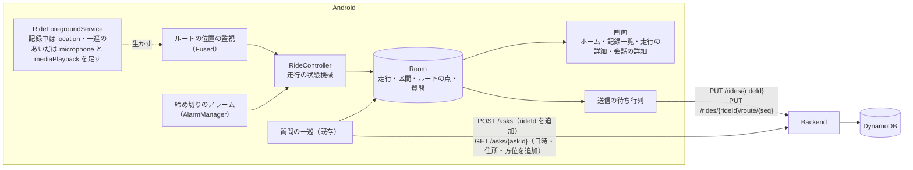

# スライス2 設計: 走行の記録と、地図での振り返り

- 日付: 2026-10-17
- 状態: 承認済み（2026-10-18）。振る舞いの節は合意済み。技術の節（§3・§4.2〜4.5・§5.1・§7.1・§7.7・§9・§11・§12）は、[ネイティブ移行](2026-10-17-native-migration-design.md)（[adr/0005](../../adr/0005-native-android-app.md)）に合わせて Kotlin・Compose 前提に直した（2026-10-18）。そのとき、端末の停止で走行を終える振る舞いを足した（§4.5・§8）。plan 3 を 3a・3b に分け（§11）、§5.3 にかたまりの端数の送り方と契機の扱いを足した（2026-10-18）。§7.9 の版の表示を plan 3a に足した（2026-10-18）。plan 3b の範囲を決めるときに §4.4・§7.1・§7.2・§7.8 を書き足した（2026-10-20）。plan 4 を 4a・4b に分け、plan 4a の範囲を決めるときに §5.1・§7.1・§7.3〜§7.8・§11・§12 を書き足した（2026-10-20）。plan 4b の範囲を決めるときに、質問を走行の記録中だけ受け、日ごとの振り返りをやめた（[adr/0008](../../adr/0008-ask-only-while-recording.md)。§1・§2・§3・§4.6・§4.7・§7.2・§7.4〜§7.6・§9・§11 を直した。2026-10-20）
- 前提の文書: [docs/](../) の現行版（01・02・04・05・07）、[スライス1の設計](2026-10-16-slice1-design.md)、[画面モック](../mock/index.html)
- スライス1の走行での完了の判定は未実施のまま、本スライスの設計に進んだ。判定で ✗ が出たら、その結果に合わせて本書を見直す

## 1. 目的と成功の判定

スライス2は、**走行の始まりから終わりまでのルートと、その間の質問を記録し、走ったあとに地図で振り返る**までを全ユニットに通す。要件定義 §9 の「走ったあと」の中心であり、残っている最も大きな技術上のリスク（何時間も背面で位置を取り続けること・端末の記録の作り）をここで確かめる。

成功の判定:

- [ ] 開始から終了までのルートが、一時停止の区間を除いて地図に引かれている（画面を消し、ナビを前面に出したまま走った区間を含む）
- [ ] 一時停止して再開しても一続きの走行として残り、離れた場所で再開しても破線で繋がる
- [ ] 連続して記録した時間が最長時間に達すると、自動で終了して通知が出る（実機では最長時間を短くして確かめる）
- [ ] 走行中の質問に番号のピンが立ち、タップすると質問と回答が読める
- [ ] 記録していないとき・一時停止中にインカムのボタンを押すと、録音を始めず、質問できないことが声で分かる（§4.7）
- [ ] 走行とルートが DynamoDB に保存され、一覧で「保存済み」と出る。電波の無い区間の分も、通信が戻れば送られる
- [ ] 実際の走行で、1時間あたりの電池の減りを測って記録する

## 2. 範囲

### 含める

| 分類 | 内容 | 詳細要件 |
|---|---|---|
| 走行の記録 | 開始（名前は必須）・一時停止・再開・終了（要約を見せて確認）。同時に記録できる走行は1つ。ホーム・対話の画面・通知での状態の表示 | US-C-01, US-C-07, US-D-05.001〜004 |
| ルート | 背面・画面が消えているとき・ナビの使用中・電波の無い区間でも記録する。精度の悪い点を除く。走行時間と距離（一時停止中を除く） | US-C-02 |
| 自動終了 | 連続して記録した時間が最長時間（既定24時間。SC-16 で変える）に達したら終了し、通知で知らせる | US-C-08 |
| 質問の記録 | 質問は走行の記録中だけ受ける（§4.7）。回答が届いた質問と、Backend 側で失敗した質問を端末に保存し、走行に結びつける。会話の区切りを残す | US-C-03, US-B-01.006 |
| 送信 | 走行・ルート・名前の変更を Backend へ送る。送れなかった分は次の機会に送り直す | US-C-05.001〜002（一部） |
| 振り返り | 記録一覧（走行・保存の状態）、走行の詳細（ルート・番号付きのピン・一時停止の破線・全体が収まる縮尺・時系列・全画面・名前の変更）、会話の詳細（走行の中の前後の会話へ移れる） | US-D-01, US-D-02（地点メモに関わる部分を除く）, US-D-03 |
| 画面 | タブ（ホーム・記録・設定）、ホーム（SC-02 の走行のカード）、走行の開始（SC-17）、走行終了の確認（SC-04）、記録一覧（SC-05）、走行の詳細（SC-06）、会話の詳細（SC-07）、走行の記録（SC-16） | — |

### 後のスライスに回す

- スライス3: メモ（US-D-04、SC-08）、削除（US-D-06）、地点メモ（US-D-08、SC-19。地図の地点メモの表示の切り替えを含む）、質問できなかった地点（US-C-09）、データの保存（SC-14）、クラウドからの読み込み・別の端末への引き継ぎ（US-C-05.004）、端末とクラウドの突き合わせの決まり（05 §9）
- スライス4以降: 初回セットアップ（SC-01）、録音の設定（SC-11）、文字での質問、文ごとの読み上げ、やめた質問の記録（US-B-07.005）、CICD による自動デプロイ

### 要件の未決を、本スライスでは「何もしない」で固定する

要件定義 §10 のうち次の2つは、本スライスでは何もしない。

- 一時停止のし忘れを自動で検知しない（終了し忘れは最長時間の自動終了だけで扱う）
- （置き換え）走行を記録していないときの質問は、受けないことにした（§4.7、adr/0008）

## 3. 全体構成

| ユニット | 変更 |
|---|---|
| Android | 走行の状態・ルートの記録・端末の DB（Room）・送信の待ち行列・タブ・振り返りの画面と地図・ホームの走行のカード・SC-17・SC-04・SC-16 |
| Backend | `POST /asks` に `rideId`、`GET /asks/{askId}` に `askedAt`・`address`・`headingDegrees` を足す。走行の受け口（`PUT` 2つ）を足す。読み出しの `GET` は作らない（スライス3） |
| Agent | 変更なし |
| CICD | 変更なし（デプロイは手動のまま） |

技術の選択:

| 対象 | 採用 | 理由 |
|---|---|---|
| 背面でのルートの記録 | 走行中は `RideForegroundService` を種類 `location` で続け、その中で `FusedLocationProviderClient` の位置を受けて DB に書く。前面で始めたサービスなので、背面での位置の許可（`ACCESS_BACKGROUND_LOCATION`）は要らない | Android で定番の作り。前面サービスが無いと、画面を消したあと位置が届かなくなる |
| 前面サービスの組み方 | 走行の記録と質問の一巡で、1つのサービスを使う。種類を状態で変える（§4.2） | サービスの通知1つで「記録中」の知らせを兼ねられる。2つに分けると、走行中の質問で通知が2つ並ぶ |
| 締め切りの判定 | サービスの中の待ちと、正確でないアラーム（`AlarmManager.setAndAllowWhileIdle`）の二段構え（§4.4） | 正確なアラームは Android 14 以降、利用者が設定で許す必要がある。終了の時刻は締め切りの時刻で記録するので、アラームが数分遅れても記録は狂わない（遅れるのは通知だけ）。WorkManager は遅れ方が同じで依存が増える |
| 端末の記録 | Room（スキーマを JSON に書き出し、版ごとの Migration を書く） | ルートの点が数万になりうる。マイグレーションとその検査の道具（`MigrationTestHelper`）が付いてくる。`Flow` で画面に変化を流せる。SQLite を直に使うと、変換・マイグレーション・変化の通知を自分で書くことになる |
| 地図 | MapLibre Native Android と国土地理院のタイル（pale・ラスタ）。`MapView` を Compose の `AndroidView` で包む | API キーが要らない。すべて Kotlin で書け、WebView の JS とのつなぎ目を作らない（adr/0005 の考え方）。Google Maps SDK はキーと GCP の請求先が要る。WebView の Leaflet は Web のコードを使い回すときの折衷で、ネイティブで選ぶ理由が無い |
| 画面の骨組み | Navigation 3。タブごとにバックスタックを持つ（§7.1） | 今の画面が Navigation 3 で組んである |

作りの決まりは、移行の spec §5 を引き継ぐ。1つの Gradle モジュールをパッケージで分ける。状態機械は Android に依存させず、外とのやり取りは interface を通す。部品は `AppGraph` で手で組む（DI のライブラリは入れない）。

| パッケージ | 役割 | Android への依存 |
|---|---|---|
| `ride`（新） | 走行の状態機械（状態・区間・走行時間・距離・締め切り・終了の理由）・司令塔（`RideController`）・外との窓口（`RidePorts`: 記録の置き場・時計・締め切りのアラーム・サービス） | 無し |
| `store`（新） | Room の DB・Entity・DAO・マイグレーション。`RidePorts` の記録の置き場を実装する | あり |
| `sync`（新） | 送信の待ち行列。何を送るかの判断は純粋な関数で、送るのは `api` | 判断の部分は無し |
| `map`（新） | 地図に渡すデータ（線・一時停止の破線・番号のピン・縮尺の範囲）を組み立てる純粋な関数と、`MapView` を包む Composable | 組み立ては無し |
| `location` | 質問の位置（既存）に、ルートの記録の位置の監視を足す | Fused の部分だけ |
| `service` | `RideForegroundService`（走行の記録と一巡の両方）・サービスを動かすかと種類を決める関数・電源を切る知らせの受け口・生きていた時刻の書き込み・締め切りのアラームとその受け口 | あり（決める関数は無し） |
| `ask` | 一巡を始めるときに記録中の `rideId` を受け取り、結果を記録の置き場に書く（窓口を2つ足す） | 無し |
| `api` | 走行の `PUT` 2つ・`POST /asks` の `rideId`・`GET /asks` の追加項目 | — |
| `ui` | タブ（タブとバックスタックの組）・各画面 | — |

- 画面は Room の `Flow` を受けて描くだけにする（ホームのカード・一覧・詳細）
- アラームの受け口と、システムに起こし直されたサービスは Activity を経ずに動く。どちらも `TouringApp`（Application）が持つ `AppGraph` から部品を取る

## 4. 走行の状態とルートの記録（Android）

### 4.1 状態と区間

状態は `記録していない → 記録中 ⇄ 一時停止中 → 終了`。走行は「記録した区間」の並びとして持つ。開始と再開で区間が始まり、一時停止と終了でその区間が閉じる。

- 走行時間は区間の長さの合計、距離は区間ごとの点の間の距離の合計。一時停止中は含まれない（US-C-07.006）
- 一時停止の回数と期間は、区間と区間のすき間から求める（US-C-07.007）
- 同時に記録・一時停止できる走行は1つだけ（US-C-01.005）

### 4.2 サービスの生き死に

`RideForegroundService` を、「走行の記録中、または質問の一巡の途中」なら動かす（スライス1は一巡のたびに始めて止めていた）。

- サービスの種類は、2つの状態から決める。記録中は `location`、一巡のあいだは `microphone|mediaPlayback` を足す。どちらでもなければ止める。決める部分は純粋な関数にし、サービスを始める・種類を変える（`startForeground` を種類を変えて呼び直す）・止めるの指示に変える。今の `KeepAlive`（一巡から `start`・`stop` を呼ぶだけ）は、これに置き換える
- 一時停止中は、質問の一巡の途中でなければ止める（泊まりで止めても電池を使わない）
- サービスの通知が、記録中であることの通知（EX-03）を兼ねる。タップでホームのタブを開く
- Android 14 以降、`location`・`microphone` の種類は、アプリが前面にあるときにしか始められず、足せない。走行中の質問はインカムのボタン（`VOICE_COMMAND`）が `MainActivity` を開くので、`microphone` を足す時点ではアプリが前面にある。足せなかったとき（例外）は、一巡のほうを失敗として扱い、記録は続ける
- サービスは `START_STICKY` にする。背面から起こし直されたときに `location` で前面に出られなければ、例外を受けてサービスを止め、次にアプリを開いたときの突き合わせ（§4.5）に任せる

### 4.3 ルートの点

- サービスの中で、Fused に `PRIORITY_HIGH_ACCURACY`・5秒ごと・10m 動いたら（`setMinUpdateDistanceMeters`）の条件で位置を頼む
- 精度が 50m より悪い点は捨てる（US-C-02.005）
- 届いた点はすぐに DB に書く
- 質問の位置（1秒ごと。スライス1）は別のリクエストのまま残し、ルートの点と混ぜない
- これらの数値は `location` の定数にまとめ、実際の走行のあとで見直す。利用者が変える設定にはしない。時速60km で8時間走って約5,800点（端末の DB で約230KB、送信のかたまりで約20個）の見込み

### 4.4 自動終了

- 区間が始まるたびに、「区間の開始＋最長時間」を締め切りとする（US-C-08.002）
- 締め切りの判定は二段構えにする
  - サービスが動いているあいだは、サービスの中で見る（コルーチンの待ちと、点が届くたび）
  - 区間が始まるたびに、正確でないアラーム（`setAndAllowWhileIdle`）を締め切りに合わせて置く。一時停止と終了では外す。プロセスが死んでいても、アラームの受け口が走行を終える
- 締め切りが来たら、締め切りの時刻で終了し、自動で終了したことを記録して、通知を出す（US-C-08.004）。どの道で気付いても、`RideController` の同じ処理を通す。もう終わっていれば何もしない
- 最長時間を変えたら、記録中の区間の締め切りを計算し直し、DB とアラームを置き直す（US-C-08.005）。新しい締め切りがもう過ぎていたら、その締め切りの時刻で自動終了とし、通知を出す（2026-10-20）
- 締め切りを過ぎてから気付くまで（アラームの遅れなど）のあいだに一時停止か終了の操作があったら、締め切りの時刻で自動終了とする。終了の操作では SC-04 で入れた名前を残す（2026-10-20）
- 最長時間は 6・12・24・48 時間から選ぶ。既定は24時間（US-C-08.003）

### 4.5 アプリが落ちたとき・端末が止まったとき

走行の状態は DB にある。アプリだけが落ちたときは記録を続け、端末が止まった（電源を切った・電池が切れた・再起動した）ときは走行を終える。

- サービスが動いているあいだ、点を書くたびと1分ごとに、走行の「最後に生きていた時刻」を書く。区間の開始のときに、端末の起動の回数（`Settings.Global.BOOT_COUNT`）を残す
- 電源を切る知らせ（`ACTION_SHUTDOWN`）をサービスで受けたら、その時刻で終える
- 起動したとき（Application の起動・システムに起こし直されたサービスのどちらでも）、記録中・一時停止中の走行があれば次の順に扱う
  1. 起動の回数が増えていれば、最後に生きていた時刻で終える。その日の続きは新しい走行になる
  2. 締め切りを過ぎていれば、締め切りの時刻で自動終了とする（通知を出す）
  3. それ以外で記録中なら、サービスと位置の監視を再開する。落ちていたあいだのルートは抜ける。一時停止中なら何もしない
- 端末の停止で終えた走行は、終了の理由を記録に残すが、画面ではふつうの終了と同じに見せ、通知も出さない

### 4.6 質問と走行の結びつけ

質問を始めた時点の記録中の走行の `rideId` を `POST /asks` に添え、端末の記録にも残す（US-C-03.005）。質問は記録中だけ始まるので（§4.7）、`rideId` はいつも付く。

### 4.7 質問を受ける条件（2026-10-20、[adr/0008](../../adr/0008-ask-only-while-recording.md)）

- 質問を受けるのは、走行が記録中のときだけ。一時停止中・記録していないときは受けない（US-B-01.006）。インカムのボタンでも、画面の「押して話す」でも同じ
- 受けないときにインカムのボタンが押されたら、録音を始めず、端末の音声で知らせる。走行していないときは「走行を記録していないので、質問できません。」、一時停止中は「一時停止中は質問できません。再開すると質問できます。」。今の失敗の読み上げ（接続キーが無いときなど）と同じく、戻り先があれば画面を出さずにすぐ戻る
- 受けるかどうかは、押下を受けた時点で決める。始めた質問は、途中で一時停止・終了・自動終了になっても最後まで続け、始めたときの走行に結びつける
- 録音の確認（SC-12 の試し録り）は質問ではないので、走行に関係なく使える
- GPS を使うのは、走行の記録中（ルート）と、記録中の質問のあいだだけになる
- Backend は変えない（`rideId` は API の上では今も省ける。07 の UC-5）
- これより前にした、走行に結びつかない質問は、端末と DynamoDB から一度だけ手作業で消す（開発中の試しの質問だけのため。走行の記録と、走行中の質問は残す。設定・接続キー・ユーザー名は残す）

## 5. 端末の記録と送信（Android）

### 5.1 Room のテーブル

| テーブル | 中身 |
|---|---|
| `rides` | `id`（Android が作る UUID）・名前・状態・終了の理由（手動・自動・端末の停止）・締め切り・最後に生きていた時刻・`updatedAt`・送信済みの `updatedAt` |
| `ride_segments` | `rideId`・番号・開始・終了（記録中の区間は終了が空）・開始のときの端末の起動の回数 |
| `route_points` | `rideId`・区間の番号・時刻・緯度・経度・精度・送ったかたまりの番号（まだなら空）・そのかたまりが断られたか（`refused`。同じ番号で受け付けられたら下りる。版3、Android #27） |
| `asks` | `askId`・受け付けた日時・回答の日時・質問の文・回答の文・位置・住所・方位・入力の種類・`conversationId`・新しい会話の最初の質問か・状態（回答あり／失敗）・失敗の理由・`rideId` |

- 会話の区切り（US-C-03.004）は「新しい会話の最初の質問か」で表す。その質問の手前が区切り
- テーブルの形を変えるときに備え、スキーマを JSON に書き出してリポジトリに入れ（`exportSchema`）、版ごとに Room の Migration を書く。破壊的な作り直し（`fallbackToDestructiveMigration`）は使わない
- `ride` の状態機械と司令塔からは、`RidePorts` の記録の置き場の interface を通して使う（テストでは作り物かメモリ上の Room に差し替える）
- 版2の `rides.routeRejected`（ルートのどれかのかたまりが断られた印）は、版3から書かない。断られたことは点の `refused` に持つ。列は残す（消すと、区間と点が参照する表を作り直すことになるため）
- 送信の `PUT /rides/{rideId}` の `autoEnded` は、終了の理由が「自動」かどうかで決める（端末の停止はふつうの終了として送る）

### 5.2 質問の保存

- 一巡が「回答あり」か「Backend 側の失敗」で終わった時点で、`GET /asks/{askId}` の結果を `asks` に書く。読み上げの成否には関係なく書く
- ポーリングを打ち切った（120秒）ものは、失敗（`timeout`）として残す
- `askId` が発行される前の失敗（`network` など）は残さない（スライス3の「質問できなかった地点」で扱う）
- 質問の記録は Backend が作るので、Android から送り返さない（07 UC-7）

### 5.3 送信の待ち行列

| 対象 | 送り方 |
|---|---|
| 走行のメタ情報 | 状態・名前・区間が変わるたびに、最新の全体を `PUT /rides/{rideId}` で送る |
| ルート | まだ送っていない点を、300点ずつのかたまりで `PUT /rides/{rideId}/route/{seq}` で送る。記録中の区間の点も、かたまりに満ちた分から送る。一時停止と終了では、満ちていない最後のかたまりも送り、あとで点が増えたら同じ番号で送り直す（泊まりで一時停止しても、その日の点が届くように） |

- 送る契機: 走行の状態が変わったとき・記録中に300点たまるごと・アプリが前面に戻ったとき・起動したとき。契機では未送信を調べるだけで、送るものが無ければ通信しない。送るのはアプリのプロセスの中（WorkManager は使わない）
- 失敗したら次の契機まで待つ（間隔を延ばしながら試し直す仕組みは作らない）。同じ識別子で何度送っても1つにまとまる
- 400 が返ったものは送り直さず、ログに残して「未送信あり」のままにする
- 送り終えても端末の記録は消さない（US-C-05.002）

### 5.4 保存の状態（US-D-01.004）

走行ごとに次のどれかを出す。

- 「記録中」: 記録中・一時停止中
- 「未送信あり」: 送っていないメタ情報か点がある
- 「保存済み」: 終了していて、すべて送り終えた

## 6. Backend

### 6.1 質問の API の追加

| API | 追加 |
|---|---|
| `POST /asks` | 任意の `rideId`（UUID）。不正な形なら 400。質問の記録に残す |
| `GET /asks/{askId}` | `askedAt`（受け付けた日時。タイムゾーン付き）・`address`（確定できなかったら null）・`headingDegrees`（方位なしなら null） |

### 6.2 走行の受け口

`PUT /rides/{rideId}`

| 項目 | 内容 |
|---|---|
| `name` | 必須。空は 400 |
| `status` | `recording` / `paused` / `ended` |
| `segments` | `[{startedAt, endedAt}]`（記録中の区間は `endedAt` が null） |
| `autoEnded` | 自動で終了したか |
| `updatedAt` | Android が変更した時刻。保存済みのものより新しいときだけ上書きする（条件付き書き込み）。古ければ何もせず 200 を返す |

`PUT /rides/{rideId}/route/{seq}`

| 項目 | 内容 |
|---|---|
| `points` | `[{t, lat, lon, accuracy, segment}]`。1かたまり300点まで。超えたら 400 |

- かたまりは丸ごと置く（同じ `seq` は上書き）
- どちらも既存の接続キーと `x-user-name` の検査を通す

### 6.3 DynamoDB

既存の1つのテーブルに足す。

| 記録 | パーティションキー | ソートキー |
|---|---|---|
| 走行 | `USER#<ユーザー名>` | `RIDE#<rideId>` |
| ルートのかたまり | `USER#<ユーザー名>` | `RIDE#<rideId>#ROUTE#<seq>`（`seq` は桁をそろえる） |
| 質問（既存に `rideId` を追加） | `USER#<ユーザー名>` | `ASK#<askId>` |

- ユーザー名ごとに分かれる（US-E-06）
- 同じ走行が別々に変えられたときは `updatedAt` の新しいほうを残す。端末が1台だけの本スライスではこれで足りる。本格的な突き合わせの決まりはスライス3で決める

## 7. 画面（Android）

見た目と細かな振る舞いは [画面モック](../mock/index.html) に従う。モックと違うところだけを書く。

### 7.1 骨組み

画面の下に「ホーム」「記録」「設定」の3つのタブを置く（02 §1）。今の Navigation 3 のバックスタック1本を、タブごとに1本ずつ持つ形に組み替える。

- 選んでいるタブのバックスタックを `NavDisplay` に渡す。タブを切り替えても、それぞれのタブの中の位置は残る。選んでいるタブをもう一度押すと、そのタブの最初の画面へ戻る
- 戻る: タブの中で戻る。ホーム以外のタブの最初の画面ではホームのタブへ移る。ホームの最初の画面ではアプリは Back を受けず、システムの既定（Android 12 以降はアプリを背面に回す）に任せる（2026-10-20、Android #32）
- タブを切り替えても、それぞれのタブの画面の状態（打ち込み途中の文字・一覧のスクロールの位置）を残す（タブごとに状態の置き場を分ける。2026-10-20、Android #34）。接続キーの打ち込み途中の値は、保存される状態に載せないので残さない
- タブとバックスタックの組は、Compose に依存しない小さなクラスにする
- 対話（AskOverlay）が出ているあいだと、地図を全画面にしたとき（SC-06）はタブを隠す
- 設定の各画面（接続・ユーザー名・戻るアプリ・音量・録音の確認・走行の記録）は、設定のタブのスタックに積む
- 走行の開始（SC-17）と終了の確認（SC-04）は、スタックに積まず `ModalBottomSheet` で出す
- ホームには設定のボタンを置かない（モックのとおり）。ホームのユーザー名の札と警告の帯は、設定のタブに移り、その最初の画面の上に該当の画面を開く（2026-10-20）
- plan 3b の時点の記録のタブは、一覧が次の版で出ることだけを伝える仮の画面にし、plan 4 で SC-05 に差し替える（2026-10-20）。plan 4a で走行の一覧にした（「日ごと」は adr/0008 でやめた）

### 7.2 ホーム（SC-02）

モックの走行のカードを足す。全体がスクロールしない、という決まりは守る。

- 記録していないとき: 「▶ 走行を開始」と「走行を記録しているあいだだけ質問できます」
- 記録中・一時停止中: 状態の印・走行の名前・走行時間・距離・質問の数（その走行に結びついて端末に残った質問の数。回答あり・失敗の両方）・一時停止／再開・終了。一時停止中は「一時停止中は質問できません（再開すると質問できます）」と添える
- 「押して話す」は、記録していないとき・一時停止中は淡くして押せなくし、その下に理由（記録していないときは「走行を記録しているあいだだけ質問できます」、一時停止中は「再開すると質問できます」）を出す。ボタンの位置と大きさは変えない（§4.7）
- モックの「走行メモ」と「地点メモ」のボタンは、スライス3まで出さない

### 7.3 走行の開始（SC-17）・走行終了の確認（SC-04）

- どちらもシートで出す
- 開始のときに位置の許可を確かめ、無ければ開始させずに理由を出す。名前が空なら開始できない
- 終了では、要約（走行時間・距離・質問の数・一時停止の回数）と名前の欄を出し、「終了／続ける」を選ばせる
- 「終了して保存」のあとはホームに残る（モックの「その走行の SC-06 を開く」はやめた。[adr/0007](../../adr/0007-stay-home-after-ending-a-ride.md)）

### 7.4 記録一覧（SC-05）

走行だけを一覧する（「日ごと」の切り替えと日の行はやめた。adr/0008）。

- 走行の行: 名前・日付（泊まりがけは期間）と時刻・距離・走行時間・質問の数・一時停止の回数・保存の状態（§5.4）。新しい順
- 走行の一覧は、記録中・一時停止中の走行を一番上に、ほかは始めた時刻の新しい順。始めた月ごとに見出し（「2026年10月」）を入れる。泊まりがけの日付は「10月16日〜18日（2泊）」、記録中の走行の時刻は「08:58〜」。一時停止の回数は、あった走行だけに出す（2026-10-20）
- モックの一覧の上の保存の状態のまとめ（SC-14 への入口）は、SC-14 と一緒にスライス3で出す

### 7.5 走行の詳細（SC-06）

上が地図、下が時系列の一覧。

- 走行の地図: ルートを線で描き、出発と到着に印を付ける。一時停止の区間は、止めた点と再開した点を破線で結ぶ。質問に時系列の番号のピンを立てる（その走行に結びついた質問だけ）。開いたときは全体が収まる縮尺。全画面にできる。質問のピンの表示・非表示を切り替えられ、選んだ状態を次に開いたときも保つ
- 時系列の一覧: 質問・一時停止・会話の区切りを並べる。泊まりがけは日付の見出しを入れる
- ピンをタップすると要約のカードを出し、そこから会話の詳細へ進む
- 走行の詳細のメニューは「名前を変える」だけ（削除はスライス3）
- 自動で終了した走行は、そのことを出す
- ピンの表示・非表示の選択は設定に残す（`showAskPins`、既定は表示）。記録中の走行を開いたときのルートは開いたときまでのもので、そのことを要約に添える（点が入るたびに地図を描き直さない）
- 時系列の番号は質問した順で、地図のピンと同じ。場所が分からない質問はピンを立てないが、番号は飛ばさない。会話の区切りは、時系列の最初の質問の前には出さない。一時停止中の走行は最後に「一時停止中」の行を出す（2026-10-20）

### 7.6 会話の詳細（SC-07）

日時・場所（住所）・進行方向・入力の種類・地点の小さな地図・質問・回答を出す。失敗した質問は理由を出す。走行の中の前後の会話へ移れる。メモと削除はスライス3。

- 進行方向は、方位から8方位で「北東へ走行中（右手 南東・左手 北西）」と出す。方位が無ければ「停車中」。場所が分からない質問は、小さな地図の代わりにそのことを出す
- 走行から開いたときの小さな地図は、その走行のルートを淡く描き、その地点に寄せて開く
- モックの「会話の文脈の何問目か」は出さない（2026-10-20）

### 7.7 地図の部品

- MapLibre Native Android の `MapView` を `AndroidView` で包み、ライフサイクルを渡す。plan 4a の使い捨てのフォルダで組んで足りたので、`maplibre-compose` は使わない（2026-10-20）
- タイルは国土地理院の pale（ラスタ。ズーム2〜18）。スタイルはアプリに同梱する。MapLibre の出典のボタンとロゴは消し、地図の右下に「地理院タイル」を出して、押すと国土地理院のタイル一覧のページを開く（国土地理院の決まり: 出典の明示とそのページへのリンク）
- ダークモードでは、ラスタのレイヤーの明るさ（上限 0.55）と彩度（-0.4）でタイルを暗くする
- 番号のピンは、端末で描いた画像を地図のスタイルに足して出す（文字のグリフを同梱しないため）
- 開いたときは、最初に場所が届いた時点で全体が収まる縮尺に合わせ、そのあとは利用者が動かしたまま。場所が無いうちは日本全体を出す
- 描いた地物の問い合わせ（ピンのタップの判定）は、地図が一度描き終えてからでないとネイティブのコードが落ちる（plan 4a のエミュレーターで確かめた）
- MapLibre が持ち込む `ACCESS_WIFI_STATE` の権限は、マニフェストで外す（MapLibre のコードに Wi-Fi の状態を読む処理は無い）
- ルート・一時停止の破線（`line-dasharray`）・出発と到着の印・番号のピンは、GeoJSON のソースとレイヤーで描く。ピンのタップは、描いた地物を問い合わせて判定する。開いたときは全体が収まる縮尺にする
- 描くデータは `map` の純粋な関数で組み立てる
- アプリの大きさを抑えるため、ABI は `arm64-v8a` に絞る（実機とエミュレーターはどちらも arm64）

### 7.8 走行の記録（SC-16）

設定の一覧の「応答後に戻るアプリ」の上に「走行の記録」の行を足し、最長時間（§4.4）を選ぶ（今の設定の一覧には「走行中の動作」の見出しの分かれが無い。2026-10-20、Android #37）。選択肢は §4.4 の6・12・24・48時間（モックの12・24・48・72時間とは違う）で、文言はモックのとおり。

### 7.9 版の表示（SC-09）

設定の最後に、押せない行「バージョン」を出し、アプリの版（`versionName`）を見せる（モックの「その他」の行）。入っているビルドを利用者が見分けるため。版は新しい plan の走行用のビルドを実機に入れるたびに手で上げる。コミットの番号はアプリに出さない（2026-10-18、plan 3a の実行中に利用者が足した）。

## 8. 失敗の扱い

| 場面 | 扱い |
|---|---|
| 位置の許可が無い | 走行を開始させず、理由を出す |
| 記録中に位置が取れない | 走行は続ける。点が無い区間はルートが途切れる |
| 走行中の質問で、サービスに `microphone` を足せない | その質問を失敗として扱う。走行の記録は続ける |
| アプリが落ちた・端末が止まった | §4.5 |
| DB への書き込みの失敗 | ログに出し、ホームの警告の帯に「記録を保存できません」と出す。走行は止めない |
| 送信の失敗 | 一覧の「未送信あり」で分かる。利用者に操作を求めない。次の契機で送り直す（400 は送り直さない） |
| 自動終了 | 通知で知らせ、走行の詳細にも出す |

## 9. テスト

| ユニット | 自動テスト | 実機・実環境 |
|---|---|---|
| Android | 下の表 | plan 1 の終わりに短い走行（30分〜1時間。ナビを前面に出し、画面を消して）で点が溜まることと、`START_STICKY` で起こし直したサービスの振る舞い。各 plan の終わりの実機の確認（地図の見た目と操作の感じを含む）。最後に §1 の判定を実際の走行で確かめる（何時間もの点の抜け・電波の無い区間・インカムでの質問・電池） |
| Backend | pytest: 2つの `PUT`（何度送っても1つにまとまる・古い `updatedAt` を無視する・ユーザー名ごとに分かれる・入力の検査）、`POST /asks` の `rideId`、`GET /asks` に足した項目 | `scripts/smoke` に走行の `PUT` を足す |

Android の自動テストの振り分け（配線を確かめるものは自動にし、実機は体で確かめるしかないものに絞る。移行の spec §8 と同じ考え方）:

| 確かめ方 | 対象 |
|---|---|
| JUnit | 走行の状態機械（開始・一時停止・再開・終了・自動終了・端末の停止での終了）・区間・走行時間・距離・締め切りと最長時間を変えたときの計算し直し・点のふるい分け・300点のかたまりへの分け方・送信の待ち行列の判断・サービスを動かすかと種類を決める関数・起動したときの突き合わせ（締め切り・起動の回数）・タブとバックスタックの扱い・地図に渡すデータの組み立て・質問を受けるかの判断（§4.7） |
| JUnit・MockWebServer | 走行の `PUT` 2つ・`POST /asks` の `rideId`・`GET /asks` に足した項目の読み取り |
| Robolectric | Room の DAO とマイグレーション（`MigrationTestHelper`）・サービスが種類を変えて前面に出ること・締め切りのアラームを置くことと外すこと・アラームの受け口が走行を終えて通知を出すこと・電源を切る知らせで終わること・1分ごとに生きていた時刻を書くこと |
| Compose の UI テスト（Robolectric） | タブ・ホームの走行のカード・SC-17（名前が空なら始められない・位置の許可が無いとき）・SC-04 の要約・SC-05（保存の状態）・SC-06 の時系列・SC-07 の前後への移動・SC-16・ホームの「押して話す」が記録していないとき押せないこと |
| エミュレーター | 地図にルートとピンが出ること・ピンのタップが届くこと。作り物の位置（`adb emu geo fix` か Fused の mock mode）を流し、画面を消した状態で数分、点が DB に溜まること。記録中に `VOICE_COMMAND` を送り、サービスに `microphone` を足せること |
| release の権限の検査 | `scripts/check-release-permissions.sh` の許す一覧に `FOREGROUND_SERVICE_LOCATION` を足し、ほかに増えていないこと |

## 10. 現行版への反映

実装の各 plan で、関わる変更と同じコミットで直す。

- 07 UC-5: 質問に添える `rideId` と、結果に足した項目
- 07 UC-7: 走行の受け口と、`updatedAt` で新しいほうを残す扱い（スライス2の暫定）
- 05 §9: 背面でのルートの記録（plan 1 で ADR 0006 にして、そこへリンクする）

## 11. 進める順番

| plan | 中身 |
|---|---|
| 1 | Android: 走行の記録の芯（Room・走行の状態機械・サービスの種類の切り替え・ルートの位置・自動終了・落ちたときと端末の停止・ホームの最小限の操作・SC-17・SC-04）。背面での走行の記録の作りを ADR 0006 にする。終わりに利用者が短い走行で確かめる |
| 2 | Backend: §6 と、関わる issue（範囲に入れるかは writing-plans の前に決める。候補は #4 会話の ID とユーザーの結び付け） |
| 3a | Android: 送信の待ち行列・質問の保存（§5.2）と `rideId`・版の表示（§7.9）（issue: Android #12・#16・#18・#22） |
| 3b | Android: タブ・ホームの走行のカードの仕上げ（質問の数）・SC-04 の質問の数・SC-16 と最長時間を変えたときの締め切りの計算し直し（issue: Android #15・#19・#20） |
| 4a | Android: 地図の部品と、走行から入る振り返り（SC-05 の走行の一覧と保存の状態・SC-06・SC-07 の走行の中での前後）（issue: Android #27・#32〜#37） |
| 4b | Android: 質問を走行の記録中だけ受ける（§4.7。押下の判断と声での知らせ・ホームの「押して話す」と走行のカードの文言）・走行に結びつかない質問を消す一度だけの手作業・後回しの指摘（Android #41・#42・#43・#45・#46）。日ごとの振り返りは adr/0008 でやめた |

使い捨てのスパイクは置かない。ネイティブにしたことで、作りを変えうる問い（JS で位置を受けられるか）が消え、残るのは数字の確かめ（何時間もの点の抜け・電池）だけになった。それは plan 1 の終わりの短い走行と、§1 の最後の走行で確かめ、外れたら位置の値と記録の芯を直す。記録中の質問で `microphone` を足せるかは、作りに響くので plan 1 のエミュレーターのテストで先に確かめる。

## 12. 未確定事項

| 論点 | 決め方 |
|---|---|
| ルートの記録の細かさ（間隔・距離・精度の閾値） | §4.3 の初期値で始め、実際の走行の結果で見直す |
| 点をまとめて受け取る設定（`setMaxUpdateDelayMillis`）を使うか | §1 の走行で電池の減りを測ってから決める |
| `START_STICKY` で起こし直したサービスが `location` で前面に出られるか | plan 1 の終わりの実機の確認で見る。出られなければ §4.5 の「次に起動したとき」だけで扱う |
| `maplibre-compose` を使うか | 決着: 使わない。plan 4a の使い捨てのフォルダで `MapView` を `AndroidView` で包んで組み、足りた（§7.7） |
| 端末とクラウドの突き合わせの決まり | スライス3で決める（05 §9） |
