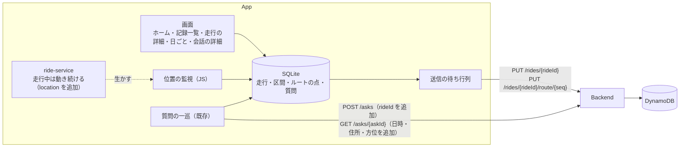

# スライス2 設計: 走行の記録と、地図での振り返り

- 日付: 2026-10-17
- 状態: 承認待ち（利用者のレビュー）
- 前提の文書: [docs/](../) の現行版（01・02・04・05・07）、[スライス1の設計](2026-10-16-slice1-design.md)、[画面モック](../mock/index.html)
- スライス1の走行での完了の判定は未実施のまま、本スライスの設計に進んだ。判定で ✗ が出たら、その結果に合わせて本書を見直す

## 1. 目的と成功の判定

スライス2は、**走行の始まりから終わりまでのルートと、その間の質問を記録し、走ったあとに地図で振り返る**までを全ユニットに通す。要件定義 §9 の「走ったあと」の中心であり、残っている最も大きな技術上のリスク（何時間も背面で位置を取り続けること・端末の記録の作り）をここで確かめる。

成功の判定:

- [ ] 開始から終了までのルートが、一時停止の区間を除いて地図に引かれている（画面を消し、ナビを前面に出したまま走った区間を含む）
- [ ] 一時停止して再開しても一続きの走行として残り、離れた場所で再開しても破線で繋がる
- [ ] 連続して記録した時間が最長時間に達すると、自動で終了して通知が出る（実機では最長時間を短くして確かめる）
- [ ] 走行中の質問に番号のピンが立ち、タップすると質問と回答が読める
- [ ] 記録していないとき・一時停止中の質問が日ごとの記録で見られ、走行の地図には出ない
- [ ] 走行とルートが DynamoDB に保存され、一覧で「保存済み」と出る。電波の無い区間の分も、通信が戻れば送られる
- [ ] 実際の走行で、1時間あたりの電池の減りを測って記録する

## 2. 範囲

### 含める

| 分類 | 内容 | 詳細要件 |
|---|---|---|
| 走行の記録 | 開始（名前は必須）・一時停止・再開・終了（要約を見せて確認）。同時に記録できる走行は1つ。ホーム・対話の画面・通知での状態の表示 | US-C-01, US-C-07, US-D-05.001〜004 |
| ルート | 背面・画面が消えているとき・ナビの使用中・電波の無い区間でも記録する。精度の悪い点を除く。走行時間と距離（一時停止中を除く） | US-C-02 |
| 自動終了 | 連続して記録した時間が最長時間（既定24時間。SC-16 で変える）に達したら終了し、通知で知らせる | US-C-08 |
| 質問の記録 | 回答が届いた質問と、Backend 側で失敗した質問を端末に保存する。記録中の質問は走行に結びつける。会話の区切りを残す | US-C-03, US-C-04 |
| 送信 | 走行・ルート・名前の変更を Backend へ送る。送れなかった分は次の機会に送り直す | US-C-05.001〜002（一部） |
| 振り返り | 記録一覧（走行／日ごと・保存の状態）、走行の詳細（ルート・番号付きのピン・一時停止の破線・全体が収まる縮尺・時系列・全画面・名前の変更）、日ごとの質問、会話の詳細（前後の会話へ移れる） | US-D-01, US-D-02（地点メモに関わる部分を除く）, US-D-03, US-D-07 |
| 画面 | タブ（ホーム・記録・設定）、ホーム（SC-02 の走行のカード）、走行の開始（SC-17）、走行終了の確認（SC-04）、記録一覧（SC-05）、走行の詳細（SC-06）、日ごとの質問（SC-15）、会話の詳細（SC-07）、走行の記録（SC-16） | — |

### 後のスライスに回す

- スライス3: メモ（US-D-04、SC-08）、削除（US-D-06）、地点メモ（US-D-08、SC-19。地図の地点メモの表示の切り替えを含む）、質問できなかった地点（US-C-09）、データの保存（SC-14）、クラウドからの読み込み・別の端末への引き継ぎ（US-C-05.004）、端末とクラウドの突き合わせの決まり（05 §9）
- スライス4以降: 初回セットアップ（SC-01）、録音の設定（SC-11）、文字での質問、文ごとの読み上げ、やめた質問の記録（US-B-07.005）、CICD による自動デプロイ

### 要件の未決を、本スライスでは「何もしない」で固定する

要件定義 §10 のうち次の2つは、本スライスでは何もしない。

- 一時停止のし忘れを自動で検知しない（終了し忘れは最長時間の自動終了だけで扱う）
- 走行を記録していないときに質問しても、記録の開始を促さない

## 3. 全体構成

| ユニット | 変更 |
|---|---|
| App | 走行の状態・ルートの記録・SQLite・送信の待ち行列・タブ・振り返りの画面と地図・ホームの走行のカード・SC-17・SC-04・SC-16 |
| Backend | `POST /asks` に `rideId`、`GET /asks/{askId}` に `askedAt`・`address`・`headingDegrees` を足す。走行の受け口（`PUT` 2つ）を足す。読み出しの `GET` は作らない（スライス3） |
| Agent | 変更なし |
| CICD | 変更なし（デプロイは手動のまま） |

技術の選択:

| 対象 | 採用 | 理由 |
|---|---|---|
| 背面でのルートの記録 | 走行中は ride-service のフォアグラウンドサービスを続け、JS で expo-location の位置の監視を受ける | ADR 0004（JS で済むならネイティブのコードを増やさない）にそろう。成り立たなければ、ride-service（Kotlin）で位置を取って溜める案に替える（§11） |
| 端末の記録 | expo-sqlite | ルートの点が数万になりうる |
| 地図 | WebView の中の Leaflet と国土地理院のタイル（pale） | モックと同じ作りで、API キーが要らない。react-native-maps は Android で Google の API キーが要り、MapLibre はネイティブのライブラリが重い |

## 4. 走行の状態とルートの記録（App）

### 4.1 状態と区間

状態は `記録していない → 記録中 ⇄ 一時停止中 → 終了`。走行は「記録した区間」の並びとして持つ。開始と再開で区間が始まり、一時停止と終了でその区間が閉じる。

- 走行時間は区間の長さの合計、距離は区間ごとの点の間の距離の合計。一時停止中は含まれない（US-C-07.006）
- 一時停止の回数と期間は、区間と区間のすき間から求める（US-C-07.007）
- 同時に記録・一時停止できる走行は1つだけ（US-C-01.005）

### 4.2 サービスの生き死に

ride-service のフォアグラウンドサービスを、「走行の記録中、または質問の一巡の途中」なら動かす（スライス1は一巡のたびに始めて止めていた）。

- サービスの種類: 走行の記録中は `location`、録音中は `microphone`、読み上げ中は `mediaPlayback` を加える
- 一時停止中は、質問の一巡の途中でなければ止める（泊まりで止めても電池を使わない）
- サービスの通知が、記録中であることの通知（EX-03）を兼ねる。タップでホームを開く

### 4.3 ルートの点

- expo-location の位置の監視を、精度は高、5秒ごとかつ10m 動いたら、の条件で使う
- 精度が 50m より悪い点は捨てる（US-C-02.005）
- 届いた点はすぐに SQLite に書く
- これらの数値は App の設定値（`src/config.ts`）にまとめ、実際の走行のあとで見直す。時速60km で8時間走って約6,000点の見込み

### 4.4 自動終了

- 区間が始まるたびに、「区間の開始＋最長時間」を締め切りとする（US-C-08.002）
- 締め切りの判定には ride-service のネイティブ側の待ちを使う（JS のタイマーは背面で止まる。ADR 0004）
- 締め切りが来たら、締め切りの時刻で終了し、自動で終了したことを記録して、通知を出す（US-C-08.004）
- 最長時間を変えたら、記録中の区間の締め切りを計算し直す（US-C-08.005）
- 最長時間は 6・12・24・48 時間から選ぶ。既定は24時間（US-C-08.003）

### 4.5 アプリが落ちたとき

走行の状態は SQLite にあるので、次に起動したとき次のように扱う。

- 締め切りを過ぎていれば、締め切りの時刻で自動終了とする
- 過ぎていなければ、記録中として位置の監視とサービスを再開する。落ちていたあいだのルートは抜ける

### 4.6 質問と走行の結びつけ

質問を始めた時点で記録中なら、その `rideId` を `POST /asks` に添え、端末の記録にも残す。一時停止中・記録していないときは添えない（US-C-03.005・US-C-04.002）。

## 5. 端末の記録と送信（App）

### 5.1 SQLite のテーブル

| テーブル | 中身 |
|---|---|
| `rides` | `id`（App が作る UUID）・名前・状態・自動終了したか・締め切り・`updatedAt`・送信済みの `updatedAt` |
| `ride_segments` | `rideId`・番号・開始・終了（記録中の区間は終了が空） |
| `route_points` | `rideId`・区間の番号・時刻・緯度・経度・精度・送ったかたまりの番号（まだなら空） |
| `asks` | `askId`・受け付けた日時・回答の日時・質問の文・回答の文・位置・住所・方位・入力の種類・`conversationId`・新しい会話の最初の質問か・状態（回答あり／失敗）・失敗の理由・`rideId` |

- 会話の区切り（US-C-03.004）は「新しい会話の最初の質問か」で表す。その質問の手前が区切り
- テーブルの形を変えるときに備え、版の番号で順に作り直す仕組み（マイグレーション）を最初から入れる
- SQLite は差し替えのできる薄い窓口を通して使う（テストで差し替える）

### 5.2 質問の保存

- 一巡が「回答あり」か「Backend 側の失敗」で終わった時点で、`GET /asks/{askId}` の結果を `asks` に書く。読み上げの成否には関係なく書く
- ポーリングを打ち切った（120秒）ものは、失敗（`timeout`）として残す
- `askId` が発行される前の失敗（`network` など）は残さない（スライス3の「質問できなかった地点」で扱う）
- 質問の記録は Backend が作るので、App から送り返さない（07 UC-7）

### 5.3 送信の待ち行列

| 対象 | 送り方 |
|---|---|
| 走行のメタ情報 | 状態・名前・区間が変わるたびに、最新の全体を `PUT /rides/{rideId}` で送る |
| ルート | まだ送っていない点を、300点ずつのかたまりで `PUT /rides/{rideId}/route/{seq}` で送る。記録中の区間の点も、かたまりに満ちた分から送る |

- 送る契機: 走行の状態が変わったとき・記録中に300点たまるごと・アプリが前面に戻ったとき・起動したとき
- 失敗したら次の契機まで待つ（間隔を延ばしながら試し直す仕組みは作らない）。同じ識別子で何度送っても1つにまとまる
- 400 が返ったものは送り直さず、ログに残して「未送信あり」のままにする
- 送り終えても端末の記録は消さない（US-C-05.002）

### 5.4 保存の状態（US-D-01.004）

走行ごとに次のどれかを出す。

- 「記録中」: 記録中・一時停止中
- 「未送信あり」: 送っていないメタ情報か点がある
- 「保存済み」: 終了していて、すべて送り終えた

## 6. Backend

### 6.1 質問の API の追加

| API | 追加 |
|---|---|
| `POST /asks` | 任意の `rideId`（UUID）。不正な形なら 400。質問の記録に残す |
| `GET /asks/{askId}` | `askedAt`（受け付けた日時。タイムゾーン付き）・`address`（確定できなかったら null）・`headingDegrees`（方位なしなら null） |

### 6.2 走行の受け口

`PUT /rides/{rideId}`

| 項目 | 内容 |
|---|---|
| `name` | 必須。空は 400 |
| `status` | `recording` / `paused` / `ended` |
| `segments` | `[{startedAt, endedAt}]`（記録中の区間は `endedAt` が null） |
| `autoEnded` | 自動で終了したか |
| `updatedAt` | App が変更した時刻。保存済みのものより新しいときだけ上書きする（条件付き書き込み）。古ければ何もせず 200 を返す |

`PUT /rides/{rideId}/route/{seq}`

| 項目 | 内容 |
|---|---|
| `points` | `[{t, lat, lon, accuracy, segment}]`。1かたまり300点まで。超えたら 400 |

- かたまりは丸ごと置く（同じ `seq` は上書き）
- どちらも既存の接続キーと `x-user-name` の検査を通す

### 6.3 DynamoDB

既存の1つのテーブルに足す。

| 記録 | パーティションキー | ソートキー |
|---|---|---|
| 走行 | `USER#<ユーザー名>` | `RIDE#<rideId>` |
| ルートのかたまり | `USER#<ユーザー名>` | `RIDE#<rideId>#ROUTE#<seq>`（`seq` は桁をそろえる） |
| 質問（既存に `rideId` を追加） | `USER#<ユーザー名>` | `ASK#<askId>` |

- ユーザー名ごとに分かれる（US-E-06）
- 同じ走行が別々に変えられたときは `updatedAt` の新しいほうを残す。端末が1台だけの本スライスではこれで足りる。本格的な突き合わせの決まりはスライス3で決める

## 7. 画面（App）

見た目と細かな振る舞いは [画面モック](../mock/index.html) に従う。モックと違うところだけを書く。

### 7.1 骨組み

画面の下に「ホーム」「記録」「設定」の3つのタブを置く（02 §1）。今の Stack を expo-router のタブに組み替える。対話（AskOverlay）が出ているあいだはタブを隠す。

### 7.2 ホーム（SC-02）

モックの走行のカードを足す。全体がスクロールしない、という決まりは守る。

- 記録していないとき: 「▶ 走行を開始」と「記録しなくても質問できます」
- 記録中・一時停止中: 状態の印・走行の名前・走行時間・距離・質問の数・一時停止／再開・終了。一時停止中は「一時停止中の質問は走行の記録に入りません」と添える
- モックの「走行メモ」と「地点メモ」のボタンは、スライス3まで出さない

### 7.3 走行の開始（SC-17）・走行終了の確認（SC-04）

- どちらもシートで出す
- 開始のときに位置の許可を確かめ、無ければ開始させずに理由を出す。名前が空なら開始できない
- 終了では、要約（走行時間・距離・質問の数・一時停止の回数）と名前の欄を出し、「終了／続ける」を選ばせる

### 7.4 記録一覧（SC-05）

上に「走行」と「日ごと」の切り替えを置く。

- 走行の行: 名前・日付（泊まりがけは期間）と時刻・距離・走行時間・質問の数・一時停止の回数・保存の状態（§5.4）。新しい順
- 日の行: 日付と質問の数だけ。質問のあった日を新しい順。日付は質問した時刻（端末のタイムゾーン）で決める

### 7.5 走行の詳細（SC-06）・日ごとの質問（SC-15）

上が地図、下が時系列の一覧。

- 走行の地図: ルートを線で描き、出発と到着に印を付ける。一時停止の区間は、止めた点と再開した点を破線で結ぶ。質問に時系列の番号のピンを立てる（その走行に結びついた質問だけ）。開いたときは全体が収まる縮尺。全画面にできる。質問のピンの表示・非表示を切り替えられ、選んだ状態を次に開いたときも保つ
- 日ごとの地図: 質問のピンだけを出し、走行の情報（名前・ルート・走行中かどうか）を出さない。走行の画面へ移る導線も置かない（US-D-07.004）
- 時系列の一覧: 質問・一時停止・会話の区切りを並べる。泊まりがけは日付の見出しを入れる
- ピンをタップすると要約のカードを出し、そこから会話の詳細へ進む
- 走行の詳細のメニューは「名前を変える」だけ（削除はスライス3）
- 自動で終了した走行は、そのことを出す

### 7.6 会話の詳細（SC-07）

日時・場所（住所）・進行方向・入力の種類・地点の小さな地図・質問・回答を出す。失敗した質問は理由を出す。開いた元の一覧（走行か日）の中で前後の会話へ移れる。メモと削除はスライス3。

### 7.7 地図の部品

- WebView の中に Leaflet と国土地理院のタイル（pale）を置き、出典を表示する
- ダークモードではモックと同じくタイルにフィルターをかける
- App は表示するデータ（線・区間・ピン）を JSON で渡し、WebView はピンのタップを App へ知らせる
- Leaflet の JS と CSS はアプリに同梱する（電波の弱い場所でも地図の枠が出るように。タイルは通信が要る）

### 7.8 走行の記録（SC-16）

設定の「走行中の動作」に「走行の記録」を足し、最長時間（§4.4）を選ぶ。

## 8. 失敗の扱い

| 場面 | 扱い |
|---|---|
| 位置の許可が無い | 走行を開始させず、理由を出す |
| 記録中に位置が取れない | 走行は続ける。点が無い区間はルートが途切れる |
| SQLite への書き込みの失敗 | ログに出し、ホームの警告の帯に「記録を保存できません」と出す。走行は止めない |
| 送信の失敗 | 一覧の「未送信あり」で分かる。利用者に操作を求めない。次の契機で送り直す（400 は送り直さない） |
| 自動終了 | 通知で知らせ、走行の詳細にも出す |

## 9. テスト

| ユニット | 自動テスト | 実機・実環境 |
|---|---|---|
| App | Jest: 区間の計算・距離・走行時間・締め切り・点のふるい分け・かたまりへの分け方・送信の待ち行列・状態の遷移・マイグレーション・地図に渡すデータの組み立て・日ごとのまとめ方。SQLite は差し替えた窓口で確かめる | スパイク（§11）。各 plan の終わりの実機の確認。最後に §1 の判定を実際の走行で確かめる |
| Backend | pytest: 2つの `PUT`（何度送っても1つにまとまる・古い `updatedAt` を無視する・ユーザー名ごとに分かれる・入力の検査）、`POST /asks` の `rideId`、`GET /asks` に足した項目 | `scripts/smoke` に走行の `PUT` を足す |

## 10. 現行版への反映

実装の各 plan で、関わる変更と同じコミットで直す。

- 07 UC-5: 質問に添える `rideId` と、結果に足した項目
- 07 UC-7: 走行の受け口と、`updatedAt` で新しいほうを残す扱い（スライス2の暫定）
- 05 §9: 背面でのルートの記録（スパイクの結果を ADR にして、そこへリンクする）

## 11. 進める順番

| plan | 中身 |
|---|---|
| 1 | スパイク（使い捨て）: 走行中にフォアグラウンドサービスを続けたまま、①画面を消し、ナビを前面に出した状態で数時間、点が抜けずに届くか ②電波の無い区間でも届くか ③記録中に背面から質問したとき、サービスの種類に `microphone` を足せるか（Android 14 以降の制限） ④1時間あたりの電池の減り。結果を ADR にする |
| 2 | Backend: §6 と、関わる issue（範囲に入れるかは writing-plans の前に決める。候補は #4 会話の ID とユーザーの結び付け） |
| 3 | App: 走行の記録（SQLite・状態・ルート・サービス・自動終了・送信・タブ・ホーム・SC-17・SC-04・SC-16） |
| 4 | App: 振り返り（地図の部品・SC-05・SC-06・SC-15・SC-07） |

スパイクの ① か ③ が成り立たなければ、位置をネイティブで取る案に替える。そのときは利用者に報告して決め直し、plan 3 の中身を変える。

## 12. 未確定事項

| 論点 | 決め方 |
|---|---|
| 背面でのルートの記録 | plan 1 のスパイクで決める |
| ルートの記録の細かさ（間隔・距離・精度の閾値） | §4.3 の初期値で始め、実際の走行の結果で見直す |
| 端末とクラウドの突き合わせの決まり | スライス3で決める（05 §9） |
