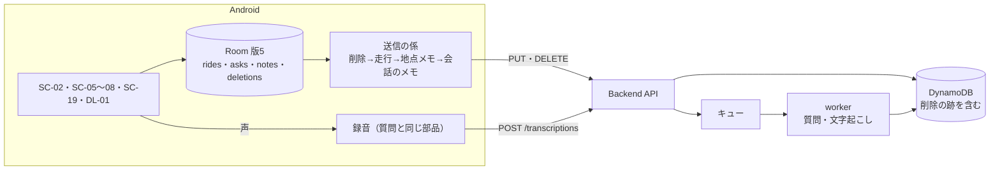

# スライス3 設計: メモ・地点メモ・削除

- 日付: 2026-10-21
- 状態: 承認済み（2026-10-21）
- 前提の文書: [docs/](../) の現行版（01〜05・07）、[スライス2の設計](2026-10-17-slice2-design.md)、[画面モック](../mock/index.html)（SC-02・SC-05〜SC-08・SC-19・DL-01 の仕様メモ）、[adr/0008](../../adr/0008-ask-only-while-recording.md)、[adr/0009](../../adr/0009-keep-deletion-marks-in-the-cloud.md)

## 1. 目的と成功の判定

スライス3は、**走ったあとと停車中に記録へ書き足し、要らないものを消し、それをクラウドにも反映する**までを全ユニットに通す。スライス2の候補だった「同期の仕上げと書き足し」のうち、書き足しと削除を先に行う。記録の形（メモ・地点メモ）をここで固め、同期の仕上げ（クラウドからの読み込み・引き継ぎ・突き合わせの決まり）は、その形を前提に次のスライスで行う（§2）。

成功の判定（実機で）:

- [ ] 走行の記録中に停車し、ホームから地点メモを文字でも声でも書ける。走行の詳細に緑のピン（質問とは別の通し番号）で出て、時系列には質問と時刻順に混ざって出る
- [ ] 通信を切って文字の地点メモを書くと端末に残り、通信が戻ると送られて、住所が付く
- [ ] 会話と走行にメモを書け、直せ、空にして保存すると消える。メモのある会話・走行が、一覧と地図で分かる
- [ ] 会話・地点メモ・終えた走行を削除すると、端末からも DynamoDB からも消え、DynamoDB に削除の跡が残る
- [ ] 消した記録を古い送信で置き直そうとしても戻らない（Backend の smoke で確かめる）

## 2. 範囲

### 含める

| 分類 | 内容 | 詳細要件 |
|---|---|---|
| メモ | 会話ごと・走行ごとのメモを書く・直す・消す（SC-08。2000字まで。保存せずに閉じるときは確認）。メモのある会話・走行は一覧と地図で分かる。記録中・一時停止中の走行のメモはホームから開ける | US-D-04 |
| 地点メモ | ホームから確認なしで新規に開く（走行の記録中と一時停止中だけ）。位置は開いたときの現在地。文字（2000字まで）と声。通信できないときは声で書けず、文字は端末に保存して後で送る。地図では緑のピンに質問とは別の通し番号を付け、時系列では質問と混ぜる。タップで開き、直す・消す | US-D-08 |
| 地図の表示の切り替え | 「💬 質問」「📝 地点メモ」のピンを出す・隠す。両方隠せばルートだけ。選んだ状態を覚える | US-D-02 の残り |
| 削除 | 会話・地点メモ・終えた走行を消す（DL-01。何が消えるかを示して確認。元に戻せない） | US-D-06 |
| 送信 | メモ・地点メモ・削除をクラウドへ送る（送る側だけ）。クラウドには削除の跡を残す | US-C-05.006（送る側） |
| 声の文字起こし | 地点メモの声を文字にするだけの依頼（AI は呼ばない） | UC-6 |
| 後回しの指摘 | Android #23・#25・#26・#29（送信）、#49（地図）、#51（時系列） | — |

### 後のスライスに回す

- 次のスライス（同期の仕上げ）: 質問できなかった地点（US-C-09）、通信できないときの後送の仕上げ（US-C-05.003）、クラウドからの読み込みと別の端末への引き継ぎ（US-C-05.004）、端末とクラウドの突き合わせの決まり（05 §9 の「どちらの変更を優先するか」）、データの保存（SC-14・US-E-05）。本スライスの削除の跡（§5.4）は、そこで端末をまたいで削除を伝えるのに使う
- 走行中にインカムのボタンだけで声の地点メモを書くこと（01 の未確定事項のまま。本スライスは、SC-19 を開いているあいだの声の入力にインカムのボタンを使うことだけを入れる。§7.3）
- スライス4以降: 初回セットアップ（SC-01）など、スライス2の spec §2 のとおり

### 決めたこと

- 削除できる走行は、終えたものだけ。記録中・一時停止中の走行には「この走行を削除」を出さない（消したいときは先に終える）。記録のサービスを動かしたまま消す場面を作らないため
- クラウドへの送り方は、スライス2の「最新の全体を置き、新しいときだけ上書きする」を広げ、削除は `DELETE` で送る。クラウドには削除の跡を残す（adr/0009）

## 3. 全体構成

## 4. Android の記録（Room 版5）

### 4.1 表

| 表 | 変更 |
|---|---|
| `rides` | `memo`（null は無し）を足す。メモの変更でも `updatedAt` を進め、今のメタ情報の送信に乗せる |
| `asks` | `memo`・`memoUpdatedAt`・`memoSentUpdatedAt`・`memoRejectedUpdatedAt` を足す（走行のメタ情報と同じ「送れた版・断られた版」の持ち方） |
| `notes`（新） | 地点メモ。`id`（UUID）・`rideId`（`rides` への外部キー。走行を消すと一緒に消える）・`at`・`latitude`・`longitude`（位置なしは null）・方位の材料（過去の1点の位置と時刻。無ければ null）・`text`・`updatedAt`・`sentUpdatedAt`・`rejectedUpdatedAt`・`address`・`headingDegrees`（Backend が返したもの。送るまで null） |
| `deletions`（新） | 削除の印。`kind`（`ask` / `ride` / `note`）・`id`・`rideId`・`deletedAt`。送れたら行を消す |

- 版4から版5へのマイグレーションは列と表を足すだけで、既存の行は変えない
- 走行の `updatedAt` は、状態・名前・区間・メモが変わったときに進む（点の追加と生きていた時刻の書き込みでは進まない。スライス2の決まりのまま）

### 4.2 消すとき

- 端末の記録をすぐ消し、同じトランザクションで削除の印を書く
- 走行を消すと、区間・点・地点メモは外部キーで一緒に消える。質問は外部キーが無いので、その走行の `rideId` のものを明示して消す
- 消したものへの送信は、行が無くなるので止まる。送信の回の途中で消した場合は、Backend の削除の跡が 410 で止める（§5.4）
- 削除の印は、消したものがまだ一度も送られていなくても書く（Backend は無いものの削除にも跡を残すので、後から古い送信が届いても戻らない）

### 4.3 地点メモの位置

- 新規で開いたときに、記録中のサービスが持っている最新の点を地点メモの位置にし、その少し前の点を方位の材料にする（質問の方位の材料と同じ選び方）
- まだ点が無いときは、位置なしで保存する。時系列には出すが、地図にピンは出さない
- 開いた時刻を地点メモの `at` にする（保存した時刻ではない）

## 5. 送信

### 5.1 送信の回

今の送信の係（`RideSync`）を広げる。1回の中で送る順番は、削除の印 → 走行（メタ情報とルート）→ 地点メモ → 会話のメモ。削除を先に送るのは、消した記録の古い版を同じ回で置き直さないため。

| 対象 | 送り方 |
|---|---|
| 削除の印 | 種類ごとの `DELETE`。204 で印を消す |
| 走行 | スライス2のまま（メタ情報に `memo` が加わる） |
| 地点メモ | 変わった版（`sentUpdatedAt` より新しく、断られた版でないもの）を `PUT /rides/{rideId}/notes/{noteId}` で全体を置く。応答の `address`・`headingDegrees` を行に書く |
| 会話のメモ | 変わった版を `PUT /asks/{askId}/memo` で置く |

- 未送信の読み出しは、1つのトランザクションで読む（Android #23）
- 送る契機に、メモ・地点メモ・削除を保存したとき、接続キーかユーザー名を保存したとき（Android #29）を足す。ほかはスライス2のまま

### 5.2 失敗の扱い

| 失敗 | 扱い |
|---|---|
| 通信・接続キー（403）・サーバーの失敗・流量の制限 | その回をそこで終え、次の契機で送り直す（スライス2のまま） |
| 端末で送る中身を組み立てられない（`SerializationException`・`IllegalArgumentException`） | そのものを「断られた」と同じに扱い、次へ進む（Android #25） |
| 400 | 送り直さない。Backend の `message` をログに残す（Android #26） |
| 410（削除の跡がある） | 送れたものとして扱い、送り直さない |
| 会話のメモへの 404（質問が Backend に無い） | 断られたものとして扱う |

### 5.3 保存の状態（SC-05）

「未送信あり」には、スライス2の走行のメタ情報と点に加えて、その走行の地点メモ・その走行の質問のメモの未送信を数える。削除の印は消えた走行の一覧に出ないので、数えない。

### 5.4 Backend の削除の跡

- `DELETE` を受けると、先に削除の跡を書き、それから記録を消す。記録が無くても跡を書く
- 跡のある記録と、跡のある走行の下の記録（ルートのかたまり・地点メモ）への `PUT` は、書かずに 410 `{"error": "deleted"}` を返す。会話のメモの `PUT` は、質問の跡か、その質問の走行の跡があれば 410
- 跡には期限を付けない（次のスライスで、端末をまたいで削除を伝えるのに使う）
- （2026-10-21 追記、plan 1 の実装）走行を消すと、その走行の質問と地点メモの1件ずつにも跡を書く。そのため会話のメモの `PUT` は質問の跡だけを確かめ、走行の跡は見ない。Backend が知っている質問は、走行の削除で必ず跡が付く（子の記録は一貫した読み出しで集める）

## 6. Backend

### 6.1 DynamoDB

既存の1つのテーブルに足す。パーティションキーはいつも `USER#<ユーザー名>`。

| 記録 | ソートキー | 中身 |
|---|---|---|
| 走行（既存） | `RIDE#<rideId>` | `memo` を足す |
| 質問（既存） | `ASK#<askId>` | `memo`・`memoUpdatedAt` を足す |
| 地点メモ（新） | `RIDE#<rideId>#NOTE#<noteId>` | `noteId`・`rideId`・`at`・`location`・`headingDegrees`・`address`・`text`・`updatedAt` |
| 削除の跡（新） | `DELETED#ASK#<id>`・`DELETED#RIDE#<id>`・`DELETED#NOTE#<id>` | `kind`・`id`・`rideId`（地点メモのとき）・`deletedAt` |
| 文字起こし（新） | `TRANSCRIPTION#<id>` | `status`・`text`・`failure`・`expiresAt`（1日後。テーブルの TTL を有効にする） |

- 地点メモをルートのかたまりと同じ `RIDE#<rideId>#` の下に置くのは、走行を消すときに1回の問い合わせで子の記録を集めるため。走行の一覧を読むときの絞り込み（スライス2の「持ち越し」）は、次のスライスで読み込みと一緒に決める
- 走行を消すときの質問は、`ASK#` の頭の記録から `rideId` が一致するものを選ぶ（1人の質問の数は多くないので、索引は足さない）

### 6.2 受け口

| API | 振る舞い |
|---|---|
| `PUT /rides/{rideId}` | 任意の `memo`（2000字まで。null か省略は無し）を足す。ほかはスライス2のまま |
| `PUT /asks/{askId}/memo` | `{memo, updatedAt}`。`memo` は2000字まで、null で消す。保存済みの `memoUpdatedAt` より新しいときだけ書く（古ければ何もせず 200）。質問が無ければ 404、跡があれば 410 |
| `PUT /rides/{rideId}/notes/{noteId}` | `{at, location?, headingSample?, text, updatedAt}`。`text` は1〜2000字。新しいときだけ書く。最初に受けたときに、住所（町名まで）と方位を質問と同じ求め方で決めて保存し、あとの `PUT` では変えない。住所を確定できなかったときは null のまま、次の `PUT` で求め直す。応答は `{address, headingDegrees}`。走行の記録がまだ届いていなくても受ける（ルートのかたまりと同じ） |
| `DELETE /asks/{askId}` | 跡を書いて質問を消す。204 |
| `DELETE /rides/{rideId}` | 跡を書いて、走行・ルートのかたまり・地点メモ・その走行の質問を消す。204 |
| `DELETE /rides/{rideId}/notes/{noteId}` | 跡を書いて地点メモを消す。204 |
| `POST /transcriptions` | `{audio}`（質問と同じ PCM の base64・0.25〜60秒）。202 `{transcriptionId}`。音声を一時的に置き、キューに入れる |
| `GET /transcriptions/{id}` | `{status: processing / done / failed, text?, failure?}`。`failure` は `no_speech` か `transcribe_failed` |

- どれも既存の接続キーと `x-user-name` の検査を通す。`DELETE` は何度呼んでも 204
- 項目の名前と型の正本は `openapi.yaml`。07 の UC-6・UC-7 を、Backend の plan で合わせて直す

### 6.3 worker

- 質問と同じキューと worker で、メッセージに種類を足して文字起こしを扱う。文字起こしは質問と同じストリーミングの文字起こしを使い、AI と読み上げは呼ばない。音声は文字にしたら消す（今の質問と同じ）
- 質問の結果を書き込むとき、質問の記録が消えていたら作り直さない（今の書き込みは、無い記録を作ってしまうので、記録があることを条件にする）

## 7. 画面（Android）

画面の見た目と文言は、モックの SC-02・SC-05〜SC-08・SC-19・DL-01 に従う。ホームはスクロールさせない。

### 7.1 ホーム（SC-02）

- 記録中と一時停止中だけ「📝 地点メモ」を進行方向のカードの右に置く（カードの高さは増やさない）。押すと SC-19 を新規で開く
- 記録中と一時停止中だけ「📝 走行メモ」を出し、その走行のメモを SC-08 で開く

### 7.2 SC-08 メモの編集

- 上部に何のメモかを出す（「会話 · 09:41 箱根町仙石原」「走行のメモ」）。開いたら入力欄にフォーカスしてキーボードを出す
- 2000字まで。空にして保存するとメモが無い状態になる。変更があるのに ✕ で閉じるときは「変更を破棄しますか？」を確認する

### 7.3 SC-19 地点メモ

- 上部に、いつ・どこで（住所が無ければ「住所は送ったあとに付きます」など。文言は plan で決める）・どの走行に入るかを出す
- 文字で書く（2000字まで）。空のまま保存はできない。✕ で閉じるときは、変更があれば破棄を確認する。記録から開いたときは「この地点メモを削除」（DL-01）
- 声の入力:
  - 「🎤 声で入力」で録音を始め、もう一度押すと止めて送る。60秒で自動で止める
  - 送ったあとは質問と同じ間隔（最初の10秒は1秒ごと・以後2秒ごと）で結果を取りに行き、120秒で打ち切る。聞き取れた文は入力欄の終わりに足す（そのあと手で直せる）
  - 失敗したら、理由を入力欄の下に出す（聞き取れなかった・文字にできなかった・通信できない）
  - 通信できないときはボタンを押せなくし、「通信できないため、声では入力できません。文字で書けば保存できます。」を出す
  - SC-19 を開いているあいだは、インカムのボタンで質問を始めず、声の入力の開始と停止に使う（停車中に手袋のままでも書けるように）
  - 録音の経路と録音の部品は、質問のものを使い回す

### 7.4 DL-01 削除の確認

録音・接続キーの削除の確認と同じ部品にそろえ、会話・走行・地点メモの3種類を足す。文言はモックの表のとおり。削除のボタンは赤で右、「やめる」は左。

| 対象 | 削除したあと |
|---|---|
| 会話 | SC-06 へ戻る。ピンの番号は残った質問で振り直す |
| 走行 | SC-05 へ戻る |
| 地点メモ | 開いた元の画面へ戻る |

### 7.5 SC-05 記録一覧

メモのある走行に印を付ける。保存の状態は §5.3。

### 7.6 SC-06 走行の詳細

- 走行のメモを出す（無ければ「＋ 走行のメモ」）。SC-08 で編集する
- 地点メモを緑のピンで、質問とは別の通し番号を付けて出す。タップで要約のカード、カードのタップで SC-19
- 地図の右上に「💬 質問」「📝 地点メモ」の切り替えを置く。選んだ状態は設定に覚え、次に開いたときもそのまま。下の時系列は切り替えに関係なく出す
- 時系列に地点メモ（緑の番号・時刻・場所・本文2行まで。タップで SC-19）を時刻順に混ぜる。メモのある会話には印を付ける
- 泊まりがけで、再開した日に出来事が無い走行でも、再開した日の見出しを出す（再開した区間の始まりを時系列の出来事として扱う。Android #51）
- メニューに「この走行を削除」（終えた走行だけ）
- ピンを選んだときは、ピンの GeoJSON だけを組み直す。記録の一覧は共有して受け、詳細から戻ったときに一瞬空にならないようにする（Android #49）

### 7.7 SC-07 会話の詳細

メモがあれば本文と「編集」、無ければ「＋ メモを追加」（どちらも SC-08）。「この会話を削除」で DL-01。

## 8. 失敗の扱い

| 場面 | 扱い |
|---|---|
| メモ・地点メモ・削除の DB への書き込みの失敗 | 画面に「保存できませんでした」を出し、画面は閉じない（入力を失わない）。ログに出す |
| 送信の失敗 | §5.2。利用者に操作を求めない |
| 地点メモを開いたときに位置が無い | §4.3 |
| 声の入力の失敗 | §7.3 |
| 走行の削除の途中で失敗した | 端末は1つのトランザクションなので、全部消えるか何も消えない。Backend の `DELETE` は何度呼んでも同じ結果になるので、印が残っている限り送り直す |

## 9. テスト

| ユニット | 自動テスト | 実機・実環境 |
|---|---|---|
| Backend | pytest: 受け口ごとの入力の検査・新しいときだけ書く・ユーザー名ごとに分かれる・跡があると 410・走行の削除で子の記録とその走行の質問まで消える・無いものの削除でも跡が残る・worker が消えた質問を作り直さない・文字起こしの流れ（キューの種類・AI を呼ばない・音声を消す） | `scripts/smoke` を、走行を1つ作るところから始め、地点メモ・メモ・文字起こし・削除と、消したあとの古い `PUT` が 410 になることまで回す（あわせて、走行に結びつかない質問を smoke が増やす件を直す） |
| Android | 下の表 | 各 plan の終わりに実機で確かめ、最後に §1 の判定 |

| 確かめ方 | 対象 |
|---|---|
| JUnit | 送信の判断（順番・410・404・組み立ての失敗で先へ進む）・時系列の組み立て（地点メモを混ぜる・再開した日の見出し）・地図に渡すデータ（地点メモのピン・番号・切り替え）・地点メモの位置と方位の材料の選び方 |
| JUnit・MockWebServer | 足した受け口の読み書き・400 の `message` を `ApiError` に入れる |
| Robolectric | Room の 4→5 のマイグレーションと DAO（消すときの印・走行を消すと子と質問が消える・未送信の読み出しが1つのトランザクション）・接続キーの保存で送信が始まる |
| Compose の UI テスト（Robolectric） | ホームの入口の出し分け・SC-08（2000字・破棄の確認・空で消す）・SC-19（空では保存できない・声のボタンの状態・通信できないとき）・DL-01 の3種類と戻り先・SC-05 と SC-06 と SC-07 のメモの印・走行の削除が終えた走行だけに出る |
| 実機 | §1 の判定・声の入力（インカムのボタンでの開始と停止を含む）・#49 の見た目 |

## 10. 現行版への反映

| 文書 | 反映 |
|---|---|
| 03 | SC-19 を開いているあいだのインカムのボタンの扱い（§7.3）。本 spec と同じコミット |
| 05 §9 | 「同期のしかた」のうち、削除の伝え方は決定済み（adr/0009）。どちらの変更を優先するかは次のスライス。本 spec と同じコミット |
| モック | SC-19 の仕様メモに、インカムのボタンで声の入力を始めることを足す。本 spec と同じコミット |
| 07 UC-6・UC-7 | 受け口・削除の跡・410。Backend の plan で、実装と同じコミット |
| 04 | 変えない |

## 11. 進める順番

| plan | 中身 |
|---|---|
| 1 | Backend: §6 の全部（メモ・地点メモ・削除と跡・文字起こし・worker の条件）・smoke・07 の UC-6・UC-7。デプロイと smoke まで |
| 2 | Android: Room 版5・メモ（SC-08・ホームの走行メモ・一覧と地図と時系列の印）・削除（DL-01 の会話と走行・削除の印）・送信の広げ方（§5）・Android #23・#25・#26・#29 |
| 3 | Android: 文字の地点メモ（SC-19・ホームの入口・地点メモの送信・地図のピンと切り替え・時系列・地点メモの削除）・Android #49・#51 |
| 4 | Android: 声の地点メモ（録音・文字起こしの依頼と取りに行く処理・通信できないとき・SC-19 でのインカムのボタン）。最後に §1 の判定 |

Backend を先に置くのは、Android の各 plan が、実機で送るところまで確かめて終えられるようにするため。メモと削除を地点メモより先に置くのは、送信の広げ方（削除の印・410・失敗の扱い）を、表が少ないうちに固めるため。声を最後に分けるのは、文字の地点メモだけで先に実機で使えるようにし、録音の経路の難しさをほかの変更と混ぜないため。

## 12. 未確定事項

| 論点 | 決め方 |
|---|---|
| SC-19 の住所が無いときの文言・声の入力の失敗の文言 | plan 3・4 でモックと並べて決める（2026-10-22 追記: 住所の文言は plan 3 で決め、モックの SC-19 に書いた） |
| 走行の一覧を読むときの絞り込み（`RIDE#` の頭にルートのかたまりと地点メモが混ざる） | 次のスライスで、クラウドからの読み込みと一緒に決める |
| 端末とクラウドの突き合わせの決まり（どちらの変更を優先するか） | 次のスライスで決める（05 §9） |
