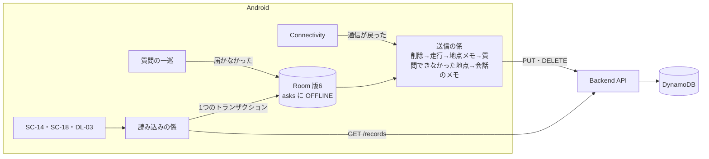

# スライス4 設計: 同期の仕上げ

- 日付: 2026-10-22
- 状態: 承認済み（2026-10-22）
- 前提の文書: [docs/](../) の現行版（01〜05・07）、[スライス2の設計](2026-10-17-slice2-design.md)（§5 送信）、[スライス3の設計](2026-10-21-slice3-design.md)（§5 送信・§6 Backend）、[画面モック](../mock/index.html)（SC-07・SC-14・SC-18・DL-03 の仕様メモ）、[adr/0008](../../adr/0008-ask-only-while-recording.md)、[adr/0009](../../adr/0009-keep-deletion-marks-in-the-cloud.md)、[adr/0010](../../adr/0010-read-the-cloud-only-when-taking-over.md)

## 1. 目的と成功の判定

スライス4は、**通信が無いときでも記録が欠けずにクラウドへ届き、端末を替えても入れ直しても記録が戻る**までを全ユニットに通す。スライス3の「後のスライスに回す」の同期の仕上げを行う。準備と入力の補い（SC-01・SC-11・文字での質問・文ごとの読み上げ・やめた質問の記録）は次のスライスに回す（§2）。

成功の判定（実機で）:

- [ ] 機内モードで質問すると、すぐ失敗の音と「通信できません」が流れ、走行の詳細の地図と時系列に「（通信できず、質問できなかった）」地点が出る。その地点にメモを書ける
- [ ] 走行の記録中に機内モードを切ると、アプリを前面に出さなくても、未送信の記録（ルート・質問できなかった地点・地点メモ）が送られる
- [ ] SC-14 に、保存の状態・未送信の内訳・最後に保存した時刻が出て、「今すぐ保存」で送り直せる
- [ ] アプリを入れ直し、SC-18 で前のユーザー名に変えると、走行・ルート・質問・メモ・地点メモ・質問できなかった地点が戻る。消した記録は戻らない
- [ ] ユーザー名を別の名前に変えて元に戻すと、それぞれの名前の記録に切り替わる（DL-03 の文言が、記録があるかどうかで分かれる）

## 2. 範囲

### 含める

| 分類 | 内容 | 詳細要件 |
|---|---|---|
| 質問できなかった地点 | 届かなかった質問の日時・位置・進行方位を端末に残し、記録の上で分かるようにし、後で送る | US-C-09 |
| 後送の仕上げ | 通信できるようになったことを送る契機にする（アプリのプロセスが生きているあいだ） | US-C-05.003 |
| 引き継ぎの読み込み | ユーザー名を変えるとき、クラウドの記録を端末へ読み込んで切り替える。SC-14 から今の名前のまま読み直す | US-C-05.004・US-E-06.004〜.008 |
| 突き合わせの決まり | 端末とクラウドのどちらの変更を優先するか | 05 §9 |
| データの保存 | SC-14 | US-E-05 |
| 後回しの指摘 | Android #28・#53・#58・#62、Backend #2・#3・#16・#17・#18・#19 | — |

### 後のスライスに回す

- 次のスライス（準備と入力の補い）: 初回セットアップ（SC-01。引き継ぎの入口を含む。US-E-06.006）、録音の設定（SC-11）、文字での質問、文ごとの読み上げ、やめた質問の記録（US-B-07.005）。本スライスの読み込み（§6）を、SC-01 の引き継ぎの入口から呼ぶ
- その後: CICD による自動デプロイ
- 決めずに置く: 2台の端末を同時に使ったときに、一方の変更をもう一方へ自動で届けること（§6.1）

### 決めたこと

- クラウドからの読み込みは、引き継ぎのとき（ユーザー名を変えるとき）と SC-14 の手動の操作だけ。前面に来るたびに読むことはしない（adr/0010）
- 突き合わせは「`updatedAt` が新しいほうが勝つ。クラウドに削除の跡があれば端末から消す」（adr/0010）
- 「質問できなかった地点」を残すのは、質問が Backend に届かなかったときだけ。受け付けたあとの失敗（時間切れ・聞き取れない・答えられない）は今のまま（Backend に記録がある）
- 通信が戻ったときの送信は、アプリのプロセスの中で行う。WorkManager は使わない（スライス2 §5.3 のまま）

## 3. 全体構成

## 4. 質問できなかった地点（US-C-09）

### 4.1 いつ残すか

| 場面 | 扱い |
|---|---|
| 録音を終えた時点で `Connectivity.online` が false | `POST /asks` を送らず、すぐ失敗にして地点を残す |
| `POST /asks` が `network` で失敗した（試し直しのあとの 5xx・流量の制限を含む。spec 1 §8） | 地点を残す |
| `POST /asks` が `invalid_key`（403）で失敗した | 残さない（今のまま） |
| 受け付けたあとの失敗（`timeout`・`no_speech`・`agent_failed` など） | 残さない（今のまま。Backend に記録があり、`timeout` は今も端末に残している） |

- 録音は捨てる（US-C-09.001。今のまま）。録音の確認（SC-12）の直近10件にも入れない
- 会話の文脈は進めない（US-C-09.006）。次の質問の `conversationId` は、今の会話のまま
- 知らせ方は spec 1 §8 の `network` のまま（失敗の音と「通信できません」。画面は今の失敗と同じで、戻り先があればすぐ戻り、無ければ5秒で閉じる。US-C-09.003）

### 4.2 端末の記録（Room 版6）

- `asks` の行として書く。`askId` は端末で作る UUID、結果（`outcome`）は新しい `OFFLINE`
- 持つのは日時（録音を終えた時刻）・位置・進行方位の材料・`rideId` だけ。文字起こし・回答・`conversationId` は持たない。`conversationId` は今は必須なので、null を許すように変える
- 進行方位は、質問と同じく録音中の位置から選んだ材料（`headingSample`）を送り、Backend が決めた値を書く。住所も Backend が決めた値を書く
- 未送信を知るために `sentUpdatedAt` を持つ（地点メモと同じ。§5.1）
- 走行の記録中にしか質問は始まらない（adr/0008）ので、`rideId` はいつも付く。走行の行が無いときは書かない（Android #54 の `AskDao.keep` のまま）。そのときの扱いは §5.3 の #58

### 4.3 表示

- 番号・地図のピン・時系列・SC-07 の前後の移動は、質問と同じ並びに入れる（モックの SC-07 の「質問できなかった地点」）
- 質問の文の代わりに「（通信できず、質問できなかった）」、回答の代わりに「質問の内容は残していません」と出す。SC-07 では「📵 通信できず、質問できなかった」と、何を聞きたかったかはメモに書けることを示す
- メモ（SC-08）と削除（DL-01 の会話と同じ）は質問と同じに扱う

### 4.4 Backend

| API | 振る舞い |
|---|---|
| `PUT /asks/{askId}/offline` | `{askedAt, location?, headingSample?, rideId, updatedAt}`。`ASK#<askId>` に `status: "offline"` で書く。新しいときだけ書く。最初に受けたときに、住所（町名まで）と方位を地点メモと同じ求め方で決めて保存し、あとの `PUT` では変えない（住所を確定できなかったときは null のまま、次の `PUT` で求め直す）。応答は `{address, headingDegrees}`。質問の跡があれば 410。同じ `askId` に `offline` でない質問が既にあれば 409（端末の UUID なので起きない前提。上書きしない） |

- メモは既存の `PUT /asks/{askId}/memo`、削除は既存の `DELETE /asks/{askId}` をそのまま使う
- 走行を消すときに集める質問（スライス3 §6.1）に、`offline` の質問も含まれる（同じ `ASK#` の頭なので変更は要らない）
- worker は `offline` の質問を扱わない（キューに入らない）

## 5. 送信

### 5.1 送信の回

スライス3 §5.1 の回に足す。1回の中で送る順番は、削除の印 → 走行（メタ情報とルート）→ 地点メモ → **質問できなかった地点** → 会話のメモ。地点を会話のメモより先に送るのは、Backend に質問の記録が無いとメモが 404（断られた扱い）になるため。

| 対象 | 送り方 |
|---|---|
| 質問できなかった地点 | 変わった版（`sentUpdatedAt` より新しく、断られた版でないもの）を `PUT /asks/{askId}/offline` で置く。応答の `address`・`headingDegrees` を行に書く |

- 失敗の扱いはスライス3 §5.2 のまま（410 は送れた扱い、400 は送り直さない）
- 会話のメモの未送信は、その質問が質問できなかった地点で、地点がまだ送れていなければ、その回では送らない（次の回に回す）

### 5.2 送る契機

スライス2 §5.3・スライス3 §5.1 の契機に足す。

- **通信できるようになったとき**: `Connectivity.online` が false から true に変わったら `RideSync.request()` を呼ぶ。アプリのプロセスが生きているあいだ（走行の記録中は前面サービスが生かしている）は、アプリを前面に出さなくても送る。プロセスが死んだあとは、次の起動で送る（今のまま）
- 通信できないあいだに来たほかの契機（状態の変化・300点ごと・前面に戻ったとき）は、通信を試さずに見送る。送るものは通信が戻ったときにまとめて送る
- SC-14 の「今すぐ保存」（§7.1）

### 5.3 一緒に直す指摘

| issue | 直し方 |
|---|---|
| Android #62 | `AndroidManifest.xml` に `ACCESS_NETWORK_STATE` を書く。`Connectivity` の `onLost` は、最後に受けた既定のネットワークと同じときだけ「通信できない」にする |
| Android #53 | 走行の削除は、削除が書けたときだけ保存待ち（`unsaved`）を捨てる。記録中でない走行の編集は、保存待ちにある同じ走行を元にする。SC-08 で「保存できませんでした」を出したメモは、保存待ちに残さない（破棄したはずのメモが後から書かれないように） |
| Android #58 | 走行の行が無くて質問を書かなかったときは、`ask_dropped` を `askId`・`rideId` つきでログに残し、警告の状態を変えない。質問できなかった地点の保存も同じ道を通る |
| Android #28 | ホームの警告の帯のうち、質問を書けなかったほうの文言を「書けなかった質問があります」にし、✕ で閉じられるようにする。書けなかった質問は取り戻せないので、見たことを確かめれば足りる。走行の書き込みの失敗の帯は今のまま |

### 5.4 保存の状態（SC-05）

「未送信あり」に、その走行の質問できなかった地点の未送信を足す（スライス3 §5.3 に加える）。

## 6. 引き継ぎの読み込み（US-C-05.004）

### 6.1 突き合わせの決まり

| 場面 | 扱い |
|---|---|
| 同じ記録が端末とクラウドの両方にある | `updatedAt` が新しいほうを残す。クラウドが新しければ端末を書き換え、端末が新しければ端末のまま（あとで送る） |
| クラウドに削除の跡がある | 端末の記録を消す（走行なら子の記録と質問も。スライス3 §4.2 と同じ消し方。削除の印は作らない） |
| 端末にだけある | 残す。未送信なら次の回で送る |
| クラウドにだけある | 端末に入れる |

比べる `updatedAt` は、走行はメタ情報の `updatedAt`、地点メモは `updatedAt`、会話のメモは `memoUpdatedAt`、質問できなかった地点は `updatedAt`。ルートのかたまりは、点の数が多いほうを残す（かたまりは点を足していくだけで、減らない）。ふつうの質問（Backend が作ったもの）は、文字起こし・回答をクラウドの値で入れ、メモだけを上の決まりで比べる。

端末に入れる記録は、次のように扱う。

- 入れた版は「送り済み」にする（`sentUpdatedAt`・かたまりの送り済みの印）。読み込んだものを送り返さないため
- 記録中・一時停止中のままクラウドにある走行（入れ直す前に走っていたものなど）は、最後の点の時刻（点が無ければ最後の区間の始まり）で終えた走行として入れ、その版を未送信にする（次の回で「終えた」状態がクラウドに届く）。サービスの動いていない記録中の走行を作らないため
- 走行の無い質問（`rideId` が無い・その走行がクラウドにも端末にも無い）は入れない（adr/0008・Android #54 と同じ考え）
- 受け付けたまま結果の出ていない質問（`pending`）は、結果の無い失敗として入れる
- 地点メモ・ルートのかたまりで、走行がクラウドにも端末にも無いものは入れない

2台を同時に使い、両方で同じ記録を変えたときは、読み込んだ時点で新しいほうが勝つ。それ以外の端末をまたぐ自動の反映はしない（adr/0010）。

### 6.2 Backend: `GET /records`

| API | 振る舞い |
|---|---|
| `GET /records?cursor=<不透明な文字列>` | `USER#<ユーザー名>` のパーティションを、強い一貫性でソートキーの順に問い合わせる。1ページは DynamoDB の1回の問い合わせ（最大1MB）。応答は `{items: [...], cursor?}`。`cursor` が無ければ最後のページ。不正な `cursor` は 400 |

- `items` の各項目は `kind` を持つ: `ride`・`route`・`note`・`ask`・`deleted`。文字起こし（`TRANSCRIPTION#`）など、ほかの記録は返さない
- `ride`・`route`・`note` の形は、それぞれの `PUT` で送る形に、Backend が決めた値（地点メモの `address`・`headingDegrees`）を足したもの。`ask` は `GET /asks/{askId}` の形に `memo`・`memoUpdatedAt`・`rideId` を足したもので、`status` が `offline` のものを含む。`deleted` は `{kind, id, rideId?, deletedAt}`
- 項目の名前と型の正本は `openapi.yaml`。07 に UC を足す（Backend の plan で）
- `cursor` は `LastEvaluatedKey` を符号化したもの。パーティションキーは `x-user-name` から作り直し、`cursor` の中のものは使わない（他人のパーティションを読ませない）

スライス3 §12 の「走行の一覧を読むときの絞り込み」は、パーティションを全部読むので要らなくなった（§12）。

### 6.3 Android: 読み込みの係

- `GET /records` を最後のページまで読み、メモリに集める。途中で失敗したら、端末は何も変えない
- 集めたものを §6.1 の決まりで、Room に1つのトランザクションで入れる
- 読み込みのあいだは、送信の係を止める（送信の回の途中で読み込みが入ると、送り済みの印が食い違うため）。終わったら `RideSync.request()` を呼ぶ
- 大きさ: 全部をメモリに読んでから入れる。3000点の走行が100本で約30万点を目安とし、それまでは問題にならないと見る。実機では今ある記録で時間を測る

### 6.4 いつ読むか

**SC-18 でユーザー名を変えるとき**（US-E-06.004・.005）:

1. 「変更する」で、新しい名前で `GET /records` の1ページ目を読む。読めなければ「読み込めませんでした」と出し、何もしない
2. 記録があるかで DL-03 の文言を分ける（モックの DL-03 の2つの状態）。記録がある: その記録に切り替わること。無い: 新しく始めること。どちらも、今の記録は引き継がず、元の名前に戻せばまた見られることを示す
3. 確認したら残りのページを読み、**端末の記録（走行・ルート・質問・地点メモ・削除の印）を消してから**、読んだものを入れる。消すのと入れるのは1つのトランザクション
4. 入れ終えてから、ユーザー名を保存する。途中で失敗したら、名前も記録も変えずに「読み込めませんでした」と出す
5. 会話の文脈（15分）は切る（ユーザー名ごとに Agent のセッションが分かれるため）。SC-12 の録音は端末のものなので残す

変えられないとき（「変更する」を押せず、理由を出す）:

- 未送信の記録があるとき（US-E-06.008）。「先に保存してください」と出し、SC-14 へ案内する
- 走行の記録中・一時停止中（先に終える）

**SC-14 の「クラウドから読み直す」**: 今の名前のまま、§6.1 の決まりで突き合わせる（端末の記録は消さない）。終わったら、入れた件数を出す。

再インストールのときの流れは、既定のランダムな名前で開く → SC-18 で前の名前に変える → DL-03「その記録に切り替わります」→ 記録が戻る、となる（SC-01 の引き継ぎの入口は次のスライス）。

### 6.5 今の作りから変える点

今の SC-18 は、名前を変えても端末の記録を切り替えず、未送信の確認もしていない（スライス2で SC-18 を作ったときは、読み込みが無かったため）。DL-03 の文言は、記録があるかを知らずに両方の場合を1つの文で書いている。本スライスで §6.4 のとおりに直す。

## 7. 画面（Android）

### 7.1 SC-14 データの保存

入口は設定のタブの「☁️ データの保存」で、右に「保存済み」か「未送信あり」を出す（モックのとおり）。

| 項目 | 中身 |
|---|---|
| 状態 | 「すべてクラウドに保存済み」と最後に保存した時刻、または「未送信の記録があります」と内訳（質問できなかった地点の件数・ルートのある走行の数・地点メモ・メモ・削除）と「通信できるようになると自動で送ります」 |
| 今すぐ保存 | 未送信があるときに出す。`RideSync.request()` を呼ぶ。送っているあいだは押せない |
| ユーザー名 | 今の名前。タップで SC-18 |
| クラウドから読み直す | §6.4。読んでいるあいだは押せない。失敗したら「読み込めませんでした」 |
| 保存している内容 | 会話の文字・ルート・メモ・地点メモは端末とクラウドにすべて。録音の音声は端末だけに直近10件（設定 > 録音の確認でだけ聞ける）。機種を変えても、同じユーザー名を設定すれば記録が戻ること（音声は戻らない） |
| 件数 | 走行・質問・端末の音声 |

- 「最後に保存した時刻」は、送信の1回が最後まで成功した時刻（送るものが無かった回を含む）。設定と同じ置き場に持ち、端末の時刻で出す
- 削除の印は SC-05 では数えない（スライス3 §5.3）が、SC-14 の内訳には出す（消したのに届いていないことが分かるように）

### 7.2 SC-18・DL-03

§6.4。読み込んでいるあいだは進み具合（「読み込んでいます」）を出し、画面を離れても読み込みは続ける。

### 7.3 SC-06・SC-07・ホーム

§4.3（質問できなかった地点）と §5.3 の #28（ホームの帯）。

## 8. 失敗の扱い

| 場面 | 扱い |
|---|---|
| 質問できなかった地点の DB への書き込みの失敗 | 質問の書き込みの失敗と同じ（ホームの帯。#28） |
| 送信の失敗 | スライス3 §5.2。利用者に操作を求めない |
| 読み込みの途中の失敗（通信・403・5xx・不正な応答） | 端末は何も変えない。ユーザー名も変えない。「読み込めませんでした」を出す |
| 読み込んだ記録の DB への書き込みの失敗 | トランザクションなので何も変わらない。同じく「読み込めませんでした」 |

## 9. テスト

| ユニット | 自動テスト | 実機・実環境 |
|---|---|---|
| Backend | pytest（moto）: `PUT /asks/{askId}/offline` の入力の検査・新しいときだけ書く・住所と方位を最初だけ決める・跡があると 410・ふつうの質問があると 409。`GET /records` のページ送り（`cursor` で続きが読める・最後に `cursor` が無い・不正な `cursor` は 400・`cursor` で他人のパーティションを読めない）・種類ごとの形・文字起こしを返さない・強い一貫性の引数。Backend #2・#3・#16・#17・#18・#19 のそれぞれの対応案のテスト | smoke に、質問できなかった地点の `PUT`・メモ・削除と、`GET /records` で作った記録と跡が読めることを足す |
| Android | 下の表 | plan 2・3 の終わりに実機で確かめ、最後に §1 の判定 |

| 確かめ方 | 対象 |
|---|---|
| JUnit | 一巡の失敗の分岐（通信できないときに送らず地点を残す・`network` で残す・403 と受け付け後の失敗では残さない・会話の文脈を進めない）・送信の順番と、地点が未送信のときにそのメモを送らない・通信できないときに契機を見送り、戻ったときに送る・突き合わせの決まり（新しいほうが勝つ・跡で消す・記録中の走行を終えて入れる・走行の無い記録を入れない・かたまりは点の多いほう） |
| JUnit・MockWebServer | `PUT /asks/{askId}/offline`・`GET /records` のページ送りと途中の失敗 |
| Robolectric | Room の 5→6 のマイグレーション・読み込みのトランザクション（途中で失敗したら何も変わらない・名前を変えるときは消してから入れる）・`Connectivity`（#62: 古いネットワークの `onLost` で通信できないにならない）・#53・#58 |
| Compose の UI テスト（Robolectric） | SC-14（保存済み・未送信の内訳・今すぐ保存・読み直す）・SC-18（未送信と記録中で変えられない・読み込み中・失敗）・DL-03 の2つの文言・質問できなかった地点の SC-06 と SC-07 の表示・ホームの帯を閉じる（#28） |
| 実機 | §1 の判定・読み込みにかかる時間 |

## 10. 現行版への反映

| 文書 | 反映 |
|---|---|
| 05 §9 | 「同期のしかた」を決定済みにする（adr/0009・adr/0010）。本 spec と同じコミット |
| モック | SC-14 に「クラウドから読み直す」と内訳の項目を足す。本 spec と同じコミット |
| 07 | `PUT /asks/{askId}/offline`・`GET /records`。Backend の plan で、実装と同じコミット |
| 01・04 | 変えない |

## 11. 進める順番

| plan | 中身 |
|---|---|
| 1 | Backend: §4.4・§6.2・Backend #2・#3・#16・#17・#18・#19・smoke・07。デプロイと smoke まで |
| 2 | Android: 質問できなかった地点（Room 版6・一巡の失敗の分岐・表示・送信）・通信が戻ったら送る（§5.2）・Android #28・#53・#58・#62 |
| 3 | Android: 引き継ぎの読み込み（§6.3・§6.4。SC-18・DL-03）・SC-14。最後に §1 の判定 |

Backend を先に置くのは、契約を固めてデプロイしておけば、Android の各 plan が本物に当てて実機で確かめて終えられるため。質問できなかった地点を読み込みより先に置くのは、読み込みが質問できなかった地点も含めて一度で作れるため。

## 12. 未確定事項

| 論点 | 決め方 |
|---|---|
| SC-14 の内訳の文言と並べ方 | plan 3 でモックと並べて決める |
| 読み込みにかかる時間が長いときの見せ方 | plan 3 の実機で測ってから決める（長ければ進み具合の件数を出す） |
| （解消）走行の一覧を読むときの絞り込み（スライス3 §12） | パーティションを全部読む `GET /records` にしたので要らない（§6.2） |
| （解消）端末とクラウドの突き合わせの決まり（スライス3 §12） | §6.1・adr/0010 |
